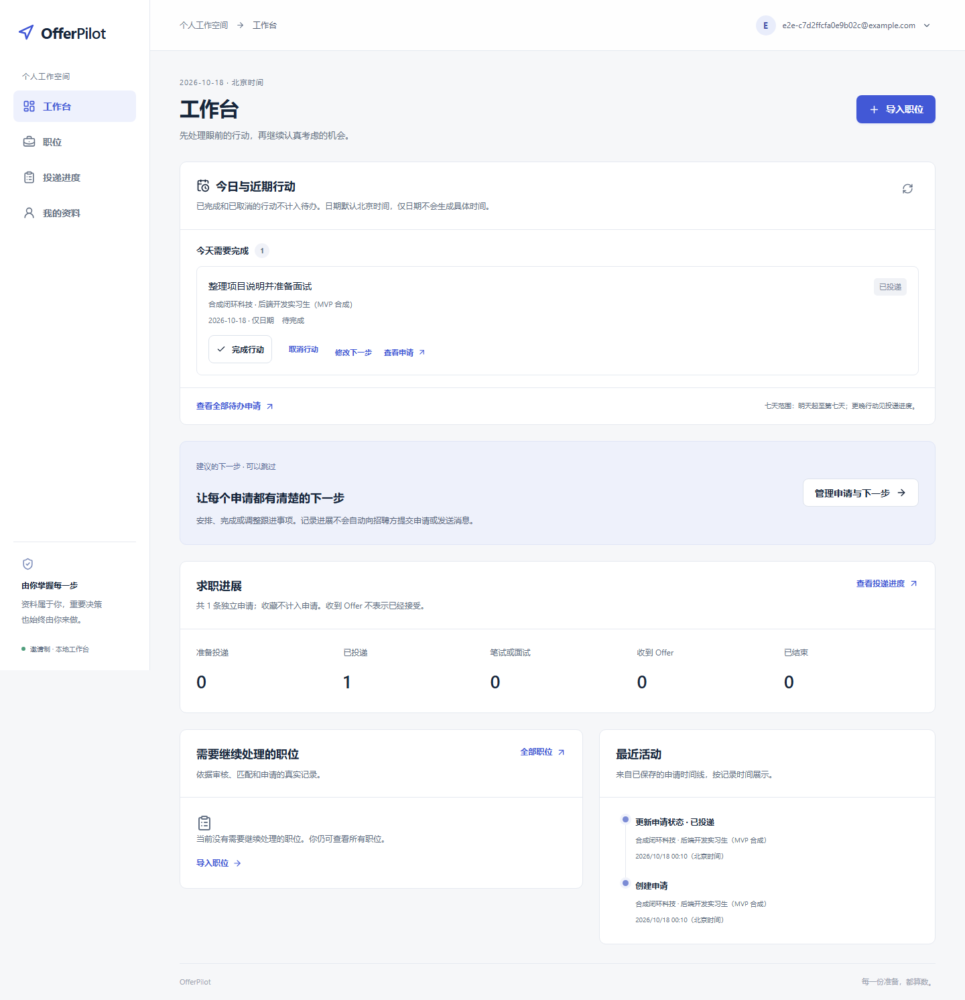
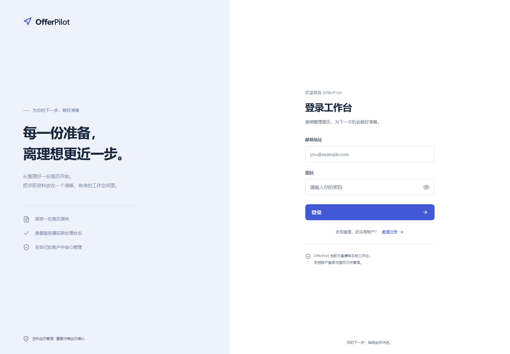
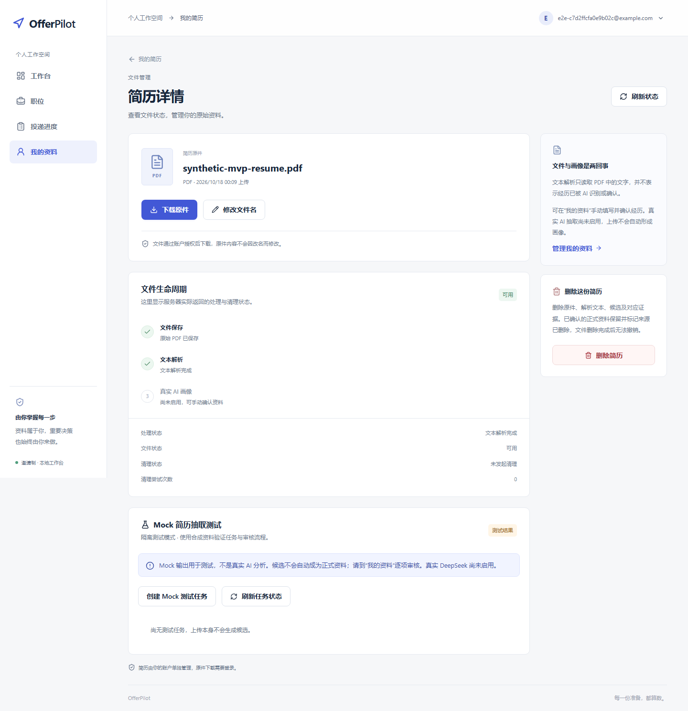
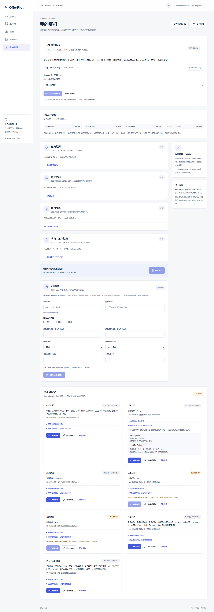
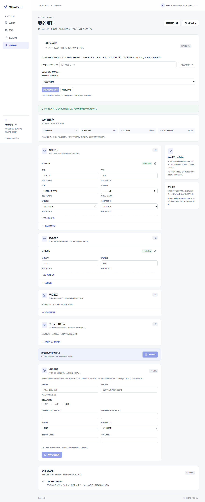
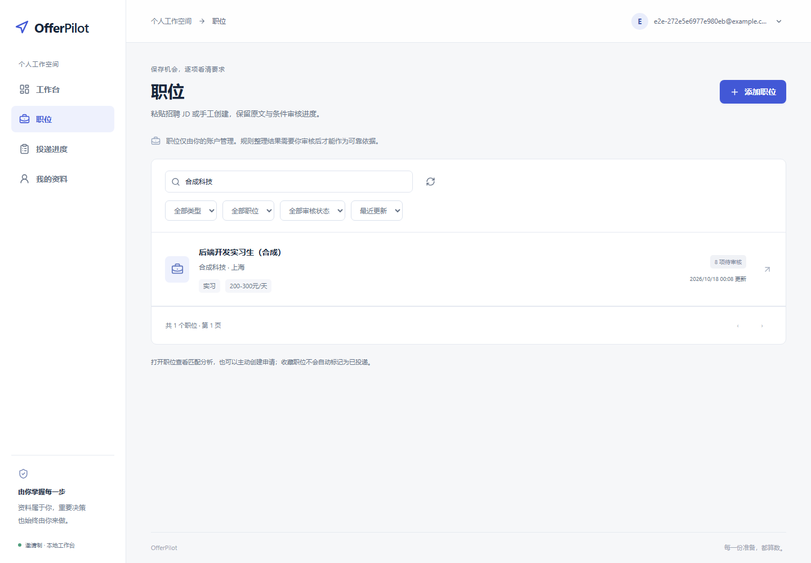
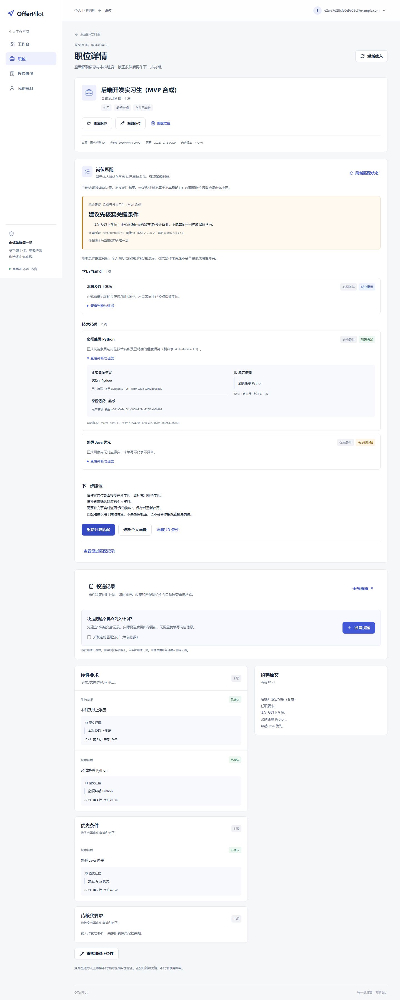
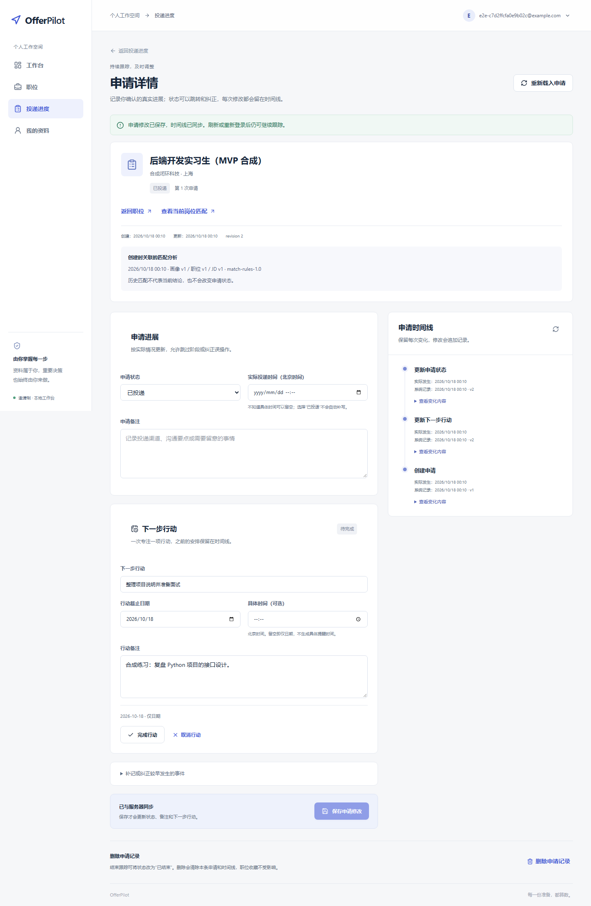
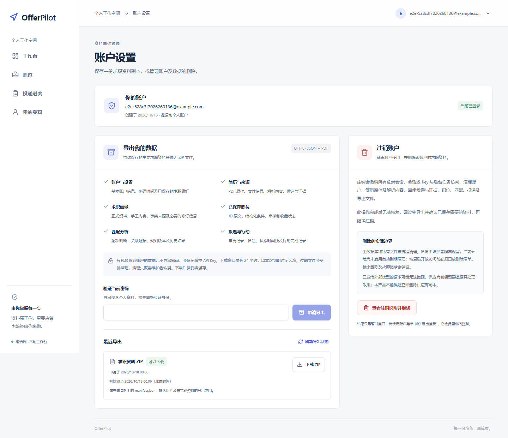
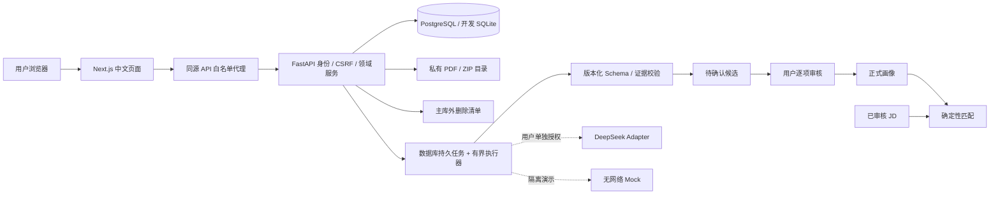

# OfferPilot

[](https://github.com/jayoffans/OfferPilot/actions/workflows/ci.yml)

**基于 FastAPI、Next.js / TypeScript 和 PostgreSQL 的中文 AI 求职工作台。**

OfferPilot 将文本 PDF 简历、个人画像、岗位条件、匹配依据和投递行动放在同一条流程中，帮助求职者整理经历、核对 JD 条件并管理下一步行动。

**核心流程：AI 辅助提取候选信息 → 用户审核证据 → 正式个人画像 → 基于规则的岗位匹配 → 人工管理求职进度。**

完整项目已在 GitHub `main` 分支公开，可下载源码，选择 SQLite 或 PostgreSQL 在本地运行；不需要公网服务器或 DeepSeek Key 即可体验主要业务流程。项目用于技术作品展示、学习交流与面试，没有公网服务、真实用户规模或生产性能承诺。

**岗位选择、事实确认、声明、申请提交和 Offer 决策始终由用户负责。** 项目不自动海投，也不生成未经确认的经历。

[系统截图](#系统截图) · [本地启动](docs/LOCAL_SETUP.md) · [演示路线](docs/DEMO.md) · [测试说明](docs/TESTING.md) · [当前架构](docs/ARCHITECTURE_GUIDE.md) · [面试材料](docs/INTERVIEW.md) · [交付验收](docs/PORTFOLIO-acceptance.md)

## 核心功能

| 功能 | 当前实现 |
|---|---|
| 账户与工作台 | 邀请注册、会话登录/退出、今日/逾期/近期行动、当前申请统计 |
| 简历管理 | 文本 PDF 上传、文本提取、改名、本人原件下载、删除与失败恢复 |
| AI 候选审核 | DeepSeek Adapter、会话 BYOK、发送预览与单次授权；严格 Schema、证据检查、逐项确认/修订/拒绝 |
| 正式画像 | 教育、技能、项目、实习/工作；手工值和审核值区分来源，未知可留空 |
| 职位管理 | 手工录入/粘贴 JD、免费规则整理、必须/优先/待核实条件审核、收藏及版本快照 |
| 可信匹配 | 四态判断、画像与 JD 双侧证据、三类综合提示、历史依据变化后失效 |
| 投递管理 | 用户手工维护八态、备注、下一步行动和追加式时间线；支持多轮申请 |
| 数据生命周期 | 密码重验后导出本人 ZIP；明确确认注销，撤销访问、持久清理及旧备份删除重放 |

以上保留 S1～S5-2 已完成能力，实施证据见各批[验收文档](docs/INDEX.md)。未配置 DeepSeek Key 也能使用手工画像、简历管理、JD 规则整理、匹配、投递和导出。免费候选演示使用明确标识的 **Mock 合成样本**。

## 系统截图

以下均为本机真实 Next.js 页面与 FastAPI 的 Chromium 截图，数据全部合成。AI 候选图来自无网络 Mock，**不代表 DeepSeek 输出或模型质量**。完整页面、复现入口及截图来源见 [DEMO](docs/DEMO.md)。



<details>
<summary>登录、简历、AI 证据审核、画像、职位、匹配、投递和导出</summary>

**登录**



**简历管理**



**AI 候选与证据审核（Mock 测试）**



**个人画像**



**职位管理**



**匹配分析**



**投递管理**



**数据导出**



</details>

## 技术栈与架构

| 层 | 使用的技术 |
|---|---|
| Web | Next.js 16、React 19、TypeScript、Tailwind CSS、Radix UI、Lucide |
| API | Python 3.11、FastAPI、Pydantic / Pydantic Settings |
| 数据 | SQLAlchemy、Alembic 0001～0010；PostgreSQL 18.6 / psycopg 3；development 可选 SQLite |
| 文件与认证 | PyMuPDF 文本提取、私有本地目录、Argon2id、可撤销 opaque 会话、CSRF |
| AI | `LLMProvider` Adapter、DeepSeek、版本化 Prompt / Schema、有限持久任务 |
| 验证 | unittest、真实 PostgreSQL、Vitest / Testing Library、Playwright Chromium、ESLint、TypeScript、OpenAPI 类型生成 |

安装版本以 [uv.lock](backend/uv.lock)、[package-lock.json](frontend/package-lock.json) 和 [Compose 镜像摘要](compose.postgres.yml) 为准。



这是当前落地的模块化单体。没有 Redis、Celery、云对象存储、独立真实模型 Worker 或 Browser Agent；历史目标态不列为已实现能力。[架构导读](docs/ARCHITECTURE_GUIDE.md)解释模块与事务边界，[架构记录](docs/architecture.md)和[数据库设计](docs/database.md)保留历次决策。

## AI 抽取与证据校验

1. 上传阶段只做文件校验和文本提取，不触发付费模型。只支持有可选中文本的 PDF，限制 10 MiB / 50 页。
2. 真实模式中，配置会话 Key、预览脱敏文本、确认外传及费用、创建请求是独立动作。Key 在单 API 进程的限时密文内存中，最长一小时且不超过会话期限；不写业务数据库、日志或浏览器持久存储。
3. 模型结果通过严格 V2 Schema，再检查引文、页段位置、字段值和同条经历归属；否定、学习计划、冲突或缺证据会阻止直接确认。词法校验不证明履历真实，也不保证完整语义理解。
4. 候选全部先进入 `pending`。只有用户确认或明确修订后才能写入正式画像；来源、版本和测试身份持续保留。

真实请求最多一次，SDK/HTTP 不自动重试；取消仍可能已产生供应商费用。退出、换 Key、删除、版本变化和租约失效都会阻止迟到事实写回。2026-10-14 仅完成过一份正常合成 PDF 的授权真实评测，不能推断总体准确率；详见[单样本记录](docs/S2-2B-single-real-evaluation-2026-10-14.md)。本地演示与 CI 均不调用真实付费模型。

## 可信岗位匹配

匹配只消费**正式画像**和**当前 JD 已审核条件**，不消费待确认 AI 候选。纯规则函数不访问网络或模型，输出“明确满足 / 部分满足 / 未发现证据 / 明确不满足”，并给出双侧证据。

综合提示为“存在明确硬性条件冲突 / 建议先核实关键条件 / 可以进一步考虑”。缺少描述不能推断用户没有能力，在读不等同已取得学历；不展示任意 0～100 总分或录用概率。画像、职位、JD 或规则版本变化后，历史结果会显示依据已变；相同依据复用结果，保留历史。[规则设计与验收](docs/S3-2-acceptance.md)

## 持久任务、幂等和错误恢复

运行状态、租约、领取令牌、尝试次数与调用账本保存在数据库。调用模型期间不持数据库写锁；完成时重新校验身份、文件状态、来源版本和令牌，将候选与任务成功状态一次提交。重复创建、重放和过期结果受到唯一约束及版本围栏保护。

申请写入以 owner + revision 更新，业务变更、分类事件与幂等回执同事务提交；409 保留客户端输入供核对。文件通过持久 journal、`.claim` 创建证明和有界补偿处理数据库与磁盘不原子的问题。导出/注销同样采用租约与有限恢复；删除清单独立于主库，防止旧备份恢复后重新开放已注销账户。[任务验收](docs/S2-2A-acceptance.md) · [生命周期验收](docs/S5-2-acceptance.md)

## 用户认证与数据隔离

密码用 Argon2id；会话与邀请只存摘要。HttpOnly / SameSite Cookie 配合 Origin、Fetch Metadata 与 CSRF 校验，退出撤销服务端会话。用户归属由服务端解析，客户端不能指定可信 `user_id`；跨用户和不存在的资源统一返回 404。

Next.js 仅代理明确允许的方法和路径，不接受任意上游地址。PDF 与 ZIP 不由静态 Web 目录公开，下载时重新鉴权并校验完整性。账户导出排除密码摘要、会话、Key 和内部路径；注销先撤销访问再持久清理。逻辑删除不承诺磁盘或备份安全擦除，主库外清单的保留限制见[数据清单](docs/S5-2-data-inventory.md)。

## 本地快速启动

准备 Python 3.11、uv、Node.js 22.12+（22.x）或 24+；PostgreSQL 路线还需 Docker Compose。命令均在仓库根目录执行，Windows 可将 `npm` 换为 `npm.cmd`。

```sh
uv sync --project backend --locked
npm --prefix frontend ci
uv run --locked --project backend python scripts/local/manage.py init --database postgres
uv run --locked --project backend python scripts/local/manage.py seed
uv run --locked --project backend python scripts/local/manage.py status
```

分别在两个终端保持运行：

```sh
uv run --locked --project backend python scripts/local/manage.py api
```

```sh
uv run --locked --project backend python scripts/local/manage.py web
```

打开[本地网页](http://127.0.0.1:3000)，按照 `status` 提示读取本机私有凭据。脚本仅使用 `.local/` 下的隔离演示资料，不覆盖现有 `.env` 或开发库；真实 DeepSeek 关闭。无 Docker 可在全新环境用 `init --database sqlite`。迁移、环境变量示例、合成样本、停止与排障详见 [LOCAL_SETUP](docs/LOCAL_SETUP.md)。

## 测试与 CI

| 检查 | 仓库根目录入口 |
|---|---|
| 后端单元 / SQLite 集成 | `uv run --locked --project backend python -B -m unittest discover -s tests -v` |
| PostgreSQL 集成 | `uv run --locked --project backend python scripts/local/postgres_tests.py`；复用 Compose 和受限角色，详见 [TESTING](docs/TESTING.md) |
| 前端组件 / API | `npm --prefix frontend test` |
| Chromium E2E | `npm --prefix frontend exec -- playwright install chromium`，再 `npm --prefix frontend run test:e2e` |
| 契约 / 静态检查 | `npm --prefix frontend run api:check`、`lint`、`build`、`typecheck`（逐条执行） |
| Git 公开前扫描 | `uv run --locked --project backend python scripts/security_scan.py`；候选需人工复核，见[安全审查](docs/SECURITY_REVIEW.md) |

E2E 自动创建独立数据库、合成账户与文件，启动真实 API / Web，结束清理。不要同时运行 E2E 和 build，它们共用 `.next`。CI 覆盖锁定依赖、SQLite、PostgreSQL、前端和 Chromium，使用无网络模型夹具；浏览器层默认使用 SQLite，PostgreSQL Chromium 保留独立本地入口。

2026-10-20，合并后的 `main`（`c341eb6`）已通过 GitHub Actions 的后端、PostgreSQL、前端 / Chromium 三项任务，见[实际运行结果](https://github.com/jayoffans/OfferPilot/actions/runs/39386760528)。许可与启动的历史检查见[发布准备报告](docs/GITHUB-RELEASE-READY.md)，完整本地回归环境见[作品集验收](docs/PORTFOLIO-acceptance.md)。

## 当前限制与后续计划

仅支持文本 PDF；没有 OCR/DOCX、密码找回/邮箱验证、自动岗位抓取、简历重写、通知派发或浏览器代填。真实 BYOK 仅单进程；模型质量只验证过一个真实合成样本，规则证据检查与 JD 整理都有语义局限。开发 SQLite 不能替代真实 PostgreSQL 的并发测试。

2026-10-19 的[依赖安全审查](docs/GITHUB-DEPENDENCY-REVIEW.md)仍记录 5 项 High 开发依赖告警，生产依赖审计范围内为 0 项；ESLint peer dependency 兼容警告仍在。第三方许可证库存仍需补齐后续锁文件变动，见[许可审查的当前边界](docs/THIRD_PARTY_LICENSES.md)。

后续聚焦仓库规范、技术说明、本地复现、合成演示、测试与面试材料。公网云部署、域名备案、大规模容量、多节点高可用、复杂生产监控、商业化隐私政策和线上试点从当前计划取消；已有安全、隔离与许可要求继续保留。[PLAN](docs/PLAN.md) · [路线图](docs/roadmap.md)

## 仓库与许可

```text
backend/     FastAPI、领域服务、Alembic、模型评测与 uv 锁文件
frontend/    Next.js 页面、OpenAPI 客户端、组件测试、Chromium E2E
tests/       后端回归与 PostgreSQL 专项
scripts/     本地演示、PostgreSQL 隔离验收与安全审查工具
docs/        当前说明、截图、面试稿与 S1～S5-2 历史验收
.github/     GitHub Actions 与贡献模板
```

**OfferPilot 原创代码、配套文档、测试和合成演示素材采用 AGPL-3.0-only。** 完整条款见 [LICENSE](LICENSE)，版权及适用范围见 [COPYRIGHT](COPYRIGHT.md)。负责人已确认相应授权来源；第三方库、图标、工具模板及其原文告知保留各自许可，不由 OfferPilot 重新授权。

PDF 校验和文本提取保留 PyMuPDF 1.28.2 / MuPDF 1.28.2，按上游 AGPL 路径使用。使用、修改和再分发须遵守完整条款，保留版权、许可及无担保声明，并履行适用的对应源码与网络交互告知义务。标准全文末尾的 “or later” 使用示例不改变本项目仅版本 3 的授权选择。当前不部署公网服务，这是维护范围说明，**不是禁止商业使用的附加条款**。许可正式化的历史验证结果见[发布准备报告](docs/GITHUB-RELEASE-READY.md)。

依赖版本、文件级许可差异及分发边界见[第三方许可审查](docs/THIRD_PARTY_LICENSES.md)、[完整依赖清单](docs/DEPENDENCY-LICENSE-INVENTORY.json)、[第三方版权原文](docs/THIRD_PARTY_NOTICES.txt)和[PyMuPDF 文件头补充](docs/PYMUPDF-1.28.2-NOTICES.txt)。

[安全审查](docs/SECURITY_REVIEW.md) · [最终发布检查表](docs/GITHUB-RELEASE-CHECKLIST.md) · [贡献说明](CONTRIBUTING.md)
