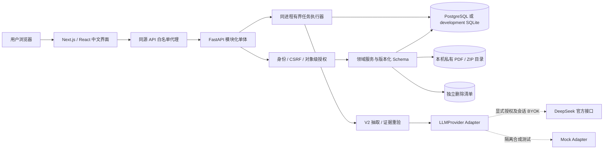
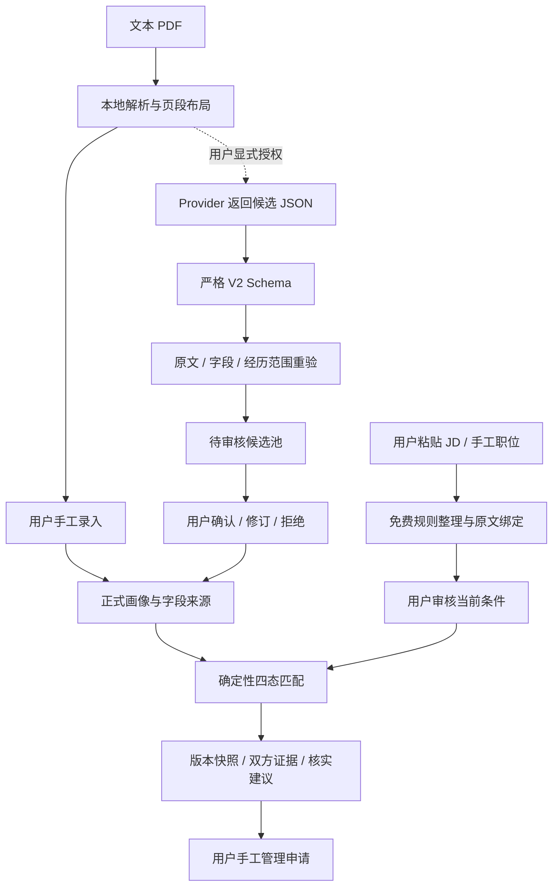

# OfferPilot 当前实现导读

本页用于快速阅读 S1～S5-2 已实现的系统。详细设计见 [architecture.md](architecture.md)，持久化结构以 [数据库说明](database.md)及 `backend/migrations/versions/0001_*`～`0010_*` 为准。旧架构文档保留了 Redis、独立 Worker、云对象存储和 Browser Runner 等目标方案；下图只画当前本地可运行的组件。

## 1. 当前系统图

无 Key 或真实抽取开关关闭时，上传、手工画像、JD 规则整理、匹配、投递、导出和注销仍可使用。常规演示和 CI 不需要外部模型。真实 BYOK Vault 只在当前 API 进程内有效，不是独立密钥服务。数据库迁移由 Alembic 显式执行，应用不会在启动时静默升级业务表。

当前没有 Redis/Celery、向量库、云对象存储、浏览器辅助、通知派发或多节点部署。`browser_assist`、`notifications` 是保留的模块边界，不代表功能已实现。

## 2. 目录与职责

| 入口 | 当前职责 |
|---|---|
| `frontend/src/app`、`src/components` | 页面路由、中文交互、响应式布局和错误/冲突状态 |
| `frontend/src/lib/api.ts`、`proxy.ts` | 生成类型的客户端、内存 CSRF、请求生命周期、代理白名单及边界 |
| `backend/src/offerpilot_api/api/routes` | 认证依赖、请求/响应 Schema 和 HTTP 装配 |
| `identity` | 邀请、密码、随机会话、服务端身份、CSRF 和限流 |
| `resume_ingestion` | 文本 PDF 解析、私有文件生命周期、V2 Schema、证据定位和恢复 |
| `profile` | 正式画像、候选审核、字段来源与共享 revision |
| `job_catalog` | 用户私有职位、JD 快照、条件审核、revision 与创建回执 |
| `job_intelligence` | 免费 JD 规则整理、纯规则匹配、版本化快照及失效判断 |
| `application_tracker` | 手工申请状态、单一当前行动、追加事件、回执和只读工作台 |
| `agent_runtime` | 持久抽取状态机、租约/调用预算、BYOK 和 Provider Adapter |
| `account_lifecycle` | 本人 ZIP 导出、账户撤销与分批清理、独立删除清单/恢复编排 |
| `db`、`backend/migrations` | ORM、连接与受限角色检查、0001～0010向前迁移 |
| `tests`、`tests/postgres`、`frontend/e2e` | 合成数据、错误注入、权限/并发边界及真实浏览器流程 |

前端不访问数据库；路由不承载资格匹配或文件补偿规则。Provider 通过 `LLMProvider` 接入，不提供数据库、任意 URL 或申请提交工具。

## 3. 从候选到可信匹配

候选未确认不得进入正式事实；当前 JD 未审核、待核实或旧版条件不能静默当作明确匹配依据。匹配没有模型请求或总分，只给四态及三种综合建议。偏好、优先条件和必须资格分开处理；无证据保持未知。画像、JD 或规则更新后旧快照动态提示失效，不覆盖历史。

证据护栏只验证文本引用和有界语义风险，不能核验学历/项目真实性。来源简历删除会清候选、原文和历史匹配引用，用户已确认/自行提供的正式值按现有规则保留；账户注销才清整个账户。

## 4. 三类一致性问题

| 问题 | 当前保护 |
|---|---|
| 重复点击、丢响应、并发修改 | owner 范围幂等键/请求摘要、数据库唯一约束、revision 条件更新、409 保留输入 |
| 抽取中断、取消、版本变更 | 持久状态、执行令牌、租约和调用预占；调用不持写锁；最终重验并原子提交候选与成功状态 |
| 数据库与文件无法原子提交 | 持久操作 journal、服务端对象键与 `.claim` 证明、可查询失败、有界补偿和恢复 CLI |

PostgreSQL 的全局任务额度通过短事务 advisory lock 保护，职位配额锁当前用户，首次画像唯一竞争使用 savepoint。SQLite 单写者不能代替这些多连接验证。申请当前状态、追加事件和回执同事务提交；日期行动与明确 UTC 时刻分开，界面使用 Asia/Shanghai。

账户注销的删除意图先写入主库外最小清单并 fsync，再停用身份/会话/任务，最后清理业务表和私有文件。已有账户在清单缺失/损坏时不能继续认证；恢复旧快照时先隔离、挂接最新清单并重放删除。不能用一个新的空清单替代真实清单。

## 5. 读代码与验证的推荐路线

1. 看 `identity/dependencies.py`、`frontend/src/lib/proxy.ts`，确认身份如何跨 Web/API 传递。
2. 看 `profile/schemas.py`、`profile/services.py`，区分候选、正式条目、字段来源与 revision。
3. 看 `resume_ingestion/extraction_schema.py`、`extractor_v2.py`、`evidence.py`，追踪模型结果如何降为待审核候选。
4. 看 `job_intelligence/matching.py` 与 `match_services.py`，区分纯规则计算和授权/事务/快照。
5. 看 `agent_runtime/extraction_runs.py` 和 `tests/postgres/test_auth_runtime.py`，理解准入、令牌、租约与迟到写入围栏。
6. 看 `account_lifecycle`、`tests/postgres/test_account_lifecycle.py` 和 `scripts/postgres/lifecycle_restore.py`，理解删除与旧备份防复活。

测试命令与本次实际结果见仓库 README 和交付验收记录；历史阶段报告用于解释实现演进，不作为远程 CI 成绩。更适合面试的详细问答见 [INTERVIEW.md](INTERVIEW.md)，真实页面演示路线见 [DEMO.md](DEMO.md)。
