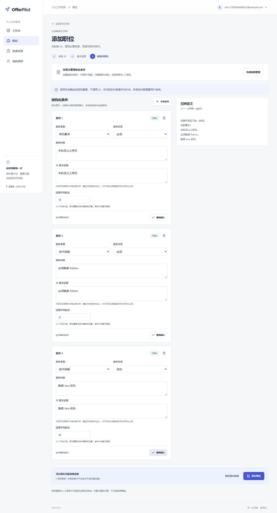

# OfferPilot 本地演示路线

日期：2026-10-18。所有账户、学校、公司、简历、岗位与申请均为合成信息；截图来自真实 Next.js + FastAPI 页面。**候选演示明确使用无网络 Mock，不是 DeepSeek 输出，不代表真实模型准确率。** 本轮不输入真实 Key，不向模型发送请求。

## 1. 准备

按 [LOCAL_SETUP](LOCAL_SETUP.md) 安装锁定依赖、初始化独立数据库和合成种子，再启动 API 与 Web。默认关闭真实模型；无 Key 也能演示手工画像、JD、匹配、投递与导出。合成 PDF 和随机演示凭据仅在忽略的 `.local/` 中生成；不要上传自己的真实简历或替换为真实申请记录。

已有 E2E 可在不保留登录环境的情况下完整重现页面操作，截图流程见第 4 节。下面图片来自独立 E2E 场景，不假设所有图片属于同一账户或同一条申请。随机 `e2e-…@example.com` 是测试身份，不是真实联系方式。

## 2. 建议现场路线（约 8～10 分钟）

| 顺序 | 页面/动作 | 讲解重点 |
|---|---|---|
| 1 | `/login` 登录 → `/` 工作台 | 会话登录、行动分组、收藏不算申请；今日日期按北京时间 |
| 2 | 账户菜单 → 简历管理 → 简历详情 | PDF 验证、文本提取、本人下载；上传不触发 AI |
| 3 | `/profile` 正式画像 | 可手工完成，未知留空；用户填写与候选审核来源分开 |
| 4 | 单独展示合成 Mock 候选 → 展开证据 | 先声明 Mock；定位由服务器重验，否定/计划不能原值确认，pending 不参与匹配 |
| 5 | `/jobs` → 添加职位 → 粘贴合成 JD → 免费规则整理 | 全部先待审核，必须/优先/待核实分开；保存链接不抓取网页 |
| 6 | 确认适用条件 → 保存 → 匹配 → 展开证据 | 纯规则四态，无证据不等于不具备；双侧依据、没有录用概率 |
| 7 | 修改正式资料 → 回职位看旧匹配失效 | revision 与版本快照，主动重算而非静默改历史 |
| 8 | 准备投递 → 修改状态与日期行动 → 工作台完成 | 人工记录实际投递，未知时刻保持空；时间线追加、幂等与冲突 |
| 9 | 账户菜单 → 账户设置 → 密码重验 → 导出 ZIP | 白名单导出、私有鉴权下载、manifest 及遗漏说明 |

注销会清空演示账户，不作为普通演示必点步骤；可讲解 S5-2 的真实清理测试与主库外删除清单。现场需要重复体验时使用新的隔离演示环境，不尝试用旧数据库备份绕过删除清单。

### 招聘展示短片分镜（80 秒）

以下是上面路线的精简录制/排练脚本。先用 [本地工具](../scripts/local/manage.py) 在独立 profile 播种合成数据并登录，准备工作台、我的资料、任一合成职位及其申请详情。种子已包含手工正式画像、已审核 JD、规则匹配和三条合成申请；Mock 候选保持待确认，短片中只展开证据，不执行确认。工作台日期随实际时间变化，旧种子的“今日”行动可能已归为逾期，按界面实际分组讲解。

| 时间 / 预计秒数 | 镜头与实际操作 | 讲解词 |
|---|---|---|
| 00–08 / 8 秒 | 工作台，指向当前行动和申请统计；参考 [工作台截图](images/demo/workbench.png) | “OfferPilot 把资料审核、岗位判断和申请下一步放在同一个本地工作台。所有数据均为合成。” |
| 08–17 / 9 秒 | 我的资料，展示手工保存的教育与 Python 技能，以及“用户填写”来源；参考 [正式画像截图](images/demo/profile.png) | “正式画像由用户填写或审核后建立，未知字段保持空白。” |
| 17–29 / 12 秒 | 同页待审核事实，保留 Mock 测试标识和待确认状态，展开一项原文证据；参考 [Mock 候选截图](images/demo/candidates-mock.png) | “这里是无网络 Mock 的测试候选。证据可展开，未确认候选不进入正式画像，也不参与匹配。” |
| 29–40 / 11 秒 | 职位详情，展示合成 JD、已确认的必须/优先条件及原文引用；参考 [JD 审核截图](images/demo/jd-review.png) | “岗位来自粘贴的合成 JD，免费规则先整理条件，再由用户审核；保存来源链接不抓取网页。” |
| 40–55 / 15 秒 | 同一职位的岗位匹配，展开 Python 的“查看判断与证据”，同时指向本科和 Java 条件；参考 [匹配截图](images/demo/matching.png) | “匹配是确定性规则，展示画像与 JD 双侧证据。Python 明确满足，本科在读仅部分满足，Java 未发现证据；缺描述不等于不会。” |
| 55–69 / 14 秒 | “继续跟踪申请”进入该职位已有的合成申请，修改下一步并保存，展示新增时间线；参考 [申请截图](images/demo/application.png) | “这里记录合成申请的状态和下一步，我手动保存调整后可在时间线回看。它不会向招聘方提交申请。” |
| 69–80 / 11 秒 | 账户设置，展示已就绪导出及“下载 ZIP”；参考 [导出截图](images/demo/export.png) | “本人数据导出要求密码重验，ZIP 带范围清单；这里展示的是可复现流程，不是模型准确率。” |

录制前真实完成导出的密码重验，凭据文件、登录输入及密码操作不入镜；等待导出就绪可剪辑，并用“导出就绪后”字幕标明切点。其余操作使用正在运行的真实页面，保留 Mock 和合成数据标识，不用静态截图假装点击成功；上面的图片只用于核对取景。七个镜头合计 80 秒，可用页面切换处的剪辑控制节奏。短片保留原路线的事实边界，revision 失效等工程细节留到面试追问时展开。

## 3. 截图清单

### 登录与工作台


### 简历管理


### AI 候选与证据审核（Mock）


图片来自登记合成 PDF 的 Mock Adapter。真实 DeepSeek 只可引用注明日期的[历史单样本报告](S2-2B-single-real-evaluation-2026-10-14.md)，本轮没有重新调用模型，不能把截图当作其真实返回。

### 正式画像


### 职位与 JD 审核




### 匹配分析


### 投递管理


### 本人数据导出


### 移动端


## 4. 重新生成与核对

在仓库根目录执行（Windows 使用 `npm.cmd`）：

```sh
npm --prefix frontend exec -- playwright install chromium
npm --prefix frontend run test:e2e
uv run --locked --project backend python scripts/collect_demo.py
uv run --locked --project backend python scripts/collect_demo.py --check
```

运行全套 E2E 会新建临时库、合成账户和文件，启动本机 8001/3001 的真实 API/Web，结束清理；端口占用则拒绝复用已有服务。测试中只有模型/故障注入使用免费夹具，页面、认证、业务持久化、匹配与导出均走真实代码。不要与 build 或另一个 E2E 进程并发写 `.next`。

收录脚本只复制固定的 11 张 PNG，不修改图片，也不复制登录输入、Key 对话框或 ZIP。来源路径、对应测试、宽高、大小与 SHA-256 见 [manifest.json](images/demo/manifest.json)。本批已逐张检查合成身份、空密码框、Mock 标签和布局；以后重生成仍须人工复核再提交。脚本的哈希检查只能证明文件一致，不能代替隐私审查。

原始运行截图仍留在忽略的 `frontend/artifacts/`；公开内容仅为本页固定清单。保留全页图片，未用生成图或 UI 改图包装功能。
