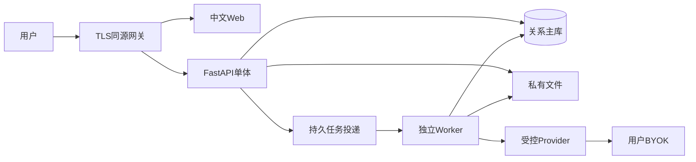

# OfferPilot 产品级开发总计划

**审查日期：2026-10-11**  
**审查基线：`feature/resume-agent`，`9ec576d06867a3d44eeaa255e03302f80d9faf8e`**  
**文档版本：1.1（保留历史记录，追加 S4-1 申请管理）**

**当前执行范围（2026-10-15）：S4-1 真实求职申请管理。** 开始时分支为 `codex/s3-1-job-management`，保留全部未提交 S3-2 成果为本地检查点 `290a988`，在 `codex/s4-1-application-tracker` 继续。复用正式画像、私有职位、可信匹配、身份/CSRF 和中文设计系统，实现独立申请、手工状态、备注、下一步行动及真实历史。只迁移隔离测试库，不调用 DeepSeek、不抓取、不自动投递、不推送或部署；完成后立即停止，不进入 S4-2。实际验证与限制见 [S4-1 验收](S4-1-acceptance.md)。[S3-1](S3-1-acceptance.md)、[S3-2](S3-2-acceptance.md) 及下文早期范围保留为历史记录。

本文保存上轮产品级审查与十四节开发总计划，并按本轮要求纠正过早确定的选型。第 2 节是 **S1-1 开发前快照**，其中代码证据指上述提交，不将历史判断改写为当前实现。本轮进展在末尾单独记录。产品行为以同步修正的 PRD 为准；既有架构、数据库和抽取设计保留有效内容。

**已确认方向：** 邀请制试用、中国大陆部署方向、首批软件与计算机方向、用户 BYOK、Key 仅当前会话保存、保留 PyMuPDF 并走 AGPL 发布路径。上述方向不表示供应商条件、部署许可或法律适用已经验证。

**历史 S2-2B 批次唯一功能范围： 真实 DeepSeek 集成代码、会话 BYOK、独立授权和中文解析流程。** 用户授权开发与免费验证，明确禁止本轮自行付费调用。复用 S2-2A；该批工作保存本地检查点 `78aecf8`，没有推送。当前状态是允许范围内开发/免费验收完成，**真实调用待验收**，不能宣称 S2-2B 全部完成或公开上线。生产默认关闭；不迁移实际数据库、不部署、不进入 S3/Browser。详细结果见末尾及 [S2-2B 验收](S2-2B-acceptance.md)。此前批次判断保留为历史记录。

**历史 S2-2B 追加审查范围：** S2-2B 正式模型验收准备与兼容性/安全/质量审查，禁止任何付费调用。保留上述有效开发内容；最小完善 Provider、Prompt 及五份合成白名单评测，完成全部免费验证后保存本地检查点，不推送。判断与后续授权入口以 [准备报告](S2-2B-readiness-review.md) 为准，历史验收数字保留；实际 DeepSeek 请求仍为 0，完成本轮后停止。

## 1. Executive Summary：项目总体判断

审查基线属于 **本地后端技术原型阶段**：已有受限 PDF 上传、数据库骨架和可测试的简历抽取核心，但抽取尚未接通上传 API 和持久化，没有前端、账户、画像确认、岗位分析、匹配或投递管理，不能描述为可供真实用户使用的 AI 求职平台。

三个核心问题：

1. **现在是什么阶段？** 已有真实身份、私有 PDF 生命周期、中文工作台与 S2-1 可信画像管理。已有 Mock V2 及本机 DeepSeek/BYOK/授权代码和中文审核闭环；真实调用与质量待验收，岗位闭环未实现。
2. **距离真实用户 MVP 缺什么？** 完整账户数据导出/注销及上线加固、可信画像确认、必要的持久任务、JD 导入及审核、确定性匹配、投递管理，以及生产隐私/质量/部署验证。文件管理闭环不能代替这些产品流程。
3. **下一轮首先开发什么？** 本轮完成 S2-2B 允许范围的免费验收后停止。下一步需负责人进一步明确授权真实模型评测，确认供应商 BYOK、API 保留/训练配置及实际质量；账户生命周期、解析隔离和上线安全仍是公开试点前条件。

保留现有后端，局部补齐领域模型和安全边界。模块化单体与同仓独立 Worker 是后续建议，不拆微服务、不引入复杂多 Agent 框架。原 PRD 的 MVP 过大，Browser、DOCX、自动抓取、简历重写和提醒派发移出首发门槛。

首发验证 **上传简历 → 确认事实 → 导入 JD → 理解匹配依据 → 保存岗位 → 管理下一步**。

### 决策状态表

| 项目 | 状态 | 约束及验证门槛 |
|---|---|---|
| 邀请制、大陆方向、CS 首批 | 用户已确认 | 具体主体、区域、试点年龄和人数仍需上线前确认 |
| BYOK、会话保存 | S2-2B 单进程本地实现 | 代理使用许可、API保留/训练退出及生产密钥方案待审核 |
| PyMuPDF / AGPL | 用户已确认路径 | 许可组合义务、源码范围和发布材料需核实 |
| FastAPI、Pydantic、SQLAlchemy/Alembic | 现有实现，继续复用 | 不无故替换或改历史迁移 |
| Argon2id、服务端可撤销会话 | S1-1 实施选择 | 成熟依赖，验证密码、会话、CSRF 和日志边界 |
| Next.js / Tailwind / Radix | S1-3 已实施，版本锁定 | 同源代理、严格 TS、真实 OpenAPI 类型；本机 Chromium 与三种宽度已验证，详见 frontend/DESIGN.md |
| PostgreSQL 18 / psycopg | 建议、待数据库批次决策 | 版本/托管支持/升级成本需核实；本轮隔离 SQLite 测试 |
| Celery + Redis | 建议、待持久任务批次决策 | 不能本轮提前搭建；评估实际任务与运维负担 |
| S3 / COS、Caddy、单机 Compose | 建议、待部署决策 | 不指定必须购买的云商或 SKU；先报价及安全演练 |
| 并发、额度、期限、RPO/RTO | 初始假设 | 不是当前 SLA；经成本、隐私、合规和恢复验证后批准 |
| 质量与试点数值 | 试点假设 | 明确样本和分母，不是当前成绩或行业标准 |

## 2. Current State：代码审查结果

### 2.1 仓库与历史（开发前基线）

- 三个提交：初始化 `ca9db6f`、简历抽取核心 `0a19fb6`、DeepSeek 校验与诊断 `9ec576d`。
- 远程只读核查：功能分支同样指向 `9ec576d`；`main` 仍指向初始化提交。后续应保留当前功能分支实现，避免从旧 main 丢失能力。
- 已阅读四份基础文档、抽取设计、依赖锁文件、迁移、代码、测试及评估记录。
- 本地 SQLite 只读核查存在三张业务表和 Alembic 版本表，未读取个人数据记录。
- `frontend/` 仅 `.gitkeep`；未发现 README、CI、Docker、Compose 或前端依赖清单。

### 2.2 能力核实与证据

以下路径和行号均属于审查基线；开发后行号会变化，应结合提交查看。

| 状态 | 能力及边界 | 基线文件证据 |
|---|---|---|
| 已实现 | FastAPI 仅注册 `/health` 和 `/resume/upload` | `backend/src/offerpilot_api/main.py:10` |
| 已实现 | 健康检查验证数据库连接，不验证业务表和迁移完整性 | `backend/src/offerpilot_api/api/routes/health.py:21` |
| 已实现 | PDF 名称/扩展名/MIME/文件头校验，10 MiB、50 页限制，拒绝加密与无文本 PDF | `backend/src/offerpilot_api/services/resume.py:16`、`:66` |
| 已实现 | 本地原件和文本保存；失败回滚并尝试清理 | `backend/src/offerpilot_api/services/resume.py:92` |
| 已实现 | 三表、UUID、关系/约束和初始迁移 | `backend/src/offerpilot_api/db/models.py:15`；`backend/migrations/versions/0001_resume_intelligence.py:16` |
| 已实现 | 姓名、教育片段、技能、项目片段四字段候选 Schema | `backend/src/offerpilot_api/resume_ingestion/extraction_schema.py:23` |
| 已实现 | Adapter、JSON、本地 Schema、子串证据检查和两次调用上限 | `backend/src/offerpilot_api/resume_ingestion/extractor.py:149` |
| 已实现 | 固定 DeepSeek 服务地址、单次超时、输出限制、关闭 SDK 重试、脱敏诊断 | `backend/src/offerpilot_api/agent_runtime/providers/deepseek.py:54` |
| 部分 | 画像和事实是存储骨架，无归属、确认状态、版本及修订流程 | `backend/src/offerpilot_api/db/models.py:32`、`:58` |
| 部分 | 上传和抽取分别存在，上传不调用模型、不生成画像 | `backend/src/offerpilot_api/services/resume.py:100`；`docs/resume-extraction-design.md:3` |
| 部分 | 有真实 API 评估 CLI，但记录明确未发真实请求、质量未测 | `backend/evaluations/evaluation.md:22` |
| 未实现 | 账户、对象授权、生命周期、生产存储、持久任务、岗位/匹配/投递、提醒、Browser | 基线路由、模型和完整文件清单 |

### 2.3 上轮只读验证

- 抽取 Mock **14/14 通过**；PDF 上传 **5/5 通过**。
- 迁移测试未运行，因为上轮禁止执行迁移；本轮允许隔离数据库验证。
- OpenAPI 实际仅有 `/health`、`/resume/upload`。
- 合成反例 `Not proficient in Java` 引用为证据，技能 `Java` 仍通过子串校验。
- TestClient 有 httpx 弃用提示，不影响当次结果，需要后续兼容验证。
- 未执行真实模型、生产部署、权限隔离、前端 E2E 或依赖漏洞扫描。

依据：`tests/test_resume_extraction.py:90`、`tests/test_resume_upload.py:49`、`tests/test_resume_models.py:18`、`extractor.py:141`。局部测试通过不证明产品或 AI 质量已达标。

### 2.4 技术债与上线阻塞

| 优先级 | 问题 | 要求 |
|---|---|---|
| 发布阻塞 | 无身份、归属和对象授权 | 服务端身份及双用户隔离 |
| 发布阻塞 | 无界面和核心闭环 | 可操作的垂直切片 |
| 发布阻塞 | 本地文件/文本无正式导出删除 | 私有存储和生命周期验收 |
| 发布阻塞 | production 上传明确 503 | 保留保护，通过安全条件再开放 |
| 高 | 原生 PDF 解析在请求进程、无资源隔离 | 受限 Worker 子进程 |
| 高 | 大小校验在应用处理阶段 | 网关限额、上传配额/限流 |
| 高 | 子串不理解否定、冲突、归属 | 审核与语义反例评测 |
| 高 | 无持久任务、恢复、幂等和预算 | 运行与调用账本、有限重试 |
| 高，待验证 | SQL 异常链潜在泄露参数 | 参数隐藏、全局安全错误和日志验证 |
| 中 | 文本解析百万字符、抽取五万字符不一致 | 明确范围错误，禁止静默截断 |
| 中 | 文件清理失败被吞掉 | 可重试补偿、失败状态及孤立对象巡检 |

基线证据：`api/routes/resume.py:31`、`services/resume.py:118`、`resume_ingestion/extractor.py:141`。这是上线边界缺失，不代表已经发生攻击。

旧 `docs/PRD.md:106` 把 Browser 列 P0，旧 `docs/roadmap.md:76` 同时称其非前置并要求发布包含它。同步修正范围，但保留后续技术设计。

## 3. Product Vision：产品定位和价值

默认中文的个人求职工作台，帮助大陆学生及初级求职者整理真实经历、理解岗位条件、作出有依据的判断并管理行动。首批聚焦软件/计算机的实习、校招和初级技术岗，暂不宣称多专业质量已验证。先以成年参与者试点的建议需招募时确认。

场景：将 PDF 事实整理为可确认资料；判断哪些条件满足/待核实；保存岗位与下一步；后续改善真实经历表达及准备材料。

| 指标 | 试点假设 |
|---|---:|
| 无开发者代操作完成闭环 | ≥80% |
| 第一条完整闭环中位时间 | ≤15 分钟 |
| JD 分析基本可用 | ≥80% |
| 匹配解释有帮助 | ≥75% |
| 关键判断有证据或明确用户输入 | 100% |
| 未授权确认、越权、Agent 提交 | 0 次 |
| 持续求职者两周内再次管理岗位 | ≥50%，方向性信号 |

这些数值待标注集和试点校准。Offer 数量、录用率、Agent 数量不作为 MVP 主要指标。独立测 BYOK 配置完成率，避免把 Key 流失误判为产品无价值。

## 4. User Journey：用户核心流程

1. 邀请注册登录，阅读必要数据说明；不先填完整问卷。
2. 上传文本 PDF，显示排队、处理中和明确失败原因。
3. 对照证据确认、修改、拒绝或补充事实；可保存继续，未知不强迫填写。
4. 使用 AI 时提供会话 Key、预览发送文本并确认自己的费用；无 Key 可手工建资料。
5. 粘贴 JD，记录来源链接但不抓取；审核必须/优先及结构化条件。
6. 查看资格、技能/经历、偏好、未知项；展开画像证据和 JD 原文。
7. 收藏或准备投递，设状态、备注和下一步时间。
8. 每日工作台优先显示逾期、今日和七天行动；用户人工更新结果。

刷新/重登录恢复保存状态；AI 失败不伪装成功，提供手工入口。画像/JD 变更后旧匹配标依据已变。删除中立即撤销访问，清理状态可查。

## 5. MVP Scope：首发功能范围

### 必须交付的完整 MVP（不是本轮范围）

- 邀请注册/登录/退出、会话失效、恢复及账户删除；完整用户隔离。
- 私有 PDF 上传/列表/下载/状态/删除，数据导出。
- 最小结构化教育、学历、专业、毕业时间、技能、项目、实习/工作证据。
- 候选确认/编辑/拒绝、手工补充、当前画像 revision。
- 会话 BYOK、发送预览、显式调用授权及限额。
- JD 粘贴、手工录入、来源链接记录、条件审核。
- 可复算四态匹配、证据解释和收藏。
- 人工投递状态、备注、时间线、下一步、工作台。
- 中文响应式页面、完整反馈状态、核心 E2E、发布和故障手册。

### 明确后置

链接自动访问、招聘站采集、共享岗位流；Browser/自动提交/自动消息；DOCX/OCR；简历排版/重写/PDF生成；聊天首页/题库；业务邮件日历提醒/自动状态；复杂版本比较、向量库、学校协作；任意厂商/base URL/长期 Key 托管。账户验证/恢复邮件属于身份能力，但 S1-1 不提前实现其投递系统。

| 能力 | 价值 | 难度 | 依赖 | 排期 |
|---|---|---|---|---|
| 事实整理确认 | 高 | 高 | 身份、文件、证据、任务 | MVP |
| JD 与匹配 | 高 | 高 | 确认画像/JD | MVP |
| 进度和行动列表 | 高 | 中 | 用户、岗位 | MVP |
| 定向简历建议 | 高 | 中高 | 可信事实/匹配 | 后续 |
| 沟通草稿/技能准备 | 中高 | 中 | 事实与复核 | 按反馈 |
| 提醒/多版本 | 中 | 中 | 稳定跟踪 | 后续 |
| 来源连接器 | 待验证 | 高 | 许可与维护 | 独立评估 |
| Browser | 潜在高 | 很高 | 许可、隔离、窄权限 | 独立试点 |

## 6. Product Architecture：产品信息架构

导航：工作台、职位、投递进度、我的资料；账户在用户菜单。AI 嵌入任务，不设聊天首页。

| 页面 | 内容 | 主行动 |
|---|---|---|
| 工作台 | 逾期/今日、七天、少量计数 | 完成下一步/继续流程 |
| 我的资料 | 画像、偏好、文件/状态 | 上传/审核/补充/删除 |
| 资料审核 | 候选/证据/状态 | 确认/修改/拒绝 |
| 职位列表 | 公司/岗位/城市/状态 | 导入/筛选/查看 |
| 职位详情 | JD/条件/匹配/来源时间 | 校正/重算/准备 |
| 投递进度 | 状态/行动/更新时间 | 更新/安排 |
| 投递详情 | 备注/材料/时间线 | 记录进展 |
| 账户 | 会话Key/说明/生命周期 | 撤销/导出/删除 |

收藏不等于申请。状态复用 `preparing/submitted/assessment/interview/offer/rejected/withdrawn/closed`，人工可纠正，不强制线性。“等待回复”是已投递说明，Offer 不代表已接受。

## 7. Technical Architecture：技术架构

### 7.1 保留与模块边界

保留 FastAPI/Pydantic、SQLAlchemy/Alembic、上传校验、Adapter 和有效测试。领域用例不能散入路由/Prompt。

- identity：账户、邀请、会话、当前用户、授权。
- profile：确认事实、画像、偏好、版本。
- resume_ingestion：文件/页段、候选和证据；S1-1/S1-2 已提供归属及生命周期，本轮 Web 复用现有 API。
- job_catalog：用户私有岗位、快照、来源。
- job_intelligence：条件、规则、后续建议。
- application_tracker：状态/事件/下一步。
- agent_runtime：后续运行、预算、Provider；不是本轮任务框架。
- notifications、browser_assist：需求成立再启用。

### 7.2 推荐选型（未验证项不锁定）

| 层 | 推荐 | 原因/待验证 |
|---|---|---|
| Web | Next.js/TypeScript、Tailwind、Radix（S1-3 已实现） | 领域留 API；同源代理、生成契约、真实 E2E 已验证 |
| API | 现有 FastAPI/Pydantic | 复用 Python 和 OpenAPI |
| DB | PostgreSQL，18为候选，psycopg | 并发/事务；版本和托管需核实 |
| 长任务 | Celery/Redis候选，DB存状态 | 避免自建通用调度；运维成本待验证 |
| 文件 | 私有S3兼容，COS为候选 | 接口/同区域/删除需实测 |
| PDF | PyMuPDF + Adapter | 不无证据替换；AGPL发布义务需落实 |
| 部署 | 大陆Linux/Compose/TLS，Caddy候选 | 适合邀请规模，单机风险需批准 |
| 观测 | 脱敏日志、request/run ID、关键指标 | 先能排障，不先搭完整观测平台 |

新增依赖须解决明确问题、说明维护和成本并锁定。S1-1 增加密码散列依赖；S1-3 前端依赖与成本见 `frontend/DESIGN.md` 和锁文件。DB/队列/云存储选型仍未实施。

官方依据： [PostgreSQL政策](https://www.postgresql.org/support/versioning/)、[Next.js自托管](https://nextjs.org/docs/app/guides/self-hosting/)、[COS S3兼容](https://cloud.tencent.com/document/faq/436/50743)。这些支持能力，不代表本项目集成已经通过。

### 7.3 后续目标数据流

浏览器同源访问；Web不直连DB；API/Worker同仓分进程、最小权限。主库/队列不开放公网。local/staging/production隔离；生产缺配置不能默认为开发。临时Key区不进入持久化/备份。

单机私网DB加另一故障域备份是封闭试点候选，公开注册前评估托管；不是无需验证的强制采购方案。

### 7.4 API方向

统一 `/api/v1`，API是身份和领域唯一权威。接口组：`auth/*`、`me`、`resumes`、`runs/{id}`、`profile/*`、`jobs/*`、`jobs/{id}/matches`、`applications/*`、`me/model-session`、`me/export`、`me/deletion`。

服务端派生归属；长任务202+ID；显式Schema/安全错误；跨用户404、匿名401；上传/任务幂等；编辑版本冲突409；OpenAPI生成前端类型并检查漂移。原上传保护保留，不能删除503直接开放公网。

## 8. Data & AI Design：数据和AI设计

### 8.1 数据演进

不改0001，以新迁移扩展。旧无归属记录隔离，不分给首个用户，也不自动搬生产；历史事实不推断为confirmed。

| 实体 | 目标 |
|---|---|
| 用户/会话/邀请 | 最小身份；一次性和会话Token仅散列 |
| resume_documents | owner、对象键、大小/哈希/状态/生命周期 |
| 现有profiles | 文档解析容器；不混用为当前用户画像 |
| 现有profile_facts | 候选状态、运行、位置、版本 |
| 用户当前画像/确认事实 | revision/偏好，引用候选或人工输入 |
| 运行/调用/outbox | 幂等、投递补偿、预算，无Key或正文日志 |
| 私有岗位/分析 | JD快照、条件、审核版本和证据 |
| 匹配 | 画像/JD revision、规则和逐项结果 |
| 申请/事件 | 状态、备注、材料引用和行动 |
| 生命周期/审计 | 清理状态与最小安全信息 |

S2-1 使用 career_profiles / career_profile_entries / profile_candidates 三表，具体字段及旧三表边界见 database；未实现的运行/匹配/账户生命周期不视为当前事实。确认值唯一权威，重跑不覆盖。UTC存储、Asia/Shanghai默认展示；年月不制造日期。来源简历删除清证据/候选、推进revision，用户正式值保留并明确标记，独立手工资料保留。

### 8.2 AI边界

AI抽取候选及后续证据约束建议；代码负责授权、条件比较、分级、状态、幂等、预算和工具权限。

V2建议覆盖学校/学历及完成状态/专业/毕业时间、技能、项目/实习/工作角色与时间；每叶子有证据，未知null/空。姓名/联系方式不是匹配前置，不要求模型抽取。

服务端页段/字符映射定位；不信任模型偏移/路径。否定、计划学习、冲突、归属不明待核实。confidence只辅助核对，不是事实概率，不自动确认。

### 8.3 匹配v1

不显示0–100总分。每要求输出明确满足、部分满足、未发现证据、明确不满足，附理由、确认事实、JD证据和规则版本。

- 只有明确条件与确认事实冲突才不满足；技能缺写/日期未知/相关专业歧义留未知。
- 优先不升级必须；模型不定权重。
- 学历区分完成/在读；届别按确认年份/范围；实习不自动折全职年限。
- 技能精确或版本化别名，不把Java当JavaScript、不推断水平。
- 偏好独立；薪资单位不明留未知；复合条件逻辑含糊不强判。

综合模板：存在明确硬条件冲突 / 先核实关键条件 / 可进一步考虑。不代表录用概率、不隐藏岗位；技能另列覆盖证据数量与待核实项。

### 8.4 后续持久工作流

固定流水线，`queued/running/succeeded/failed/cancelled`与审核状态分开。DB事务创建运行/outbox；投递有限重试；领取校验owner/删除/版本，重复消息不重复落库。

初始建议参数（实际批次前须实测和批准）：PDF子进程30秒并限CPU/内存；AI单次30秒、每运行最多2次实调、总120秒；输入五万字符，输出4096tokens，超限/截断明确失败。认证/余额/参数错误不重试；瞬态/Schema修复共享预算；SDK不叠重试。未知收费结果不自动重发，取消/删除后的迟到结果不写回。

用户并发1、日分析20、全局并发2是试点建议，非已验证承诺。无法查询费用时显示调用上限/token实耗，不虚构金额。[Celery任务说明](https://docs.celeryq.dev/en/stable/userguide/tasks.html)不能代替业务幂等，需重复投递/崩溃测试。

### 8.5 会话BYOK与最小数据

仅受控现有Provider/官方地址，不接受任意base URL。TLS提交、成熟库加密、绑定用户/会话，退出撤销到期清理。临时Redis区是候选方案，需S2评审；一小时TTL为假设。Key不进DB/消息/日志/浏览器持久存储/模型上下文。Worker取引用并重新授权；失效重输，不回退开发者Key。创建会话不隐式收费，分析显式触发。无Key手工继续、无假结果。

发送前预览必要文本，排除直接姓名/邮箱/电话及无关链接，保存原文映射。BYOK只改付款方，不免个人数据责任；API保留/训练/委托及代理Key使用需单独确认，不从消费端设置推断零保留。[DeepSeek隐私政策](https://cdn.deepseek.com/policies/zh-CN/deepseek-privacy-policy.html)。JSON/非思考参数在审查时有官方依据，但仍需Schema/业务校验：[JSON Output](https://api-docs.deepseek.com/guides/json_mode/)、[Thinking Mode](https://api-docs.deepseek.com/guides/thinking_mode/)。

## 9. UI/UX Design Direction：界面设计方向

安静中文界面，中性色、单一主强调色、统一字号/间距、清晰边界。列表/表单/时间线/证据对照优先，不卡片堆叠。

- 桌面字段证据并排，手机上下；工作台按紧迫行动组织。
- 明确标签、就地错误、未保存提示；保存/事实确认/调用授权分开。
- 所有处理有真实排队/运行/成功/失败/取消/删除中状态。
- 空状态按真实进度引导上传、导入JD、安排下一步，不用假数据。
- 四态有文字/图标，不只颜色；键盘、焦点、弹窗和可访问异步反馈。
- 建议检验1440/768/390宽度，主要行动不横向滚动，尺寸待设计验证。
- AI候选显式标来源；用户确认不暗示系统核验履历真实性。
- 原件鉴权附件下载，不先做复杂编辑器。

审查基线没有页面。S1-3 已实际打开本机页面并审查登录、注册、空/有数据工作台、简历列表/详情和弹窗；1440/768/390 宽度无主要内容横向溢出，已修复移动布局与焦点恢复问题。24 张合成数据截图及检查范围见 [验收记录](S1-3-acceptance.md)。尚未进行真实用户研究或完整无障碍认证。

## 10. Development Roadmap：阶段开发计划

阶段按小批次交付真实行为、契约、错误/权限验证和说明。未验收不标完成。

### S1：安全简历工作台（拆分）

**目标：** 登录后上传、查看、下载和删除自己的PDF。

- **S1-1已验收：** 最小账户、邀请注册/登录/退出/me、会话/CSRF、归属迁移、统一当前用户、简历及父链对象授权、隔离测试。
- **S1-2已验收：** 私有本地 Adapter、文件元信息与持久上传/清理记录、原件下载/删除/状态、有限恢复及故障/HTTP 验证。
- **S1-3本轮已验收：** 中文邀请注册/登录、工作台、PDF 全部基础管理、恢复入口、账户退出；真实浏览器 E2E、三种宽度截图、前端检查及原有后端回归。
- **S1后续独立批次：** 账户导出/注销和隐私保留/备份要求、解析隔离与上线加固；范围待授权，不并入本批或声称已完成。
- **模块/依赖：** identity/resume_ingestion；文档范围一致、开发可复现。
- **成果：** 无模型真实简历工作台；S1-1只是后端前置切片。
- **验收：** 双用户、旧NULL记录、失败清理、持久恢复、完整删除已覆盖；S1-3 真实浏览器文件管理 E2E 已交付，生产条件仍未验收。
- **DoD：** 用户自己完成流程、无法越权、清理失败可追踪。
- **难度/风险：** 高；历史数据、原生解析、生命周期。

### S2：可信画像与会话BYOK

- **目标/任务：** 手工画像/确认 → V2/证据 → Provider元数据/调用账本 → BYOK → 审核页。
- **模块/前置：** profile/resume_ingestion/agent_runtime；S1身份、文件、Worker、删除。
- **成果：** AI与手工真实路径，失败不阻断资料建立。
- **验收：** 未确认不匹配、重跑不覆盖、Key到期撤销、否定/冲突/注入；E2E S2。
- **DoD：** 边界测试通过；真实AI须授权、供应商条件和评测满足。
- **难度/风险：** 高；语义、Key、费用和流失。

### S3：岗位导入与可信匹配

- **目标/任务：** 手工岗位 → JD候选/审核 → 四态规则 → 证据详情/收藏。
- **模块/前置：** job_catalog/job_intelligence，S2确认revision。
- **成果：** 粘贴/手工JD的可复算匹配。
- **验收：** 学历/届别/否定技能/专业歧义/必须优先/地点薪资未知；E2E S3。
- **DoD：** 金标准规则全通过、结论回指依据、无模型总分。
- **难度/风险：** 高；含糊条件、错误硬拒绝。

### S4：投递管理与完整MVP

- **目标/任务：** 申请/时间线 → 下一步 → 工作台 → 完整E2E。
- **模块/前置：** application_tracker/工作台；S3岗位/收藏。
- **成果：** 定义的完整MVP，无业务提醒派发。
- **验收：** 去重、状态纠正、时区、重登录、删材料后的记录；E2E MVP。
- **DoD：** 无开发者代操作闭环、真实持久化。
- **难度/风险：** 中；录入负担、空状态、收藏状态混淆。

### S5：大陆邀请试点与发布

- **目标/任务：** staging → 授权评测 → 建议5人 → 建议10–20人 → 修复复盘。
- **模块/前置：** 部署/安全/隐私/观测/反馈；S4和所有发布条件。
- **成果：** 受限线上MVP、故障手册、质量报告；人数/招募仍需落实。
- **验收：** E2E、模型失败、队列中断、删除/恢复/日志/限流。
- **DoD：** 无发布阻塞，满足第14节，Key/数据条件明确。
- **难度/风险：** 高；合规、访问、隐私、个人运维。

部署准备可前移，真实数据不能先于安全验收。

### S6：证据驱动的高价值扩展

- **目标/任务：** 定向建议、沟通草稿、技能准备、提醒、版本逐项验证。
- **模块/前置：** 对应领域；S5真实需求、稳定证据链。
- **成果：** 每次一个可用场景。
- **验收/DoD：** 不添事实/数字；只生成沟通草稿；提醒幂等；用户真正采用，不以生成成功验收。
- **难度/风险：** 中高；造假和功能膨胀。

### S7：Browser独立可行性试点

- **目标/任务：** 审核目标、隔离会话、字段预览、暂停停止、步骤/失效开关。
- **模块/前置：** browser_assist；许可、需求、证实事实、资源预算。
- **成果：** 自有测试表单再到一个明确允许站点，不承诺通用支持。
- **验收：** 页面变/声明/验证码/未知字段暂停；停止无后续；恢复重新核对。
- **DoD：** 工具没有最终提交/签署/接受Offer/任意点击；站点边界可验证。
- **难度/风险：** 很高；隐式提交、凭据、变动、维护。

最终用户亲自提交；字段事件也可能隐式提交，需动作/请求边界，无法区分草稿和提交则不启用该站点。

## 11. Testing & Security：质量与安全

### 11.1 验证入口

保留unittest，新增覆盖用户结果、故障与权限。以下为各批次应交付入口，未存在的脚本不算已经通过：

- `uv run --frozen --project backend python -m unittest discover -s tests -v`。
- 后续按必要性锁定Ruff/mypy；本轮不为形式检查随意加依赖。
- PostgreSQL集成必须独立环境，空库/旧快照迁移只在临时数据库。
- S1-3 已有 `npm run api:check`、`npm run typecheck`、`npm run lint`、`npm run test`、`npm run build`、`npm run test:e2e`；运行说明及隔离测试策略见 README。S2/S3/MVP 场景后续再补。
- staging部署/恢复/回滚；每批CI适用检查，真实模型评测显式独立，普通CI无付费Key。

### 11.2 AI评测

建议至少30份合成简历、20份JD，再加获授权样本。覆盖中文多栏、别名、学历/届别、否定/计划、冲突/归属/注入、空/坏JSON/截断/不可用。

建议精确率≥95%、召回≥85%、接受证据定位100%，标注中新事实和错误硬拒绝0。数值/样本量待验证，并报告分母、字段和错误，不以均值掩盖严重问题。规则金标准全通过；模型/Prompt更新先评测再灰度。有限集零错不是线上保证，仍需确认与未知。

### 11.3 身份和秘密

- Argon2id成熟实现，不自制密码算法；[官方指南](https://argon2-cffi.readthedocs.io/en/stable/howto.html)。
- 服务端不透明会话、只存Token散列；HttpOnly/SameSite，生产Secure。
- 写操作CSRF/Origin；认证限流，安全失败；恢复/验证单次Token是后续，恢复应撤销会话。
- 所有文件/画像/事实/岗位/运行/申请/生命周期对象授权。
- 上传现有限制加入口/配额/隔离解析；下载鉴权、不暴露路径/对象键。
- 不记请求响应正文/SQL参数/密码/Cookie/Key/证据；合成标记检查，依赖/秘密扫描。
- JD/用户输入按文本防XSS；URL仅记录、拒绝危险协议、不自动访问。

### 11.4 生命周期与故障（政策草案）

拟议策略需隐私/合规/运营评审，不是已批准政策：账户有效期保存；试点结束通知及导出窗口；删除立即撤访问、新任务，目标24小时清主数据；临时导出24小时；普通诊断14天；安全日志按适用法定期（六个月是待核查的生产草案）；备份最多30天，恢复先重放删除清单。秘密不进入导出。供应商删除独立说明，不承诺应用删除自动清供应商副本。

拟议试点RPO24小时/RTO4小时须实际演练，未通过不算SLA。模型熔断保留手工；队列显示真实状态；存储/DB安全错误。越权、Key泄漏或无依据自动确认应停止试点。

### 11.5 上线与许可待落实

项目负责人核实主体、备案、隐私供应商关系/必要同意/影响评估、生成式服务适用要求/身份/备案/安全评估、AI标识，不能因邀请/BYOK推断豁免。

官方资料：[备案办法](https://www.miit.gov.cn/zcfg/xxtxl/art/2024/art_7e48434c08c24131b4b7eecfca5b2b6c.html)、[个人信息保护法](https://gzca.miit.gov.cn/zwgk/zcwj/zcfg/art/2021/art_98dffb76ef944db68c10194618c72559.html)、[生成式办法](https://www.cac.gov.cn/2023-07/13/c_1690898327029107.htm)、[标识办法](https://www.cac.gov.cn/2025-03/14/c_1743654684782215.htm)、[网络安全法](https://www.cac.gov.cn/2025-12/29/c_1768735112911946.htm)。实际发布时再核实生效文本和本服务适用性。

AGPL文件、依赖许可、部署对应源码及构建材料，组合义务待核实：[PyMuPDF许可](https://pymupdf.readthedocs.io/en/latest/about.html#license-and-copyright)、[AGPL](https://www.gnu.org/licenses/agpl-3.0.html)。未确认不能写“已合规”，真实AI入口继续关闭、合成样本开发。

## 12. Risks & Trade-offs：风险与取舍

| 风险 | 取舍/应对 |
|---|---|
| BYOK学生门槛 | 保留选择、单Provider/手工路径、测配置流失再复盘费用模式 |
| 子串非语义 | 审核、反例、confidence不代确认 |
| 人工确认负担 | 只必要字段、可跳未知、测修正时间 |
| 旧PRD范围 | 同步P0，Browser不阻发布 |
| 文档画像与用户画像 | 明确唯一权威/来源，S2决定映射 |
| 队列增组件 | 候选方案需证明减少工作，不建通用Agent调度 |
| 单机故障 | 异地备份/演练，公开注册评估托管 |
| 不抓链接 | 先粘贴验证，避许可/SSRF/维护 |
| 不显示总分 | 可验证解释，避免误当录用概率 |
| 中文PDF复杂 | 只承诺文本，OCR/DOCX独立评测 |
| 无真实AI质量 | 不用Mock冒充，授权后评测 |
| 个人资源有限 | 每轮单场景，先解激活阻塞 |

基础设施/邮件/存储仍运营方承担。云商、SKU、预算、账单预测未确定，采购先报价/批准，本轮无支出或部署承诺。

## 13. First Development Sprint：第一轮具体任务

原计划的安全简历工作台保留为完整 S1 路线。S1-1/S1-2 已验收，本轮独立 **S1-3 中文 Web 工作台** 已完成；不能因保存完整计划继续账户注销、生产上线或 S2。

| 批次 | 任务 | 验收 |
|---|---|---|
| 规划落盘（已完成） | 完整PLAN、PRD/Roadmap冲突、未证选型待决策 | 一套MVP定义、保留历史设计 |
| S1-1（已完成） | 最小账户、邀请、认证会话、当前用户、owner新迁移、父链授权 | 双账号、匿名、伪造ID、退出、旧NULL、隔离迁移和旧测试 |
| S1-2（已完成） | 私有Adapter、文件元信息、处理/清理记录、下载/删除/恢复 | 实际字节/物理清理、权限、故障、中断、并发、迟到不复活、隔离迁移 |
| S1-3（本轮已完成） | 中文认证/工作台/上传/列表/详情/改名/下载/删除恢复/退出及 E2E | 真实闭环、重登录恢复、双账户、字节与物理清理、错误恢复、响应式截图；未新增 CI 平台 |
| S1后续：账户生命周期 | 本人导出/注销、记录保留、备份删除重放 | 全域数据清理、备份恢复后不复活，范围待授权 |

本轮文档说明“仅上传/文本解析，AI画像未接入”。PLAN保存审查基线，PRD改首发范围/指标，roadmap拆依赖与批次；架构/数据只补事实和待验证目标；抽取V1保留。每批说明实际改动、验证、限制和依赖。

## 14. Acceptance Criteria：完成标准

### S1-1（已验收批次）

1. 两个独立账户完成真实邀请注册、登录、当前用户与退出。
2. 未登录不能访问受保护接口；伪造user_id/header/query不改变身份。
3. A不能访问或修改B简历及关联画像/事实；未知/无归属都不可见。
4. 服务端只接受有效未撤销未过期会话，退出后旧Cookie重放失败。
5. 密码/邀请/会话明文不入DB日志错误；写操作CSRF防护。
6. 0001保持不变，新迁移在隔离空库与含旧三表数据的快照通过，不自动认领、不破坏关系。
7. 原PDF上传/抽取回归通过；上传限制/非development保护保留。
8. 不接前端、AI、Browser、任务框架，不改实际生产DB、不推送/公网部署。

### S1-3（本轮已验收批次）

真实页面完成邀请注册 → 登录 → 上传 → 查看 → 改名 → 原件下载 → 删除 → 退出；刷新和重登录恢复。双账户、匿名、CSRF、401/404/409/429/503、实际后端停启、文件故障恢复可重复验证；类型/契约/lint/build、16 个前端测试、7 个真实 Chromium E2E、125 个后端回归及真实 HTTP 联调通过。三种宽度实际截图和关键弹窗键盘/焦点检查通过。完整证据、文件清单、运行入口与未执行范围见 [S1-3 验收](S1-3-acceptance.md)。

### 完整S1（本机文件工作台已达下列流程；上线及账户生命周期仍属后续）

用户自己上传/查看/下载/删除，重登录持久恢复；B不可操作A；入口和错误路径；原件/文本/派生清理失败可追踪；重复/中断/迟到不复活；无敏感泄漏；中文键盘/手机；适用类型/集成/S1E2E全过；无模型调用。

### 真实用户MVP（后续）

真实页面持久闭环；BYOK/手工/过期/失败/限额可操作；确认事实及版本证据、未知不作缺失能力；无Mock假结果/越权/静默确认/Agent提交；旧匹配失效及重算可复核；导出删除/队列/备份/回滚演练；授权真实AI评测报告；生产/供应商/大陆/AGPL条件落实；试点任务门槛未达先修阻塞。

### 实施记录

2026-10-11：**S1-1 已完成本地后端验收。** 保存十四节计划及开发前审查证据，修正 PRD/Roadmap 首发范围；原架构/数据/抽取设计保留，补充当前事实与待决策选择。不能将后续页面、对象存储、任务、画像确认或 MVP 描述为已实现。

实际交付：`identity` 的密码/邀请/会话/CSRF/限流/当前用户与本机邀请 CLI；`api/routes/auth.py` 的注册/登录/退出/me/csrf；`resume_ingestion/access.py` 的父链授权及简历安全元数据查询/改名；既有 `/resume/upload` 和新 `/api/v1/resumes` 上传需登录与 CSRF。身份仅从服务端会话解析，新文件只归属当前用户；客户端 owner 无效；NULL 历史数据无认领入口。API 显式响应不暴露密码摘要、会话秘密、本地路径或全文，安全错误 Schema 与 OpenAPI 一致。

新增 `0002_identity_ownership`：`users`、`registration_invitations`、`auth_sessions`、`auth_throttles`；`resume_documents.user_id` nullable 外键/索引。0001 未修改；画像/事实通过原父链归属，不重复 owner。旧行全部保持 NULL 且内容/关系保留；SQLite 原生加列避免重建父表丢子记录。已有身份数据时阻止破坏性 downgrade；其他数据库路径保留但尚未运行验证。

执行 `OFFERPILOT_DATABASE_URL=sqlite:///:memory:`、development 下的 `python -B -m unittest discover -s tests -v`：**58/58 通过（12.779 秒）**，含认证 21、迁移 6、对象所有权 11、原上传 5、原抽取 14、原模型 1。身份/授权使用临时 SQLite、真实 Argon2id 和真实 HTTP 用例，没有 Mock 身份；仅旧模型抽取回归沿用 Fake Provider。覆盖请求成功/失败、跨用户读写、伪造 ID、退出重放、到期/停用、CSRF/Origin、历史 NULL、并发一次邀请与限流、异常/日志脱敏、空库/旧数据迁移及安全降级。独立只读复核发现的非法 Unicode 密码 500 已修复，中文密码和非法 surrogate 回归通过；非 ASCII CSRF 也安全拒绝。现有测试依赖提示 httpx TestClient 弃用警告，当前测试通过，后续按依赖兼容批次处理，不额外安装新客户端。

新增依赖仅 `argon2-cffi`（锁定 25.1.0）及必要传递依赖；复用 FastAPI/SQLAlchemy/Alembic，不引入 JWT/Redis/队列。运行与邀请步骤、配置项及完整 API 清单见仓库 README。密码找回/修改、邮箱验证、账户注销、原件下载/导出/删除、过期身份记录物理清理、前端与生产代理/HTTPS/容量尚未实现或验证；上传仍 development。本轮无付费 API、实际数据库迁移、真实简历外传、远程推送或公网部署。下一批建议按 S1-2 独立拆出私有文件生命周期与授权测试，再推进中文工作台，不能跳至 S2。

额外启动验证：新的系统临时 SQLite 经实际 Alembic CLI 升级、邀请 CLI 签发，再启动 `127.0.0.1` 随机端口的 Uvicorn；真实 HTTP 双账户注册/登录/me、合成 PDF 上传、本人读取、他人读取/修改 404、他人列表为空、注销后旧 Cookie 重放 401 的全部业务断言通过，进程已停止。该辅助脚本退出清理因 Windows 文件锁返回非零，不能记为脚本全绿；后续两次清理请求均被工具自动审批拒绝（仅给出 blocked by policy）。留下合成测试目录 `C:\Users\13432\AppData\Local\Temp\offerpilot-s1-smoke-0jv2ebwg`，不含真实简历或付费调用。58 项自动化测试自身全部通过且清理成功。另已验证 41 个 Python 文件语法、锁文件可解析、新文件空白及 `git diff --check`；0001 和抽取实现无差异。

#### 本轮实际变更文件清单

| 范围 | 新增/修改文件（仓库相对路径） |
|---|---|
| 规划与运行文档 | 新增 `docs/PLAN.md`、`README.md`；修改 `docs/PRD.md`、`docs/roadmap.md`、`docs/architecture.md`、`docs/database.md`、`docs/resume-extraction-design.md` |
| 依赖与配置 | 修改 `backend/pyproject.toml`、`backend/uv.lock`、`backend/.env.example`、`backend/src/offerpilot_api/core/config.py` |
| 身份模块 | 新增 `backend/src/offerpilot_api/identity/__init__.py`、`security.py`、`schemas.py`、`services.py`、`dependencies.py`、`invites.py` |
| API 契约与接入 | 新增 `backend/src/offerpilot_api/api/routes/auth.py`、`backend/src/offerpilot_api/core/api_errors.py`；修改 `backend/src/offerpilot_api/main.py`、`backend/src/offerpilot_api/api/routes/resume.py` |
| 数据持久化 | 修改 `backend/src/offerpilot_api/db/models.py`、`backend/src/offerpilot_api/db/session.py`；新增 `backend/migrations/versions/0002_identity_ownership.py` |
| 资源所有权 | 新增 `backend/src/offerpilot_api/resume_ingestion/access.py`；修改 `backend/src/offerpilot_api/services/resume.py` |
| 自动化验证 | 新增 `tests/test_authentication.py`、`tests/test_identity_migration.py`、`tests/test_resume_ownership.py`；修改 `tests/test_resume_upload.py`（保留原场景，改为真实登录并验证 owner） |

### S1-2 私有简历文件生命周期实施记录（2026-10-11）

**授权范围与真实基线：** 开工先重读文档、实际代码、0002、Git 状态和测试。仍在 `feature/resume-agent` / `9ec576d`，S1-1 合法未提交内容全部保留，无破坏性 Git 操作。实测基线 **58/58 通过（14.831 秒）**。发现旧保存/失败补偿没有 Storage 边界、unlink 异常被静默忽略、无跨介质事务恢复；本批局部补齐而非重构 AI/身份模块。无新增/安装依赖，无既有或生产数据库迁移、付费调用、简历外传、推送或部署。

**交付：** 服务端用户身份 + CSRF 保持不变；原双上传路由及成功四字段响应兼容。新上传使用独立随机对象键，数据库仅新文件元信息，原 legacy `file_path` 留兼容列，新行空串；10 MiB/50 页/类型/内容/密码/可选中文本限制保留。正常列表、详情、改名、画像、事实和下载只接受本人 active+parsed。既有 NULL-owner 不认领、不读、不清理；已归属的 S1-1 根目录内合法 UUID.pdf 可安全下载/删除，跨用户仍 404。

| 新增接口 | 实际行为与错误 |
|---|---|
| `GET /api/v1/resumes/{resume_id}/download` | 原始 PDF 字节，大小/SHA-256 核验，application/pdf、安全 RFC UTF-8 附件名、no-store/nosniff；不存在/无归属/他人一致 404；本人缺失 410，完整性不符 409，IO 不可用 503 |
| `DELETE /api/v1/resumes/{resume_id}` | 服务端 owner+CSRF；先提交隐藏/清正文和候选画像事实，再删除对象，最后硬删文档；只有实际完成 204；同 owner 已完成重复 204，跨用户/NULL-owner/未知 404；失败 503 + Location，可重试 |
| `GET /api/v1/resumes/{resume_id}/lifecycle` | 仅本人，六字段：id、processing_status、lifecycle_status、deletion_status、error_code、attempt_count；不返回正文/路径/键/文件名；可看到失败与最小已删除记录 |

**跨介质状态与恢复：**

1. 上传先提交文档 active/uploading + upload journal，再持 DB 写锁保存 `.claim` 创建证明、`.part` 临时文件及不覆盖发布的 PDF；证明 token 为已入库简历 UUID，独立于随机对象键。文件保存、校验与解析成功后 CAS 写 parsed/正文/元信息并删除上传 journal。uploaded 是同步事务内中间态，不能承诺每个瞬时状态都能被轮询观察。
2. 普通失败有限补偿；补偿失败保持 delete_failed+可查询 journal，不假装成功。异常提交结果不确定时，如果最终 parsed/active 已实际提交则确认并返回同一资源；初始提交或无法确认结果的 503 带资源 ID 的 Location，可检查状态，避免盲目重传。
3. 删除先提交 deleting、清 raw_text 和仅依赖该文档的 Profile/Fact，再删 PDF/part/claim；完成才硬删文档及保留最小 deleted tombstone。该记录无简历 FK，用户 FK RESTRICT；完成清对象引用/错误，保留 owner/ID/状态/时间/次数用于重复请求和迟到隔离，保留期限及未来账户注销尚待决定。
4. 文件 IO 与状态转换使用一致 Resume→Operation 锁序；当前 SQLite 写事务覆盖受限 IO/解析。已经完整缓冲的下载可继续，新下载在删除意图后拒绝；文件句柄在响应前关闭。迟到处理仅 active 可 CAS 完成，最终父表 FK 删除兜底，重复删/恢复不可复活。
5. 新 `resume_ingestion.recover` CLI 每次显式、有限恢复删除失败/待完成，以及过期 upload journal（默认一小时、100 个，至少 60 秒、最多 1000）；只输出计数，有失败退出 1，不建 Celery/Redis 或无界循环。通常用户重复 DELETE 即可完成恢复。证明缺失/半写/归属冲突、legacy 越界均安全失败保留记录；必须停止相关写入，由可信操作员核对后处置，不自动扫描删除未知对象，不提供绕过证明 API。

**迁移：** 仅新增 `0003_resume_file_lifecycle`；ResumeDocument 新 object_key/byte_size/sha256、processing_status/lifecycle_status 与 CHECK/唯一索引，新 ResumeFileOperation 清理表。0001/0002 未修改。SQLite 原生加列不重建父表，含 owner/NULL-owner、正文、画像/事实的 0002 隔离快照升级保持原值；旧行默认 active/parsed，没有对象键回填或自动所有权分配。存在元信息/非默认状态/清理记录拒绝 downgrade，保护恢复依据；其他数据库路径尚未运行验证。

**测试与实际行为证据：** 自动化与真实 HTTP 的最终数量/退出结果记在下方验收结果中。除原抽取 Fake Provider 外，认证/授权/Schema/SQL/FK/事务/物理存储均真实运行；故障只在 IO/提交异常/调度边界注入。故障提交通过真正违反 SQLite CHECK 触发，未以 Mock 成功代替业务规则。

**最终验收结果：** 在显式 `OFFERPILOT_DATABASE_URL=sqlite:///:memory:`、development 环境执行 `python -B -m unittest discover -s tests -q`：**125 项，123 通过、2 跳过（31.824 秒，退出 0）**。包含 S1-1 原 58 项全部通过、新迁移 10、Storage 31（29 通过/2 跳过）、生命周期 14、事务/中断/兼容/CLI 故障 12。两项跳过分别为文件/part 符号链接和根/祖先符号链接测试：本机账号缺创建 symbolic link 权限；Windows junction 真正创建拒绝及 reparse 属性防护已实际通过。不能将跳过项报告为通过。FastAPI TestClient 现有 httpx 弃用警告仍在，无新客户端依赖，后续兼容批次处理。

独立运行 `python -B tests/http_file_lifecycle_smoke.py`：**HTTP file lifecycle smoke passed，退出 0**。实际 Alembic `command.upgrade(..., 'head')` 升级临时库、双邀请/真实账户、localhost 随机端口 Uvicorn、真实 multipart 上传及 HTTP Cookie/CSRF；本人下载逐字节等于上传、他人 GET/DELETE/lifecycle 404、匿名下载 401、缺 CSRF 删除 403；删除/重复删除 204，之后内容入口 404，Profile/Fact/Resume 硬删，原 PDF/claim 消失，另一用户 PDF/claim 字节及下载保留，退出失效。脚本正常关闭服务/客户端/DB 后 TemporaryDirectory 完整清理，不吞清理失败。最终只读核查 `offerpilot-*` 临时目录 0、匹配 HTTP 脚本/Uvicorn 的 Python 子进程 0，上轮遗留目录也已不存在。另验证 50 个 Python 文件语法、项目/锁 TOML、`git diff --check` 通过；Git 的 LF→CRLF 提示不影响校验。没有项目现成 formatter/type-check 命令，不额外安装工具制造检查。

**完成判断：S1-2 达到本轮本地后端完成标准。** 已具真实上传/查询/原件下载/删除 API、用户隔离、文件及关联数据清理、可追踪失败与有限恢复、自动化/真实 HTTP、README/PLAN 更新；生产条件和上述两个符号链接权限受限用例仍明确未验证。该判断不表示完整 S1、可公网发布或真实用户 MVP 已完成。

- 真正下载比对上传 PDF 全字节、大小和 SHA-256，不是仅 200；存储键与显示名隔离，附件头安全，API 不泄漏绝对路径/键。
- 真正删除核对原 PDF/part/claim 不存在、raw_text 及 Resume/Profile/Fact 行消失；其他用户/其他简历原字节和记录保留。已归属旧文件兼容测试与 NULL-owner 真实文件/正文不变均通过。
- IO 失败保持隐藏且返回 503；取消故障后 DELETE/有限 CLI 恢复清实际文件。物理删成功但最终提交失败保持 pending，可恢复；上传提交失败补偿干净；初始提交失败未产生文件；已提交但丢响应正确返回已确认资源。
- 实际中断 source 留 64 字节 part + claim + 初始 journal，重开 Session 恢复清除，迟到加锁/完成返回 409；并发下载/删除、上传/删除、状态读取/删除、改名/删除均不复活。
- 独立审查发现并回归修复：对象标识碰撞且失败记录提交失败时恢复误删已有对象（创建证明修复）；最终提交成功但响应丢失；状态两次读取遇删除显示矛盾；改名竞态修改隐藏资源。原件冲突现返回可追踪失败并保存预存字节。

**Windows 清理：** TestCase 立即注册 addCleanup，setup 失败也关闭客户端/DB/释放调度屏障；下载 read 全部 context 关闭；Uvicorn 通过受控 stdin EOF 设置 should_exit 正常结束，lifespan dispose 池，避免 Windows venv 启动器遗留子进程。上轮文件锁遗留 `C:\Users\13432\AppData\Local\Temp\offerpilot-s1-smoke-0jv2ebwg` 本轮在核实精确目录及文件后，经工具批准逐个非递归删除，最终路径不存在；不绕过安全限制。当前测试临时目录和匹配服务子进程的只读核查结果见最终验收。

**未完成与限制：** 没有 S1-3/S2、前端、AI、岗位匹配、完整账户导出/注销、云 SDK、定时恢复守护进程或生产上线。SQLite 写锁内受限解析/IO 仍会串行阻塞，公网前必须验容量、解析超时/隔离、入口配额与生产数据库；PostgreSQL 行为未实测。Windows 文件私有性依赖可信目录 ACL，应用防 reparse 不等于防具有写权限的恶意本机进程。损坏创建证明不能安全自动清理，已保留恢复记录与人工检查说明。数据库逻辑清空/硬删与 unlink 不等于磁盘/SQLite 空闲页/备份安全擦除，保留及备份删除重放仍须上线前落实。

#### S1-2 实际变更文件（不把此前 S1-1 未提交内容算作本批）

| 范围 | 新增/修改文件（仓库相对路径） |
|---|---|
| 私有存储与生命周期 | 新增 `backend/src/offerpilot_api/resume_ingestion/storage.py`、`lifecycle.py`、`recover.py`；修改同目录 `access.py` |
| API/上传用例/启动 | 修改 `backend/src/offerpilot_api/api/routes/resume.py`、`backend/src/offerpilot_api/services/resume.py`、`backend/src/offerpilot_api/main.py` |
| 模型/迁移 | 修改 `backend/src/offerpilot_api/db/models.py`；新增 `backend/migrations/versions/0003_resume_file_lifecycle.py` |
| 自动化/真实 HTTP | 新增 `tests/test_private_storage.py`、`test_resume_file_lifecycle.py`、`test_resume_lifecycle_failures.py`、`test_file_lifecycle_migration.py`、`http_file_lifecycle_smoke.py`；修改 `tests/test_resume_upload.py`（保留原场景，检查新对象字段）、`tests/test_identity_migration.py`（最新 head 与安全降级的保留字段查询适配） |
| 运行及同步文档 | 更新 `README.md`、`docs/PLAN.md`、`docs/PRD.md`、`docs/roadmap.md`、`docs/architecture.md`、`docs/database.md`；保留原审查证据/有效目标设计，修正旧 S1-2 同时承担前端/导出的范围冲突 |

此批没有修改身份实现、0001/0002、抽取核心/Provider、配置、依赖或锁文件；Git 工作区显示的这些历史改动属于保留的 S1-1 内容。下一批只建议评审独立中文账户/简历工作台，S1-2 完成后停止，未经新授权不开始。

### S1-3 中文 Web 工作台实施记录（2026-10-11）

**完成判断：S1-3 达到本机开发验收标准。** 用户本轮明确授权后，在现有 `feature/resume-agent` 工作区实现真实中文 Web；保留 S1-1/S1-2 未提交内容，没有提交、重置或推送。本批不改后端业务/依赖/迁移，不连接生产库、不调用付费模型、不部署公网。完整证据及本批文件清单见 [S1-3 验收记录](S1-3-acceptance.md)，运行命令见 [README](../README.md)。

- **实际交付：** 邀请注册、登录/会话恢复/退出、工作台首次引导与真实最近文件、PDF 上传/列表/搜索/排序/分页、详情/改名/原件下载/删除确认/生命周期/失败重试。刷新和重新登录恢复服务器数据；上传、文本解析和未开放 AI 画像明确区分。
- **架构：** Next.js App Router、严格 TypeScript、Tailwind、Radix、Lucide；真实 FastAPI OpenAPI 生成类型和漂移检查。同源代理只允许明确 API，保留 Cookie/Origin/CSRF，有体积/超时/取消边界；前端不存身份凭据、不执行领域授权、不直连数据库。依赖固定版本，成本与技术债见 [DESIGN](../frontend/DESIGN.md)。
- **实际验证：** 当前后端全量 **125/125，失败 0、跳过 0**；独立真实 HTTP 联调 exit 0；前端契约、类型、lint、生产构建通过；Vitest **16/16，失败 0、跳过 0**；真实 Chromium E2E **7/7，失败 0、跳过 0**。最后截图更新后分别重跑响应式和完整闭环两场，各 1/1 通过。生产构建不代表生产部署。
- **用户/安全证据：** 双账户/匿名隔离、CSRF/不可信 Origin、未知与他人资源同 404、会话过期、真实 409/429/503 和后端停启已验证。下载比较完整字节；删除核查实际 PDF/part/claim、正文与文档/Profile/Fact 行清除，保留最小幂等记录；真实清理失败能刷新及重试，未伪装成功。
- **视觉证据：** 实际本机页面和 PNG 检查；1440/768/390 三种宽度主要页面无横向溢出，关键弹窗键盘/焦点通过。保存 24 张合成数据截图，修复移动布局、平板账户显示和焦点恢复后复验。截图忽略、不含秘密或真实简历正文；未做完整 WCAG 认证或正式用户研究。
- **文档：** README、PLAN、PRD、architecture、database、roadmap 同步本批事实；新增 frontend/DESIGN.md 和本批验收，保留历史审查与前批记录。
- **清理与限制：** 测试服务/临时库已正常关闭并清理，无持续预览进程；ESLint 10 传递插件 peer 安装告警列为非阻塞工具债，实际 lint 无告警。仅本机 Chromium/SQLite，其他浏览器、PostgreSQL、正式部署与容量/备份/解析隔离未验证；账户导出/注销、S2/S3/Browser 均未实现。

**停止点：本轮到 S1-3 为止。** 后续工作须另行授权，不以验收通过自动进入 S2。

### S2-1 可信求职画像基础实施记录（2026-10-11）

**完成判断：S2-1 达到本机开发验收标准。** 用户单独授权本批后先核对实际S1代码/模型/前端/证据与测试，保存本地S1检查点 `571d95d89f651a0a54aa77c8c2eb079bc131c60f`；既有有效内容全部保留，无远程推送。完整文件清单、场景与限制见 [S2-1 验收](S2-1-acceptance.md)。

- **产品：** `/profile`“我的资料”提供教育、技能、项目、实习/工作分组编辑，可保存未完成内容，未知留null。逐字段显示用户填写、简历确认/修订与证据；候选待确认/已确认/已修改/已拒绝独立于正式集合。完成提示仅分组与缺失信息，无综合评分。
- **数据与架构：** 新0004追加career_profiles（每用户唯一）、career_profile_entries、profile_candidates，旧profiles/profile_facts继续按简历派生，不迁移为正式事实。新增profile领域Schema/服务与三API，前端OpenAPI生成契约；无新增依赖、队列、Agent或Provider调用。
- **写入与来源：** 保存/审核共用revision CAS、身份/对象授权和CSRF；旧版本409不静默覆盖。修改字段转用户提供，旧引文只参考。删除简历意图事务清候选与来源证据/引用、推进revision，保留已由用户确认的当前值及独立手工资料，原S1物理清理/503恢复不变。
- **证据护栏：** 缺证据、否定/计划/歧义不能一键确认；服务端原文上下文/词边界覆盖短引文、重复、长句、Unicode规避反例。置信度不作为正确率；字面支持仍需用户确认，非语义/真实性核验。已修模型序列化warning隐私风险与超大revision输入边界。
- **中文交互：** 保存成功/失败/冲突清晰；保存及审核防重，409保留输入可读最新版本。导航/退出/刷新提示；同文档浏览器返回用按真实user.id的纯内存业务草稿恢复，保持原基线版本、退出/明确放弃清除，不写浏览器持久存储。
- **最终验证：** 后端 **167/167**（原125 + 新42，零失败/跳过）；既有真实HTTP生命周期smoke通过。前端 **30/30**（原16 + 新14），真实Chromium **12/12**（原S1七场景 + 画像五场景）；OpenAPI漂移、typecheck、lint、生产build、git diff--check通过。真实双线程CAS、双用户/伪造ID、实际删除失败证据清除、刷新重登录均覆盖。
- **迁移与视觉：** 原0001～0003/依赖锁文件不变，空库和含旧0003数据快照保持原值/关系，metadata无漂移；新数据禁止有损降级。1440/768/390空/填写/审核页无溢出，新增13张合成截图，实际查看桌面/手机、候选、409与来源状态；不宣称完整无障碍认证。
- **清理与剩余条件：** 本批本机测试服务、句柄、临时库清理完成；代码与文档留工作区、截图被忽略。未改实际开发/生产库，无付费调用、GitHub推送或公网部署。PostgreSQL、正式容量/HTTPS/解析隔离/保留备份/账户导出注销待后续；S2-2还需真实结构化抽取与映射、语义评测、会话BYOK/发送授权、持久运行/预算/幂等/取消与迟到删除验证。

**停止点：本轮到 S2-1 为止。** 不自动进入S2-2/S2-3或岗位匹配。

### S2-2A 可信简历抽取流水线实施记录（2026-10-12）

**完成判断：S2-2A 达到本机开发验收标准。** 用户单独授权后审查实际代码/迁移/前端与 S2-1 验收；后端基线167/167通过，有效S2-1保存为本地检查点 `d91582400caecae599574bb8ed1f8f8af438016d`，无推送。完整文件清单、字段映射、运行一致性与限制见 [S2-2A 验收](S2-2A-acceptance.md)。

- **实际流程：** 合成中文 PDF 上传 → 用户主动创建 → queued/持久领取 → 固定无网络 Mock → 严格 V2/原文定位与风险验证 → 7条 pending 候选；四类正式集合仍空。用户在同一S2-1资料页确认Python后才写唯一正式画像，其余仍待审核，来源持续标Mock。教育确认、用户修订及拒绝另有后端覆盖。
- **架构/数据：** 新0005追加服务端页段、运行表、候选关联/追溯及来源标记；旧0001～0004、V1、DeepSeek Adapter和依赖锁保持。运行DB领取/token/lease/revision/动态资源版本、持久调用上限、同版本及请求幂等；候选与succeeded同事务。默认30秒租约、执行最多2次/总调用4次，每用户active3/全局20，有限dispatcher/CLI。
- **证据/安全：** 字段原值、原文、路径、位置、断言/风险保留；中文日期与有限别名不补事实。重复提议（包括confidence差异）去重；否定/计划/冲突/范围交叉/未知引文/注入及截断保守阻止原值确认，无法映射安全失败。入库与审核都重验版本，内部run关联亦授权；成功run不可追加新批次。词法支持不证明语义或真实性。
- **API/UI：** 六个/api/v1运行接口，身份/owner/CSRF/Origin、请求/状态/版本与额度校验；真实OpenAPI生成前端类型和明确代理白名单。Mock仅development显式开启且只匹配登记合成材料，测试UI另开服务器开关；默认无抽取按钮，查询最多20次/离开取消，不重做工作台。
- **最终验证：** 后端 **222/222**（84.828秒，原167+新55），真实HTTP生命周期smoke通过；前端 **39/39**（10.14秒），完整Chromium **16/16**（1.2分钟，原12+4），局部样式/文案后受影响2/2、截图调整后1/1。契约/typecheck/lint/build与git diff--check通过。工作流20/20、全部迁移30/30纳入全量；真实双线程/双用户、取消/删除迟到、版本变化、flush异常/租约过期、提交ack丢失、独立子进程中断和CLI恢复均覆盖。
- **评测：** 独立gold的11个固定合成案例：非空字段146正确/1错/1漏，null正确41；含null总187正确/1错/2漏、4extra；原文位置161/163（98.77%），0护栏失败、正常案例误阻止0。错/漏/位置缺口来自故意错误输出，逐case见 [报告](../backend/evaluations/s2-2a-synthetic-report.json)。这只验证夹具/映射/定位和保守护栏，不宣称真实AI质量。
- **清理/限制：** 只迁移临时SQLite，无实际开发/生产库变更、付费调用、Key收集、远程推送或公网部署；E2E进程/临时库清理，3001/8001无监听。新增四张合成截图并实际查看桌面/手机/候选。真实供应商传输超时/线程隔离、会话BYOK/发送授权/数据配置、独立真实模式迁移与授权标注评测、PostgreSQL/容量/上线/账户生命周期仍待后续。

**停止点：S2-2A完成后停止。** 不自动进入S2-2B、S3或Browser Agent。

### S2-2B 真实集成与安全 BYOK 实施记录（2026-10-12）

**完成判断：允许范围的开发与免费验收完成，真实调用待验收。** 未使用真实Key、未向DeepSeek发送请求，付费次数0、费用0元；不宣称AI质量或可公开上线。后端基线222/222通过，S2-2A保存检查点 `78aecf8756b6ac1f1f22650eac12d3f6402693a6`。完整文件/API/架构、供应商依据和剩余条件见 [S2-2B验收](S2-2B-acceptance.md)。

- **流程：** 我的资料选择已上传PDF → 独立配置会话Key → 免费脱敏预览 → 主动确认外传/费用 → 最多一次官方调用 → 严格V2/原件证据 → 四组pending → 用户逐项审核。刷新/浏览不调用模型；正式值不会自动写入。真实来源模型与run继续保留，Mock测试来源不改称真实。
- **BYOK：** 单API进程Fernet密文内存，默认最长1h且不超过会话期限，随机进程加密Key不落盘；按owner/session/key_reference隔离。退出/撤销/轮换/换Key/过期/密码或账户失效后的引用不可用；重启要求重新配置并安全失败旧队列。独立CLI只处理Mock，无Redis或跨进程凭据共享，没有开发者Key回退。
- **收费边界：** 真实max_attempts=max_calls=1；SDK和HTTP无重试；调用前持久计数和unknown。401/402/429/参数/超时/断网/截断/Schema错误不自动修复或重试，旧run禁止retry。每用户一个active，顺序dispatcher。取消/删除/退出/版本变化丢弃迟到事实；有供应商usage才显示token，不估造确定账单。
- **迁移/契约：** 新0006追加授权/会话引用与usage，保留0001～0005；SQLitebatch保留旧候选runFK关联，真实记录禁止有损降级。新增Key三方法及预览API、生成OpenAPI客户端和代理白名单。新增cryptography锁定50.0.2，无Agent框架。
- **验证：** 最终后端255/255；前端49/49；完整Chromium18/18；HTTPsmoke、契约/typecheck/lint/build及差异检查通过。测试仅合成/故障注入，真实Provider网络和质量未验收。授权弹窗1440/768/390查看并调整后BYOK两场复验2/2。详细命令和免费评测入口见验收/README。
- **阻塞：** 官方BYOK第三方托管许可、API确切保留/训练退出配置和处理协议；真实字段/证据/归属质量、网络参数/时延；规则脱敏长尾；单进程正式部署、账户导出/注销、HTTPS/ACL/备份/解析隔离/PostgreSQL及容量。生产真实配置持续关闭。

**停止点：S2-2B本轮允许范围与免费验收。** 真实调用需用户进一步明确授权；不自动进入S3。

### S2-2B 正式模型验收准备与兼容性审查（2026-10-12～14）

**判断：免费准备完成，收费验收未执行。** 保留原有效S2-2B工作，核查当前官方模型/API/JSON、锁定SDK、运行机制和供应商协议；不推送、不迁移实际库、不进入S3。详细官方依据、问题、免费结果与阻塞见 [准备报告](S2-2B-readiness-review.md)，后续命令见 [执行手册](S2-2B-real-evaluation.md)，合同/隐私事项见 [专项审查](S2-2B-provider-policy-review.md)。实际DeepSeek请求0、付费0、费用0元。

- 最小修复畸形响应裸异常、SDK对usage字符串/布尔/浮点的强转和压缩字节绕过上限；保持官方flash/非思考/JSON、SDK/HTTP零补发。补全V2完整示例，Prompt升级v2.1但Schema仍2.0；旧来源读取审核兼容，旧模板queued零调用。
- 五份合成白名单覆盖正常、否定/计划、多经历、时间歧义、注入；默认首份plan和免费mock。未来负责人授权记录、次数/token/预算、当天峰值价格、新账本及交互Key均为收费门槛；失败/未知停止。首次建议一份，后四份逐批另行决定。
- 最终后端 **286/286**（87.839秒，基线255保留，新增31），前端 **49/49**、Chromium **18/18**；HTTPsmoke、契约/typecheck/lint/build、86文件AST/TOML、默认plan、原11份Mock与差异/秘密形态扫描通过。5份固定响应字段112/112、定位127/127、范围归属113/113、严重错误0、协议桩5次；不代表真实AI成绩。
- 第三方服务器BYOK许可、API训练退出/保留配置、下游个人数据处理及正式部署仍阻塞发布。本人控制的本机纯合成CLI技术评测可以在未来明确授权后进行，不能因此放行真实个人简历或认定收费验收通过。

**停止点：保存本地审查检查点后停止。** 本轮没有真实收费授权，不自动调用模型或进入S3。

### S2-2B-Fix 首次真实评测入口修复（2026-10-14）

上轮 [首次预检](S2-2B-first-real-preflight-2026-10-14.md)按要求失败停止，本轮明确授权免费修复。基线 `aad33bc`，该失败记录及有效代码保留。完成判断：**五个原阻塞解决，零费用预检通过，技术上具备申请首次真实DeepSeek单样本授权的条件；未获收费授权。** 详见 [修复验收](S2-2B-first-real-preflight-fix.md)，不进入S3/Browser、不推送或部署。

- 评测复用正式PDF上传/私有Storage/parser/页布局、身份API、0001～0006临时迁移、预览与BYOK、create/execute/finish、候选池和review；不另建抽取/审核机制。只生成/读回固定合成PDF，各样本临时独立账户和SQLite，退出销毁。
- Provider Spy直接比较最终JSON.resume_text与用户确认的完整脱敏预览及hash；Mock亦复用正式脱敏。实际公开合成值、证据/页码/定位、具体expected/actual错误与候选/画像状态写入隔离报告。Key回显含Unicode转义在入库前阻断；普通日志没有完整正文/Key。
- 原生TTY/控制台验证及GetPassWarning失败关闭，无环境/参数Key回退；原Vault期限、撤销和隔离不变。未来CLI只normal_chinese、max-calls=1、新账本、当天价格/预算/授权、费用及完整hash确认；不允许真实自动审核或扩样本。
- 最终后端 **324/324**（108.279秒，原286保留、新38），前端 **49/49**（13.70秒），Chromium **18/18**，HTTPsmoke、契约/typecheck/lint/build通过；单PDF免费报告字段 **19/19**、定位 **21/21**、5 pending、审核前正式四组空。Mock usage为null，协议1次、实际DeepSeek/收费0次、费用0元。
- 浏览器增强初轮独立PDForacle遗漏段间空行及CLI整合候选数组覆盖/TS narrowing均真实修复并回归，未改gold或放松定位断言。没有新增依赖、迁移文件或实际库变更；供应商BYOK许可、API训练保留、真实质量与生产隐私/部署仍未放行。

**停止点：完成免费验收及本地修复检查点后停止。** 后续必须由负责人另行明确授权一份合成真实调用的次数和预算，本轮不会执行收费。

### S3-1 职位导入与智能职位管理（开发/验证2026-10-14，收口2026-10-15）

**完成判断：S3-1 达到本机功能与自动化验收标准。** 本轮按用户明确授权进入S3，仅完成私有职位导入、JD确定性结构化、人工条件审核与中文职位管理。开始先核实 `de9040d` 和真实代码/文档/迁移/权限/前端契约，将既有已验收S2单样本记录保留为 `de9f204`，在 `codex/s3-1-job-management` 开发，不推送。详细文件、API、截图和结果见 [S3-1验收](S3-1-acceptance.md)、[条件设计](job-structure-design.md)、[安全审查](S3-1-security-review.md)。

- **实际能力：** `/jobs`列表搜索/筛选/排序/分页与收藏状态，`/jobs/new`粘贴JD或手工录入→基本信息→规则整理→逐条审核→保存，`/jobs/{id}`详情/原文/证据/历史快照/编辑/删除。名称之外未知信息可留空，审核未完成也可保存；刷新/重登录恢复持久数据。没有匹配分数或投递流程。
- **数据与模块：** `job_catalog`领域服务和显式Schema；`job_intelligence`的可替换JDParser及本地词法规则；0007追加saved_jobs/job_jd_snapshots/job_requirements/job_create_receipts。沿用会话、CSRF、OpenAPI生成类型及严格代理，0001～0006和依赖锁不改，没有新依赖或大型Agent框架。
- **可信条件：** 必须/优先/待核实，14类条件、逐字引文、Unicode字符位置/行号、来源和审核版本。规则全pending，优先不升级、相关专业不展开、未知不编造；人工可以修订、补充和逐条确认。JD修改先保存、使旧条件pending/stale，再对照当前版重新绑定审核。
- **版本与安全：** 写入CAS、过期409且保留编辑；相同JD去重及创建幂等，同键/审核冲突不丢数据；删除清快照/证据并以最小回执防迟到重建。本人owner查询/统一404、CSRF/Origin、危险URL/编码IP防护、React文本展示、账户切换迟到响应隔离均验证。不访问招聘链接、不读写正式画像、不调用模型。
- **实际结果：** 开发前后端324/324、前端49/49；最终后端 **371/371**（214.089秒，原324+新47），前端 **65/65**（11.70秒，原49+新16），完整Chromium **22/22**（2.4分钟，原18+新4），最后审核按钮窄修后职位 **4/4**复验（24.9秒）。真实HTTP smoke、40项联合迁移、130个独立安全断言、OpenAPI/类型/ESLint通过；生产构建与收口检查结果以验收表为准。
- **界面与迁移：** 三种宽度1440/768/390无横向溢出，新增24张合成职位PNG并实际查看；旧0006全表快照、正式画像/候选/授权计量不变，新数据或删除回执存在时拒绝有损降级。只迁移测试临时SQLite，没有改实际开发/生产库。
- **剩余边界：** 词法规则需人工检查复合句/遗漏，1000岗位/30,000字符JD/100条件/100快照上限；PostgreSQL、其他浏览器/实体设备、生产容量、账户导出/注销和回执/备份保留仍待后续。S2单样本不代表总体模型质量，本轮未继续其他真实样本。

**停止点：S3-1完成后停止。** S3-2需另行授权、只消费正式画像及当前已审核的适用条件，验证四态规则、证据解释和版本失效；不自动进入匹配、S4投递、Browser或公网部署。

### S3-2 可信岗位匹配（2026-10-15）

**完成判断：S3-2 达到本机功能验收标准，完成后停止。** 本轮按用户新授权，在核实的 `codex/s3-1-job-management` / `2f44f2f` 上保留 S1～S3-1，交付可由真实中文网页使用的正式画像与已审核 JD 匹配。完整文件、规则/数据/API、实际结果、双方证据、截图、验证命令和限制见 [S3-2验收](S3-2-acceptance.md)。

- **规则与产品：** `match-rules-1.0` / Schema1.0 纯确定性规则，四态判断、三类综合建议，无0～100分数或录用概率。区分在读/取得、预计/实际毕业、精确届别、受控技能别名、程度与否定、同条经历归属和偏好；模糊专业/复合条件/未知数据需核实，不因缺证据拒绝。未审核及旧JD条件明确排除，AI候选不参与，不调用模型或抓取。
- **持久与权限：** 新0008偏好列、job_matches/job_match_receipts，保留0001～0007和锁文件。服务器读取owner正式画像/当前审核条件，画像+岗位双CAS、结果依据唯一、请求幂等、只读历史和动态失效；旧重放不替换新结果。来源删除清历史原文/引用，用户修订字段归属保留；收藏/候选也可能保守推进依据版本。
- **中文闭环：** 资料页独立保存最小偏好，职位详情显示原因、双方字段/原文证据、版本、核实项、历史、重算和真实导航；支持初次、空、失败、加载与冲突状态。真实浏览器以合成资料验证登录→审核→匹配→证据→修改届别→失效→重算，不依赖Mock匹配请求；三种宽度1440/768/390无溢出，24张匹配PNG已查看。
- **最终实测：** 固定检查点临时快照后端371/371、原前端65/65；最终后端 **474/474**（176.025秒，原371+规则74+API21+迁移8），前端 **81/81**（13.17秒，原65+16），Chromium **25/25**（1.7分钟，原22+3），截图定位修正后3/3再通过（18.2秒）。新旧迁移48/48、真实HTTP生命周期、OpenAPI契约、TypeScript、ESLint、Production Build及diff检查通过；不虚报未配置的后端formatter/typechecker。
- **限制与下一阶段：** 有限语法和专业分类、月份精度、薪资税基/周期限制明确展示；仅本地SQLite和Chromium，PostgreSQL/生产容量/实体设备未验证。账户导出/注销、完整保留/备份策略及原有发布条件仍未完成。S4需另行授权后设计本人申请状态/事件/时间线、幂等与时间语义，收藏不等于投递。

本轮真实DeepSeek请求0次，无新增依赖，不迁移现有开发或生产库，不推送或部署。仅本地工作区交付。**不自动进入S4投递管理、Browser、抓取或自动申请。**

### S4-1 真实求职申请管理（2026-10-15）

**完成判断：S4-1 达到本机功能验收标准，立即停止，不进入 S4-2。** 开始时保留全部已验收 S3-2 未提交内容为本地检查点 `290a988`，在 `codex/s4-1-application-tracker` 开发。文件清单、数据/API、状态/时间线、截图、安全/生命周期矩阵、命令和限制见 [S4-1 验收](S4-1-acceptance.md)。

- **产品闭环：** 职位详情明确创建独立“准备投递”记录，中文投递进度列表/详情支持手工八态、实际投递时间（可未知）、备注、单一当前行动及分页时间线，刷新/重登恢复。收藏、匹配及 Offer 均不触发自动投递或接受；不强制线性推进。终态后确认新一轮，阻止意外重复和两轮同时进行。
- **持久和安全：** `application_tracker` 模块与新 0009 三表，保留旧迁移和依赖。服务端 owner/CSRF、严格 Schema、CAS revision、回执摘要和事件同事务；业务发生/系统记录时间分开，纠正追加历史，未知结果重试不重复造事件。日期和可选时间独立，现代北京时间 UTC+08，明确时刻规范化 UTC；备注编辑保留未改时刻的秒/毫秒。
- **生命周期：** 有申请历史阻止删职位；明确删申请清备注/行动/事件和 update 回执，create/delete 最小墓碑防复活。仅最小匹配引用，动态展示失效；简历删除清原有匹配来源原文，不改申请、不复制简历/画像。有限配额拒绝时整笔回滚，删除仍允许；不擅自裁剪历史。
- **最终实测：** 后端 **531/531**（208.913 秒，原 474 + 新 57），前端 **99/99**（12.44 秒，原 81 + 新 18），完整真实 Chromium **29/29**（1.9 分钟，原 25 + 新 4）。0009 迁移 12、日期 5、申请 API/DB 40 均纳入全量，包含 4 个真实并发场景及两用户隔离。OpenAPI、ESLint、构建后 TypeScript、生产构建、真实 HTTP 文件生命周期和差异检查通过。18 张合成截图检查三种宽度，没有虚假统计。
- **范围与未完成项：** 仅本地 SQLite 和 Chromium；PostgreSQL 并发/迁移、生产容量、实体设备和公开部署未验证。完整账户导出/注销、正式保留/备份及恢复删除重放、既有供应商/生产安全条件仍需上线前验收。S4-2 须后续明确授权再设计今日/近期/逾期聚合与性能验收，不提前开发 Dashboard 或通知基础设施。

本轮 DeepSeek、招聘站访问、自动投递、招聘方消息均为 0。没有推送 GitHub、修改生产数据库或公网部署。**本轮止于 S4-1。**
