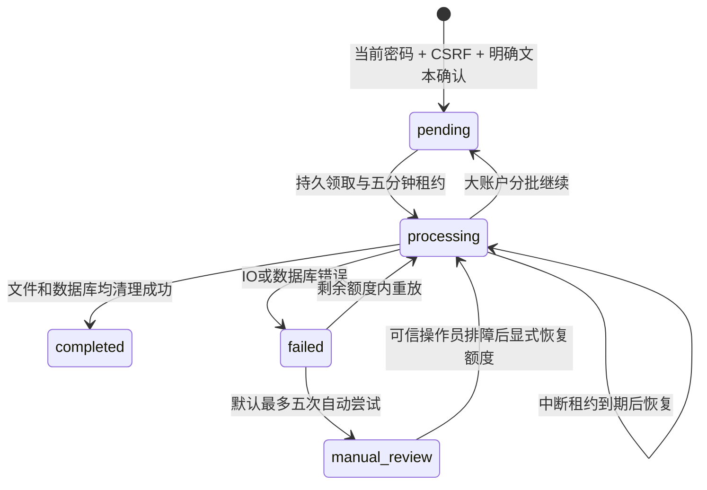

# S5-2 用户数据生命周期本地验收

日期：2026-10-17（Asia/Shanghai）。基线为真实干净仓库 `96709a6`，没有沿用历史测试数字作为本轮结果。范围仅为数据导出、账户注销、删除恢复与相应中文页面；不执行 S5-3，不推送、不部署、不调用真实付费模型，不读取或删除真实用户数据。

**验收结论：S5-2 用户数据生命周期本地验收完成。** 用户可在中文网页导出本人资料，并在密码重验与明确确认后注销账户；所有权、文件补偿、迟到结果和旧备份重放均已在合成隔离环境验证。不能据此宣称生产就绪或已满足全部隐私与法律义务。完成后停止，不进入 S5-3。

## 1. 用户数据依赖与实现文件

完整所有权、导出字段、清理顺序和系统边界见 [用户数据依赖清单](S5-2-data-inventory.md)。盘点覆盖 21 张既有业务/支撑表、新增两张生命周期表、会话内 BYOK、PDF/part/claim、导出 ZIP/part、独立删除清单、备份及第三方请求。另有 Alembic 版本表；2026-10-18 作品集复核澄清计数口径，合计 24 张数据库表，未改变 Schema 或验收结果。没有 Redis、搜索索引或通知队列；以后增加这些存储时必须扩充清单。

| 文件组 | 实现说明 |
|---|---|
| `backend/src/offerpilot_api/account_lifecycle/exports.py`、`export_schemas.py` | 持久导出、版本化白名单快照、资源预算、私有 ZIP、完整性校验、到期拒绝和有界清理 |
| 同目录 `deletion.py`、`ledger.py`、`guards.py`、`schemas.py`、`recover.py` | 密码重验、账户写入锁、外部删除清单、持久注销任务、租约恢复、文件补偿和有限 CLI |
| `api/routes/account_exports.py`、`account_deletion.py`、`main.py` | 服务端身份与 CSRF、显式错误契约、短期状态 Cookie、后台有限批次调度 |
| `identity/services.py`、`dependencies.py`、`agent_runtime/extraction_runs.py`、`process_extractions.py` | 所有会话与登录检查独立清单；已授权请求写入前再次围栏；调用前与迟到结果的账户检查 |
| `db/models.py`、`migrations/versions/0010_account_lifecycle.py`、`core/config.py` | 两张新表、索引/CHECK/唯一约束、导出与删除额度；0001～0009 保持 |
| `frontend/src/components/account-settings.tsx`、`account-deletion.tsx`、相关页面/CSS/账户菜单 | 中文导出、确认注销及独立处理状态；沿用当前设计系统 |
| `frontend/src/lib/api.ts`、`auth.tsx`、`proxy.ts`、OpenAPI/生成类型 | 严格代理白名单、短期状态权限、下载响应字节上限、注销后导航 |
| `tests/test_account_exports.py`、`test_account_deletion.py`、`test_account_lifecycle_migration.py` | 合成 SQLite 账户、文件、失败注入、越权、幂等与迁移验证 |
| `tests/postgres/test_account_lifecycle.py`、`scripts/postgres/lifecycle_restore.py` | 真实 PostgreSQL 并发、主库外清单、旧备份恢复、失败重放和其他用户指纹 |
| `tests/http_account_lifecycle_smoke.py`、`frontend/e2e/account-lifecycle.spec.ts` | 独立 uvicorn/HTTP、真实 Chromium、ZIP 与实际磁盘清理、三种屏宽截图 |

没有新运行依赖，没有引入任务队列或大型 Agent 框架。新模块只编排生命周期，不增加求职业务功能。

## 2. 导出 ZIP 与 Schema

Schema 标识为 **`offerpilot-user-export/1.0`**，JSON 为 UTF-8，所有系统时间显式 UTC `Z`，行动日期保留 `YYYY-MM-DD` 与 `Asia/Shanghai`。JSON 文件根为记录数组；UUID 和父子引用保留，空账户也有可读的空数组。无自动重新导入能力。

```text
manifest.json
account.json
profile.json
profile_entries.json
profile_candidates.json
resumes.json
resume_lifecycle.json
legacy_resume_profiles.json
legacy_resume_facts.json
extraction_runs.json
jobs.json
job_jd_snapshots.json
job_requirements.json
matches.json
applications.json
application_events.json
resumes/{服务端简历 UUID}.pdf
```

`manifest.json` 包含 Schema/export/user ID、快照时刻、范围说明、`complete`、`omissions`，以及每个文件的相对路径、字节数、SHA-256。manifest 不对自身计算哈希；整个 ZIP 的大小与 SHA-256 单独保存在任务元信息中。简历项记录 `original_file_status`，包含、删除中、处理未完成、文件缺失、不可读和完整性失败明确区分；不生成占位 PDF 或把遗漏伪装为完整。运行状态和候选审核状态按当前保存值导出，不把待确认候选升级为事实。

账户字段只允许 ID、邮箱和创建时间；偏好随正式画像导出。字段采用白名单，明确排除密码散列、会话 Token/摘要、CSRF、邀请、Key、Key reference、会话/外传授权引用、内部对象键和绝对路径。旧解析资料单独命名，不能混同于正式画像。

所有路径从服务端 UUID 构造，显示文件名不参与 ZIP 路径。ZIP 使用 `ZIP_STORED`，不接收/解压用户 ZIP，因此没有上传压缩炸弹或 ZIP Slip 路径。JSON 按条/片段写入，PDF 复用既有 10 MiB 存储限制；总记录、字节和时间预算共同限制临时占用。超限安全失败并清理 partial。

## 3. 导出状态、安全与资源边界

`queued → running → ready / failed`；过期为 `expired`，注销中的任务为 `cancelled`。持久任务先于文件 IO 提交，执行令牌和租约保护单次发布。中断后的 running 在租约到期后有限重建，最多执行两次；同一请求键不会重复创建。

默认值为 ZIP 64 MiB、10,000 条记录、60 秒处理时间、全局最多 20 个活跃任务、每账户最多一个活跃和两份有效导出、最多 100 个历史任务回执。存在未完成的物理导出清理时禁止再创建新导出，避免失败残留继续累积。额度命中返回可操作的 429/资源限制错误；大账户需维护者调整已验证额度，不能静默截断。保留历史任务回执到注销以防幂等重放；达到 100 次历史上限需要人工处理，目前没有用户端回执清除入口。

导出创建需当前密码重验、会话与 CSRF；密码最多每窗口五次重验，错误密码不撤销有效会话。下载再次验证当前 owner、账户活跃状态、外部清单、到期时间、ZIP 大小及哈希；没有公开文件 URL 或客户端存储路径。下载窗口默认 24 小时，可配置 60 秒至 24 小时，不能配置超过一天。过期立即拒绝下载，随后执行物理清理；IO 失败可能使文件残留更久，但不可继续访问。物理清理最多自动五次，留下 `export_cleanup_failed`，由可信操作员排障后恢复。不能把异常情况下的物理残留描述成已经擦除。

后端下载逐块读取；当前 Web 下载使用受大小限制的缓冲/Blob。代理也按 `OFFERPILOT_EXPORT_MAX_BYTES` 对实际响应字节计数，即使上游缺失 Content-Length 仍有界。前后端配置应相同，默认均 64 MiB。已授权、已打开的下载可能在注销意图之后完成；新下载全部拒绝。

## 4. 账户注销状态机



确认页区分“退出登录”和“注销账户”，先说明范围、导出提醒和备份/第三方边界，再输入当前密码、“注销账户”并勾选确认。服务端不接受 user_id。独立删除清单 fsync 成功后才提交账户停用、全部会话撤销、运行取消和导出撤销；普通访问立即不可用。全部会话内 Key 引用及发送预览同时撤销，不能回退开发者 Key。

清理完成才显示 completed。失败显示未完成或需人工处理，不用“退出成功”冒充注销成功。重复 HTTP 写入因会话撤销被拒绝，原短期状态仍可查询；内部处理和清单重放均幂等，只保留一份账户回执。

状态权限为一小时 HttpOnly、SameSite=Strict Cookie，数据库仅保存摘要；Cookie 不允许恢复账户、执行业务或继续提交注销。注销响应丢失时，原已撤销会话 Cookie 只能在同一小时内匹配最小状态摘要。没有 URL Token、localStorage/sessionStorage 中的长期接管秘密；查询凭证到期返回明确无法查询，不能据此断言已经完成。

## 5. 数据库、文件与异步一致性

账户 User 行是认证业务写入、导出快照和删除意图的共同外层锁。请求 Session 在 DML、flush 和 commit 前再次检查活跃账户与独立清单；旧请求不能在注销开始后提交新业务数据。抽取任务在领取、调用预占和候选结果完成时检查账户；CLI 同样传入当前安全配置。取消执行令牌与候选落库 CAS 同事务，迟到结果不能重建画像或账户。已提交到外部模型的请求可能继续执行/计费，不能承诺外部撤回。

删除复用现有 `resume_file_operations` 和 `.claim` 归属证明，清正文/证据，再清 PDF、part、claim，最后移除文档。失败保留对象引用和安全错误，重试缺失文件为幂等成功；冲突或证明损坏需要人工核对，不扫描删除未知对象。单份简历删除仍保留用户正式值，账户注销才删除全部正式画像。

账户清理每批最多处理 100 份文档，正常分批不会消耗故障重试额度。申请事件/回执/申请、匹配回执/匹配、职位创建回执/职位及其 JD/条件、正式画像/候选、运行账本、文件 journal、导出任务、会话按依赖顺序清理，最后硬删 User。邀请按原账户的精确规范化邮箱清除；仅清已知账户级限流摘要，不能删除共享 IP 桶或系统配置。所有查询/删除带服务端 owner 或其已授权父链；legacy NULL-owner 保持。

## 6. API 与迁移

| API | 行为 |
|---|---|
| `POST /api/v1/me/export` | `{password,idempotency_key}`，202 与持久状态 |
| `GET /api/v1/me/exports` | 当前用户最近最多十份任务，刷新可恢复 |
| `GET /api/v1/me/export/{id}` | owner 范围状态，伪造/他人 ID 为 404 |
| `GET /api/v1/me/export/{id}/download` | 鉴权 ZIP，过期 410，无公开目录 |
| `POST /api/v1/me/deletion` | `{password,confirmation:"注销账户",idempotency_key}`，202 与短期状态 Cookie |
| `GET /api/v1/me/deletion/status` | 短期只读权限查询最小回执，不依赖普通业务会话 |

新增 `0010_account_lifecycle`，只追加 `account_exports` 与 `account_deletions`。前者 owner FK RESTRICT，包含幂等唯一键、运行租约/次数、清理次数、哈希、TTL；后者无 User FK，以便硬删账户后保留最小删除凭据/处理结果。短期状态摘要有索引；完成后不保留邮箱或正文。存在任何生命周期数据时拒绝有损降级。没有修改 0001～0009，也没有在实际开发/生产数据库执行迁移。

## 7. 备份恢复与删除防复活

外部 `deletion_ledger_dir` 独立于数据库、上传目录和可恢复的文件快照。每条仅有 user UUID、deletion UUID、带时区意图时间；没有邮箱、正文、会话或密码。清单不可随旧备份回滚，丢失/损坏/不可访问返回安全 503 并拒绝认证，不能自动初始化为空。全新空数据库的首次注册可创建新清单；已有安装升级必须由可信操作员显式初始化，恢复环境禁止使用初始化动作替代恢复真实清单。

恢复流程必须关闭外部访问与写入，在新隔离库和新私有目录恢复，迁移至 0010，挂接最新独立清单，运行删除重放与文件补偿，确认 failed=0、无未完成或人工处理项，并验证其他用户数据及权限，再由维护者决定开放。即使尚未重放，恢复出的已注销账户也会在登录/会话解析时被清单拒绝。原 S5-1 快照校验脚本不能代替此流程。

本轮演练真实执行 pg_dump/pg_restore：快照先包含 A/B 完整资料、PDF、有效导出及 NULL-owner legacy；之后注销 A，恢复旧快照，再验证旧 Cookie 和密码都不可用。注入 A 的文件删除故障，状态保持未完成；修复后重放，A 的数据库、PDF/part/claim、ZIP/part 清除，B 全部 owner 行指纹、PDF/导出 SHA-256、旧会话及 legacy 字节保持。重复重放无副作用。仅使用新建随机 S5 数据库和新的 artifacts 目录，没有覆盖真实备份。

## 8. 中文页面与截图

账户菜单新增“账户设置”，页面 `/settings` 提供范围、密码重验、任务状态、下载、过期与失败处理；`/account-deletion` 在普通会话撤销后展示独立状态。原工作台导航与业务页面不重做。1440/768/390 像素均检查横向溢出，截图只含合成资料，密码字段保持空。

真实截图在忽略目录 `frontend/artifacts/s5-2/`，包括三种宽度的 `account-settings`、`export-ready`、`export-expired`、`deletion-confirmation`、`deletion-cleanup-failed`、`deletion-completed`，共 18 张。可重新运行 Chromium 重生，截图不提交个人数据。

| 场景 | 桌面 | 手机 |
|---|---|---|
| 账户设置 | [1440](../frontend/artifacts/s5-2/account-settings-1440.png) | [390](../frontend/artifacts/s5-2/account-settings-390.png) |
| 导出完成 | [1440](../frontend/artifacts/s5-2/export-ready-1440.png) | [390](../frontend/artifacts/s5-2/export-ready-390.png) |
| 最终确认 | [1440](../frontend/artifacts/s5-2/deletion-confirmation-1440.png) | [390](../frontend/artifacts/s5-2/deletion-confirmation-390.png) |
| 注销完成 | [1440](../frontend/artifacts/s5-2/deletion-completed-1440.png) | [390](../frontend/artifacts/s5-2/deletion-completed-390.png) |

## 9. 验证结果

| 验证 | 通过 / 失败 / 跳过 / 未运行及统计口径 |
|---|---|
| 完整 SQLite 后端 | **596 / 0 / 53 / 0**；发现649项，645.882秒。53项为PG opt-in，已另在真实PG执行 |
| SQLite 最终导出专项 | **18 / 0 / 0 / 0**，33.794秒；比上述全量快照多一项旧执行不能删除新租约文件的补偿竞争测试 |
| SQLite 0010迁移/配置专项 | **4 / 0 / 0 / 0**；比全量快照多一项私有目录不得重叠的配置测试。与导出专项去重后，本轮SQLite共598项通过，未把重复执行加总 |
| PostgreSQL 原API/领域与新增生命周期 | **288 / 0 / 0 / 0**，按模块去重。完整首轮原API均运行，受影响的BYOK、导出、注销模块完整复验，最后导出18项再复验；合并证据见 `pg-combined-verified.json`，不是一次288项单命令的成绩 |
| PostgreSQL 专项 | **53 / 0 / 0 / 0**，97.666秒；含六项S5-2、旧47项迁移/并发/安全专项，真实受限应用角色 |
| 前端 Vitest | **140 / 0 / 0 / 0**，13个文件；53秒左右，含新增账户/代理/响应限额 |
| PostgreSQL 完整 Chromium | **36 / 0 / 0 / 0**，5.7分钟，无重试，完整新库、真实API与Next服务 |
| SQLite Chromium | 首轮34通过、2失败；修复后新增生命周期 **3/3** 通过，原33个既有场景在首轮均通过。没有再跑第二次完整SQLite Chromium，不将复验写成单次36/36 |
| 真实HTTP | 原文件生命周期和新增账户ZIP/注销/实际服务重启两脚本均通过；无Mock HTTP替代 |
| OpenAPI契约 / ESLint | 最终通过，exit=0；生成Schema一致，lint无错误/告警 |
| Production Build / TypeScript | Chromium停止后顺序执行，最终通过，exit=0；新增两个页面构建成功 |
| 数据库迁移 | SQLite 0009历史保留、0010结构/约束/安全降级；PG空库模型一致、0001～0010逐级历史升级通过 |
| 锁文件 / diff | `uv lock --check --offline`、`git diff --check`通过；0001～0009无改动，锁定依赖未变 |

本轮新安全验证逐项覆盖：空/完整账户导出、原PDF字节和所有manifest文件哈希、JSON/关联ID、两用户/NULL-owner/伪造ID、密码/CSRF/非法Unicode、幂等与额度、ZIP路径及不压缩、文件缺失/篡改/不完整状态、字节/记录超限、两次中断租约恢复、TTL/五次清理上限及阻断新导出；注销覆盖所有会话/Key/排队任务撤销、逐表/文件/导出清理、旧请求写入拒绝、迟到模型结果丢弃、并发/重复重放、文件与最终数据库提交失败、服务重启和一小时只读状态权限。未发起任何真实模型请求。

恢复演练证据为 `restore-test-b0e90cc46155/lifecycle-restore-report.json`：实际dump **84,117 bytes**，包含原件及有效导出文件快照；17项安全/保留检查通过。源库和恢复目标均为新随机合成库，运行结束删除，只在忽略的artifacts留证据。

失败与修复记录如实保留：首轮SQLite的三项失败来自旧head固定0009及新增降级错误措辞；更新验收断言/措辞后完整649项重新执行通过。PG首次免费故障桩执行因仍导入未使用的真实SDK，3秒门闩未及时到达（隔离诊断3.531秒）；改为仅无注入Adapter时导入SDK，原时限断言不放宽，全部47项受影响模块复验通过。首轮浏览器注销后认证刷新抢先跳到登录页，改为清会话内存后完整导航至独立状态页；测试对既有匹配HTTP200误写201亦纠正。随后PG一次35/36为浏览器跨完整导航后读取旧Response body的测试竞态，改为通过短期权限读取持久回执，最终完整36/36通过。

最后复审发现导出失败补偿在rollback释放锁后可能误清新租约文件，已在清理前重新按User→任务锁顺序核对执行令牌；SQLite/PG均有可重复用例，且清理失败会阻止新导出。普通日志不记录异常正文或个人资料。没有后端独立类型检查/formatter命令，不虚报这些检查。

复现（均只用合成数据）：

```powershell
$env:OFFERPILOT_DATABASE_URL='sqlite:///:memory:'
& ./backend/.venv/Scripts/python.exe -B -m unittest discover -s tests -v
& ./backend/.venv/Scripts/python.exe -B tests/http_file_lifecycle_smoke.py
& ./backend/.venv/Scripts/python.exe -B tests/http_account_lifecycle_smoke.py
. ./scripts/postgres/env.ps1
& ./backend/.venv/Scripts/python.exe -B -m unittest discover -s tests/postgres -t . -v
& ./backend/.venv/Scripts/python.exe -B scripts/postgres/regression.py --output frontend/artifacts/s5-2/new-pg-regression.json
$env:OFFERPILOT_E2E_POSTGRES='true'
npm.cmd --prefix frontend run test:e2e
Remove-Item Env:OFFERPILOT_E2E_POSTGRES
npm.cmd --prefix frontend run api:check
npm.cmd --prefix frontend run test
npm.cmd --prefix frontend run lint
npm.cmd --prefix frontend run build
npm.cmd --prefix frontend run typecheck
```

如果已加载PG opt-in URL，再执行SQLite discover会同时运行PG用例；报告中的53项跳过来自尚未加载PG URL的独立SQLite命令。备份路径始终使用新目录，不覆盖既有备份。

## 10. 保留政策与实际边界

| 数据 | 本轮实际策略及边界 |
|---|---|
| 原始业务数据 | 注销开始拒绝访问；完成状态只在数据库/私有文件成功清理后出现 |
| 临时 ZIP | 下载窗口最多 24 小时；过期即拒绝，物理失败最多自动五次后人工恢复，残留仍私有 |
| 状态权限 | 一小时，随后失效；过期摘要由生命周期 tick/CLI 清空 |
| 最小删除清单/回执 | 当前持续保留以对抗仍可能存在的旧备份；只有确认全部可恢复副本退出、经批准保留规则后才能缩短，不自行设置会使旧备份复活的 TTL |
| 本轮合成备份与截图 | 只用于本地验收，隔离保存；建议验收后七天由维护者清理。未启用定时备份淘汰，也未删除或覆盖既有备份。真实备份的正式期限、加密、责任人和淘汰证据尚未批准 |
| 共享 IP 限流桶 | 不归单一用户，不因注销全表删除；沿既有按认证请求清一天前桶的机制，不宣称安全匿名化 |
| 数据库空闲页、磁盘/云快照 | 逻辑硬删与 unlink 不等于物理安全擦除，需部署存储与备份政策处理 |
| 第三方模型副本 | 不承诺撤回已发送请求或供应商立即删除；供应商许可、训练/保留配置与适用义务仍待审查 |

本轮没有声称法律要求必须保留某类数据，也没有自行判断已满足全部监管要求。最小清单仍属可与备份关联的假名化标识，需要访问控制与适用依据/期限审核。

## 11. 恢复命令与 S5-3 前置条件

以下命令只能在操作员核对目标配置后执行；验收命令本身会创建隔离数据库，不接触传入基础库。真实生产环境不在本轮授权范围。

```powershell
# 仅首次为既有安装上线新功能时，确认没有应恢复的真实删除清单后显式配置。
# 恢复旧备份时禁止用此命令创建空清单。
& ./backend/.venv/Scripts/python.exe -B -m offerpilot_api.account_lifecycle.recover --initialize-ledger

# 有限恢复，不打印正文、秘密或内部路径。
& ./backend/.venv/Scripts/python.exe -B -m offerpilot_api.account_lifecycle.recover --limit 100

. ./scripts/postgres/env.ps1
& ./backend/.venv/Scripts/python.exe -B scripts/postgres/lifecycle_restore.py --output frontend/artifacts/s5-2/new-isolated-restore
```

S5-3 需要后续明确授权；前置事项是正式备份保留期限/加密/淘汰与恢复封闭流程、独立清单持久卷及灾难恢复、Windows ACL/私有存储、Worker/解析资源隔离和监控人工处置、第三方数据条款与适用法律/许可审查。清单或证明损坏需要可信操作员核对，不能提供绕过验证的用户 API。当前单进程会话 BYOK 边界不因本轮改变。

完成本轮后停止，不自动实施上述部署工作或新求职功能。
