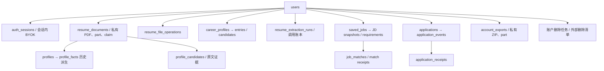

# S5-2 用户数据依赖清单

日期：2026-10-17（Asia/Shanghai）。依据当前模型、0001～0009、身份/文件/画像/任务/职位/匹配/申请领域逐项核对；本表在实施前建立，新增生命周期结构随实现补充。只处理服务端身份明确归属的数据；`resume_documents.user_id IS NULL` 的 legacy 数据不认领、不导出、不清除。

| 存放位置 | 所有权与关联 | 用户导出 | 注销处理与注意事项 |
|---|---|---|---|
| `users` | `id` 为所有权根 | ID、邮箱、创建时间；无密码散列 | 删除意图先禁用；全部子数据清理后硬删；不通过客户端 user_id 选择 |
| `registration_invitations` | 当前没有 user FK，仅规范化邮箱 | 不导出凭据 | 按被删除用户邮箱处理对应邀请；不能删除其他邮箱或系统配置 |
| `auth_sessions` | user FK CASCADE | 不导出 Token、Token hash、会话 ID | 意图事务撤销全部会话；最终清理 |
| `auth_throttles` | 散列限流键，无用户 FK | 不导出 | 仅关联账户的已知散列可移除；IP 桶不属于一个用户，不全表清除；旧桶按现有期限淘汰 |
| `resume_documents` | user FK RESTRICT，可为 legacy NULL | ID、显示名、类型、大小、哈希、解析正文/布局、处理/删除状态与时间；不导出 file_path/object_key | 复用文件 journal，清正文、旧派生、候选/证据，再物理清理 PDF/part/claim；全部成功才移除文档 |
| 私有 `upload_dir` | 文档/operation 记录和 `.claim` 证明归属 | 原始 PDF，ZIP 路径固定为 `resumes/{resume_id}.pdf`，核对字节/哈希 | 只删已证明归属对象；缺失是幂等成功，冲突/IO 失败留可恢复状态，不扫未知对象 |
| `resume_file_operations` | owner + resume_id；有意无 resume FK | 仅必要的删除/处理状态，不含对象引用 | pending/failed 必须清理；完成 journal 账户注销时删除 |
| `profiles / profile_facts` | 经本人 resume 父链 | 历史解析资料与事实、置信度、证据；明确非正式画像 | 随本人简历清除；不迁移或确认旧事实 |
| `career_profiles` | 每用户唯一，RESTRICT | 当前 revision/schema、偏好和时间 | 清 entries/candidates 后删除 |
| `career_profile_entries` | profile 父链；resume SET NULL | 正式值、顺序、来源、字段来源、证据、处理版本、必要修订时间 | 注销全部清除，区别于单简历删除保留正式值的原行为 |
| `profile_candidates` | profile 与本人 resume 双父链，run SET NULL | 候选值、审核状态、来源、证据、schema/抽取版本、关联 ID | 清除；未确认候选不写作正式事实 |
| `resume_extraction_runs` | user FK RESTRICT；没有 resume FK | 最小用户可见运行/调用次数、token 计量、版本/安全状态；无 session/key/authorization 引用、请求/原响应 | 先取消/清执行令牌，外部请求可能已发出；迟到结果重新检查活跃账户后丢弃；最终移除账本 |
| 进程 `SessionKeyVault` | user/session/key_reference | 不导出 Key 或授权秘密 | 撤销用户全部引用；重启自然消失；供应商账户 Key 仍由用户自行撤销 |
| `saved_jobs` | user FK RESTRICT，私有 | 基本资料、收藏、来源链接/方式、revision/JD 版本和时间 | 先删申请/匹配及回执，再删职位；不访问 source_url |
| `job_jd_snapshots / job_requirements` | 本人 job 父链 | JD 原文与历史版本、结构条件、证据位置/分类/审核/规则版本 | 按父职位 CASCADE 清除 |
| `job_create_receipts` | user FK，job SET NULL | 不导出内部请求键/摘要 | 账户注销时清除；单职位删除原墓碑行为保持 |
| `job_matches` | user 和本人 job 双重过滤 | 所有历史 evaluation、逐项四态/依据/规则版本；依据 revision 同时导出以重算失效 | 先清对应回执，再删匹配；不恢复被单简历删除清除的证据 |
| `job_match_receipts` | user/job/match | 不导出内部幂等资料 | 注销时清除 |
| `applications` | user，job RESTRICT，match SET NULL | 状态、备注、已知投递时间、当前行动（含完成/取消）、关联 ID、revision | 先事件/回执，后申请，保证其他用户记录不变 |
| `application_events` | user + application | 所有追加时间线、before/after、业务发生时间和系统时间 | 删除对应用户事件；旧行动和完成记录存在于事件 changes 中 |
| `application_receipts` | user；application SET NULL | 不导出请求键/摘要 | 注销时清除，不能留可重放的新业务来源 |
| `account_exports`（0010） | owner；持久任务/租约/次数/TTL | ZIP 本身不递归导出先前 ZIP；任务敏感内部信息不导出 | 意图后禁止下载/继续产出；清 `.zip/.part` 后删除任务；失败有界恢复 |
| 导出私有 `export_dir` | 仅服务端 job UUID 派生文件名 | 有时限鉴权下载，固定附件名；不公开目录 | 默认最多 24 小时；过期先拒下载，后台/CLI 清理；未知文件不自动删除 |
| 账户删除任务与外部删除清单 | 最小随机 user UUID、任务状态/时间，无邮箱/简历/秘密 | 不含控制凭据 | 主库外清单独立于可恢复备份；恢复先重放，再开放访问；失败不宣称完成 |
| PostgreSQL dump、私有文件备份、SQLite 空闲页/磁盘快照 | 隔离运维边界 | 不导出数据库备份 | 逻辑删除不是物理安全擦除；备份保留期及重放记录随 S5-2 恢复协议执行，正式部署仍须 S5-3 审核 |
| 日志、前端内存/生成缓存 | 日志无完整个人正文；页面 no-store，无业务缓存索引 | 不导出服务器日志/凭据 | 清会话/页面状态；没有 Redis/搜索索引/通知/浏览器会话需要额外删除；新增时必须扩展清单 |
| 第三方 DeepSeek | 已授权的最小脱敏请求，无法控制供应商全部副本 | 仅本地保存的运行计量/来源 | 不承诺撤销已发请求或立即擦除供应商副本；保留/训练政策仍属独立发布条件 |

导出 Schema 以 `offerpilot-user-export/1.0` 标识；所有系统时间规范化 UTC `Z`，行动日期保持 `YYYY-MM-DD` 与 `Asia/Shanghai` 民用语义。快照使用数据库事务和资源锁，文件缺失/删除中/未完成会在 manifest 与各简历项明确记录，不称完整。导出没有导入功能。

本清单描述实现范围与预定清理边界；实际通过情况以 `S5-2-acceptance.md` 的执行结果为准，不代表法律合规或生产就绪。
