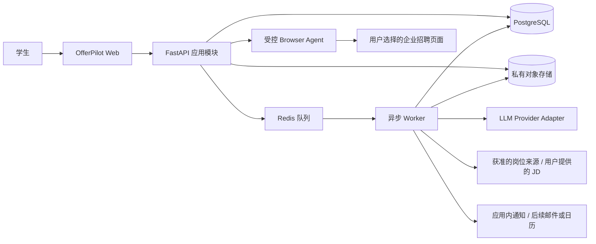

# OfferPilot 系统架构与技术方案

> **当前作品集边界（2026-10-18）：** 继续使用 Next.js + FastAPI 模块化单体、SQLAlchemy/Alembic、PostgreSQL 或 development SQLite，以及本机私有文件和主库外删除清单。当前组件图与代码阅读入口见 [ARCHITECTURE_GUIDE](ARCHITECTURE_GUIDE.md)。不新增 Redis/Celery、云对象存储、独立真实 Worker、Browser Runner 或监控平台。本地运行见 [LOCAL_SETUP](LOCAL_SETUP.md)，优先级见 [PLAN](PLAN.md)。下文各批记录保留；第 1～7 节中的高级组件是早期目标设计，不代表已实现，也不再是作品集待办。

### S5-2 生命周期编排边界

`account_lifecycle` 编排身份、简历现有清理、画像、职位/匹配和申请数据，不增加求职功能。导出使用持久租约/额度、白名单流式 JSON、私有 ZIP、显式版本/遗漏/哈希和最多一天下载窗口。注销先写主库外 fsync 删除清单，再提交身份停用、全部会话/Key/任务撤销，最后复用文件 journal 补偿和显式依赖清理；只有全部完成才标记成功。

已认证 Session 的写入/flush/commit 与后台抽取结果共享 User 外层锁及活跃/删除清单围栏。清单缺失或损坏失败关闭，不能随数据库旧快照回滚；恢复必须隔离、迁移、重放、验证后才开放。两张持久表由0010追加，0001～0009不变。没有新增broker；lifespan按有限批次处理，CLI提供有界恢复。短期状态Cookie不授予业务权限，前端沿OpenAPI生成类型和严格代理白名单。完整行为和实测见 [S5-2验收](S5-2-acceptance.md)；下文历史边界保留。

2026-10-19 并发修复：独立删除清单仅由可信的全新环境准备流程在开放服务前初始化，注册及 lifespan 不补建；空用户表也不能证明环境全新。准备流程先在同一父目录的临时目录写完并 fsync 标记、关闭句柄，再用不覆盖目标的硬链接原子发布；并发准备者验证已有标记，损坏标记仍拒绝。文件系统前提与准备操作见 [本地启动说明](LOCAL_SETUP.md)。

**版本：** 1.4（本地作品集交付）
**日期：** 2026-10-18

### S5-1 数据库适配与事务边界（2026-10-16～17）

应用和 Alembic 共用 Settings / build_engine，新增锁定的 psycopg 3.3.3；本机 PostgreSQL 18.6 的版本、镜像摘要、权限分离及实测见 [S5-1 验收](S5-1-acceptance.md)。SQLite 保留为 development 选择，非开发环境禁止回退；启动核查实际角色、继承权限和对象所有者。连接池和连接/语句/锁/空闲事务均有上限，会话强制 UTC，SQL 参数及服务端错误语句不记录。

PostgreSQL 的不同简历行锁不能保护全局任务额度，因此任务准入用固定服务端键的事务 advisory lock，提交/回滚自动释放，不跨 Provider 调用持有。新建职位锁当前用户行，将配额 count 与 insert 串行化。不同来源首次创建同一画像的唯一竞争使用 savepoint 保留外层 run/resume 事务；仅内部无显式 revision 的路径可在唯一竞争后领取新画像版本，用户显式 revision=0 仍返回冲突。候选与 succeeded 保持一次提交。

岗位列表对当前页的条件状态一次分组统计，查询数不随页内条数线性增长。文件仍使用既有资源行锁、操作记录、CAS 和补偿，不新建存储体系或账户注销流程。0001～0009 历史及 head 不变。以下旧批次的“PostgreSQL 未验证”保留为当时记录，当前结论以上述独立验收为准；没有生产部署或生产就绪声明。

> **当前 S4-1：** `application_tracker` 负责申请、当前下一步和追加式事件，`api/routes/applications.py` 装配服务端身份/CSRF、显式请求响应及安全错误。申请创建读取本人职位和可选匹配引用，不调用模型或修改画像；状态由用户手工维护。0009 向前新增三张表，旧迁移不变。中文页面通过真实 OpenAPI 生成类型使用同源代理。实际边界与验证见 [S4-1 验收](S4-1-acceptance.md)；下文 S3-2 范围保留为历史。

### S4-2 聚合边界

`application_tracker/dashboard.py` 从既有申请、当前行动、职位审核、匹配版本和正式画像/简历元数据计算只读工作台。`GET /api/v1/dashboard` 使用服务端会话 owner，输出显式 Schema；每组行动、待处理岗位和最近活动均有条数上限，返回总数和继续查看入口，不读取全文 JD、匹配 evaluation 或无界事件 changes，不新增统计表、任务、通知或迁移。

首页行动修改仍使用原申请 GET/PUT：核对当前版本和行动，完整保留已有字段，通过 revision、CSRF 和幂等回执提交；冲突或未知结果明确提示恢复。申请列表使用数据库筛选并批量读取关联标签/版本，避免按行读取职位、匹配和画像。时间分类共用北京时间判定，以响应中的服务器日期为准。

服务端结束申请时在同一事务取消 pending 行动并记录变化；聚合和逾期查询亦排除历史终态 pending。取消后需用户明确恢复，不因重开申请自动重启待办。导航收敛为工作台、职位、投递进度、我的资料；简历管理保留既有路由和资料/账户入口。完整验证与边界见 [S4-2 验收](S4-2-acceptance.md)。

### S4-1 申请领域边界

`applications` 是当前状态权威，下一步作为严格 Schema 校验的单一当前行动存于申请；旧值由 `application_events` 保留，不为单行动引入独立调度实体。每次写入以 owner + revision 条件更新，业务数据、类别事件及 `application_receipts` 同事务提交；回执只含请求摘要、作用域和资源引用。所有读写由会话派生 owner，客户端不能指定归属，事件接口只读。

创建在职位上做版本围栏，和职位删除串行；数据库外键 RESTRICT 禁止丢弃有申请的职位。按岗位最多一个非终态申请，终态后须明确 reapply 才建立下一轮。纠正旧轮状态时仍校验不能同时恢复两轮未结束申请。所有类别变更追加 before/after；不提供覆盖历史接口。系统记录时间不接受客户端覆盖，业务发生时间可由用户明确补录，排序采用服务器记录顺序，避免补录伪造先前系统历史。

明确时间以带时区输入规范化 UTC，SQLite 返回亦显式补 UTC；界面固定 Asia/Shanghai。行动日期和可选分钟时间保持两个字段，无日期不能只有时间；只有日期的截止到北京时间当日结束，完成/取消均不逾期。没有队列、派发器、第三方日历或自动联系。

匹配只保存本人该职位的必要引用及版本，读取时沿用 S3-2 动态失效规则；不复制匹配证据/简历/联系方式。简历删除仍由原画像领域清历史匹配证据，不影响申请状态和用户备注。显式删除申请级联清行动/事件，保留最小幂等墓碑阻断迟到重放。账户级导出/注销、备份删除、PostgreSQL 并发及公开部署仍需独立验收。

> **当前追加 S3-2：** `job_intelligence/matching.py` 提供无网络、无模型的纯规则函数，`match_schemas.py` 校验版本化四态与证据，`match_services.py` 负责服务端正式数据读取、版本围栏、幂等、快照及失效判断。HTTP 层沿用身份/CSRF/安全错误；`profile` 独立保存最小偏好，复用画像 revision；`job_catalog` 保持私有职位与审核边界。中文详情通过 OpenAPI 生成类型展示结果。0008 在 0007 上向前扩展，不实现 S4/Browser。详细设计与验证见 [S3-2 验收](S3-2-acceptance.md)，旧 S2/S3-1 说明保留为历史。

> **2026-10-14 后续单样本真实验收：** 已在用户受限授权下完成 `normal_chinese.synthetic.pdf` 唯一一次真实 DeepSeek 请求；5项候选全部 pending，正式画像四组为空，非空字段19/19、定位21/21、归属19/19，usage为1107/781 tokens。详见 [单样本质量报告](S2-2B-single-real-evaluation-2026-10-14.md)。下文准备阶段的“真实调用0次”为历史基线；否定/计划、多经历及其余四份未验收，生产和供应商阻塞不变，不进入S3。

> **历史 S2-2B 批次实施范围：** S1 提供真实邀请身份、私有 PDF 生命周期和中文工作台；S2-1 提供唯一正式画像及候选审核；S2-2A 提供 V2、证据和持久 Mock 运行；S2-2B 已实现本机 DeepSeek Adapter、会话 BYOK 和独立授权，并完成免费兼容性与评测准备。实际 DeepSeek 请求仍为 0，真实模型质量待负责人授权验收；生产真实模式关闭。PostgreSQL、Redis、云对象存储、生产 Worker、岗位匹配和 Browser Agent 未实施。当前证据见 [正式模型验收准备](S2-2B-readiness-review.md)，下文保留后续目标设计。

Phase 1-2 上传接口仅在 `development` 环境可用，默认上传目录为本地 `backend/uploads/`；仅接收不超过 10 MiB、50 页且有可选中文本的 PDF。PyMuPDF 采用 AGPL 或商业许可，正式发布前需确定适用许可方案。

### S1-3 已实现的 Web 边界

`frontend/src/app` 以 App Router 提供中文页面；`src/components` 封装任务 UI，`src/lib/api.ts` 使用真实 OpenAPI 生成的 `schema.d.ts`。`/api/v1/[...path]` 只代理当前 auth/me/resumes 白名单方法与路径，目标来自服务端环境配置；不接受客户端任意 URL、用户归属或数据库操作。FastAPI 仍负责密码、会话、CSRF、资源授权与所有文件领域规则。

代理保留原 Origin、Sec-Fetch-Site、X-CSRF-Token 和唯一会话 Cookie，只转发后端的 offerpilot_session Set-Cookie；no-store、限体积、55 秒请求上限，读取请求体与上游请求均可取消，没有写操作自动重试。后端与前端都显式配置可信 Web origin，不能把不可信来源改写为可信来源。浏览器仅内存保存 CSRF，刷新从 auth/csrf 恢复；会话秘密只在 HttpOnly Cookie。旧请求迟到不能覆盖新会话 CSRF 或触发新会话退出。

当前是客户端确认会话后显示工作台，API 由后端强制授权，页面不包含服务端预渲染的个人资料。文件状态和清理通过真实 lifecycle 接口读取；自动查询有次数/间隔上限，页面卸载终止请求。详见 [前端设计](../frontend/DESIGN.md) 与 [S1-3 验收](S1-3-acceptance.md)。本批没有 Worker、队列、AI 或新数据表；账户导出/注销仍单独后续验收。

### S2-1 画像领域边界

`profile/schemas.py` 定义正式条目、保存请求、审核请求及版本化候选批次；`profile/services.py` 负责用户授权、结构约束、字段来源、审核状态、幂等入库及 revision 条件更新。`api/routes/profile.py` 只装配已登录身份和 HTTP Schema；前端沿用生成 OpenAPI 类型，不直接写数据库。

`career_profiles` 每用户最多一个当前画像，`career_profile_entries` 是用户手工提供或明确审核的正式条目，`profile_candidates` 是简历候选审核池。旧 `profiles/profile_facts` 保留按简历的历史派生容器，不作为正式画像、不自动迁移或确认。候选和正式集合在 API 中分开；候选的模型置信度不用于确认。

画像全量保存和单候选审核共享 `revision`：服务端 CAS 成功才写条目/状态并递增版本，过期请求返回 409，客户端保留本地编辑供核对。所有 entry/candidate ID 均校验当前用户，不允许来源元数据或客户端 `user_id` 控制授权。没有公开候选创建/批量导入接口。

内部 `ingest_profile_candidates` 是 S2-2 的接入边界：受信任调用者仍需传入服务端身份、校验同 owner 的 active/parsed 简历、重验版本化 Schema、限制数量并按批次键去重。精确原文存在和值片段校验仅证明文字引用；否定或学习计划风险保守标记待核实，不能声称完整语义理解。缺少依据只能经用户修订为自行提供的资料，不能原值确认。该入口本批只由合成测试调用，无 Provider 调用、Key 或任务系统。

删除简历在原删除意图事务中调用画像领域清理：删除该简历候选与批次记录，清除正式条目的简历引用、文件名和原文证据，保留用户已提供/确认的当前值并标记来源简历已删除；独立手工资料保留。相关画像 revision 同事务递增，旧快照无法恢复已删证据。物理删除失败仍不重新开放候选或证据；S1 的 journal、重试及下载边界继续复用。

### S2-2A 持久抽取边界

`resume_ingestion/extraction_schema.py` 保留 V1 并追加严格 `StudentProfileExtractionV2`；`extractor_v2.py` 使用同一 `LLMProvider` 契约、固定 Prompt、输入/输出上限和有限 Schema 重试。`providers/mock.py` 仅匹配登记合成简历，未匹配材料失败，不访问网络或读取 Key。`evidence.py` 负责服务端页段定位、有限别名/日期归一化、原文及经历范围重验与风险标记；它是词法护栏，不是语义或履历真实性证明。

`agent_runtime/extraction_runs.py` 管理数据库状态机、领取令牌/租约、调用账本、revision、资源版本、幂等及最终提交。任务表是工作来源，API 只持久 queued；Mock 模式的 lifespan 执行器每轮最多三条、逐条运行。`process_extractions.py` 提供有限批次处理/租约恢复 CLI，重启不依赖内存队列。默认每次运行租约 30 秒（配置 1～60），最多两次执行、合计四次 Provider 调用；每次调用先落计数，重试不重置预算。默认每用户三个 active、全局二十个，SQLite 写事务串行化本机准入。

调用期间不持数据库写锁。最终按简历 → 运行 → 画像锁序重验 owner、active/parsed、文本/文件/布局版本、状态、令牌和时间；`ingest_profile_candidates(commit=False)` 将 V2 映射、追溯元数据及 pending 候选与 succeeded 一次提交。原入口默认自行提交，保留 S2-1 兼容。重复请求返回原任务，同简历/版本/抽取版本不能另建重复任务；failed 的显式有限 retry 复用同一任务。

取消/删除失效令牌，迟到结果丢弃；过期 running 在状态查询、执行器及 CLI 恢复中失败，用户可查询并按剩余额度重试。删除意图同事务取消运行、清页段/候选及正式来源原文，保留用户确认值与 Mock 来源标记。任务最小终态可在简历硬删后按 owner 查询，不保存正文、原模型 JSON 或 Key。

前端使用生成 OpenAPI，新增明确代理白名单。`OFFERPILOT_MOCK_EXTRACTION_UI=true` 只显示隔离测试面板，后端仍必须 `development + OFFERPILOT_MOCK_EXTRACTION_ENABLED=true` 才准创建；默认界面没有 AI 触发按钮。候选及审核后的来源持续显示测试身份。生产队列、跨数据库并发、真实网络请求隔离及费用策略需后续单独验证。

租约限制运行状态和迟到写入；当前固定 Mock 计算有界且无网络，不代表已实现强制终止任意供应商阻塞线程的生产 runner。S2-2B 需扩展 Mock-only 的数据库/来源契约，并验证真实传输超时、执行隔离与会话/费用边界。

### S2-2B 本地真实 Provider 与会话边界

复用 S2-2A 持久运行、调用预占、V2、证据和原子pending入库；`agent_runtime/byok.py`管理加锁、有界Fernet密文内存和十分钟授权快照，`api/routes/byok.py`提供独立Key/预览接口。固定官方Adapter、deepseek-flash/非思考/JSON、SDK和HTTP零重试；真实max_attempts=max_calls=1，旧run不允许retry。服务端预算及调用状态不依赖浏览器。用户审核仍只通过profile领域。

同进程执行器按user/session/key_reference解析Key，每次调用/最终写入重验会话、密码/账户状态、Key引用与资源版本。删除/取消/退出/换Key/过期阻断迟到候选，usage可作为最小计量保留。先记调用和unknown再请求；无效/空/截断输出不修复收费，usage超授权上限安全失败。读取恢复也终止重启后的孤立队列，不能付费重放。

默认最长1h、进程随机加密Key、不持久化Key/Prompt/原模型JSON；原件保留本机证据，只发送用户预览并授权的脱敏文本。这个最小方案不支持多API进程或独立真实Worker，CLI只处理Mock，没有Redis或开发者Key回退。生产真实开关持续关闭；跨进程密钥方案、供应商BYOK/保留/训练条件与实际网络/质量需后续验证。详见 [S2-2B验收](S2-2B-acceptance.md)。下文高级部署图继续是目标方案。

正式模型准备保持同一 Adapter 与 V2 Schema。Prompt 升为 `resume_extract_v2.1`，补充完整 JSON 四组示例；新运行记录 `resume-extraction-v2.1`，旧候选 V2 来源继续可读取和审核，旧模板排队任务在构造 Provider 前安全失败，不以新模板重放旧授权。SDK 原始响应 usage 先验证类型和总数，再作为计量；畸形响应只返回安全错误，无收费修复。纯合成评测 CLI 与产品 API 开关分开，默认 0 调用，后续收费授权按批次重新提供。供应商许可和隐私条件见 [专项审查](S2-2B-provider-policy-review.md)。

S2-2B-Fix的独立评测CLI通过 `evaluations/pdf_evaluation.py`装配系统临时DB/Storage及真实身份/API，实际生成/读回合成PDF后调用同一上传/parser、create/execute/finish/ingest/review；不建第二套领域逻辑。Mock运行也复用正式脱敏，Spy验证实际Provider参数。真实评测仅未来明确授权的一次合成请求，复用会话Vault/正式预览，默认不审核；评测结束销毁临时DB和Key。仅固定合成报告可存公开正文/候选/证据，普通生产日志规则不变。见 [修复验收](S2-2B-first-real-preflight-fix.md)。原有限批处理Worker CLI仍仅处理Mock，生产真实配置不变。

## 1. 历史目标态架构决策摘要（非当前交付清单）

**待决策说明：** Next.js 前端已由 S1-3 实施并延续验证；PostgreSQL 18.6 / psycopg 3.3.3 由 S5-1 在本机隔离选定，生产托管、Celery/Redis、对象存储和观测供应商仍待决策。保持模块化单体，Worker 在后续真实长任务需要时再决定，Browser 独立 S7，DOCX/OCR 和通知首发后评估。MVP 岗位来源为粘贴/手动输入，不访问保存的 URL。具体容量、数据期限与部署许可需相应批次验证。

- 采用**模块化单体**；独立异步 Worker 为后续有持久任务时的候选，早期不拆微服务，降低部署与调试成本。
- Web 使用 Next.js/TypeScript；API、解析、Agent 编排使用 Python/FastAPI，共享明确的 OpenAPI 契约。
- PostgreSQL 是业务事实的主存储；Redis 只承载任务队列/短期协调，不作为事实数据库。
- 简历原件放私有对象存储，数据库只保存对象键和元数据；敏感文本按需加密或控制访问。
- Agent 采用显式、可恢复的工作流状态机和窄权限工具；模型只负责提取、归纳、解释，不拥有申请提交权限。
- 第一阶段岗位匹配以可解释规则为主；向量搜索属于后续可选能力，不作为推荐正确性的唯一依据。

## 2. 历史目标态系统上下文（当前图见架构导读）

### 部署边界

- **Web：** Next.js 前端；服务端仅做会话校验、页面数据装配和 API 代理，不承载长时间 AI 任务。
- **API：** FastAPI 模块化单体，负责身份校验、授权、领域用例、数据访问和任务提交。
- **Worker：** 与 API 同一代码库，独立进程运行简历解析、JD 分析、匹配生成、提醒派发等队列任务。
- **Browser Runner：** 独立隔离的浏览器会话进程/容器；短生命周期、按用户创建、限制出站域名和资源，不能访问内部管理端点或云元数据地址。
- **PostgreSQL：** 用户、画像、岗位、申请、事件、运行状态和审计数据的主库。
- **对象存储：** 私有桶保存简历原件与必要的导出件，短时签名 URL，生命周期和删除任务可追踪。
- **Redis：** Worker broker/短期协调；不放简历正文、长期令牌或唯一业务状态。

## 3. 逻辑模块

### S1-2 已落地边界

HTTP 路由只处理会话/CSRF、Schema、附件头与安全错误；`services/resume.py` 复用原 PDF 规则，协调先入库上传记录、存储、文本解析、CAS 完成和失败补偿；`resume_ingestion/lifecycle.py` 承载 owner 过滤、删除意图、清理状态、下载完整性、幂等和迟到结果隔离；`storage.py` 只处理不透明对象键的受限 save/read/delete，拒绝路径穿越、符号链接/reparse 与创建证明冲突。不使用云 SDK 或进程内锁伪装跨进程可靠性。

数据库先持久化上传/删除记录，再执行文件操作。托管文件的 PDF/part/claim 共用私有根目录；claim 使用已入库简历 ID 证明本次创建，防止对象键碰撞和数据库更新失败时误删原有对象。处理中断由 `recover.py` 显式、有限批次恢复；证明损坏/归属冲突只安全失败并要求可信操作员核对，不扫描删除未知对象。已完成删除保留最小 owner/ID 幂等记录，正文/画像/事实/文件引用均清除。

当前受限文件 IO、解析和 CAS 持有 SQLite 写事务，使并发删/下载/上传按提交顺序一致；原件先完整读入受大小限制的内存并关句柄再响应。迟到处理只允许 active 文档完成，硬删父表 FK 兜底。该保守方案适用于本机验证；公开部署前再验证容量、超时/解析隔离与生产存储，不能将写锁或本机恢复 CLI 当成已交付 Worker/生产 SLA。优先复用这条领域状态边界，未来 Adapter/Worker 替换不得绕过 owner 和状态检查。

### S1-1 已落地边界

`identity` 管理密码、邀请、会话与限流；`api/routes/auth.py` 只负责 HTTP；`identity/dependencies.py` 统一从 Cookie/数据库解析用户并验证 CSRF。没有客户端可信 user_id 或无状态 JWT；可撤销 opaque 会话适合当前单体，复用数据库而不增加 Redis。成熟 `argon2-cffi` 使用 Argon2id 默认参数，不自行实现密码算法；增加了默认 12～128 字符和合法 UTF-8 输入校验。

`resume_ingestion/access.py` 在服务端 owner 条件下读取/修改元数据；画像/事实经简历父链查询。`services/resume.py` 新上传强制 UUID owner。列表/详情响应显式限定字段，授权先于写入；PATCH 仅改显示名，保留原件存储路径。旧上传兼容路径同样需会话与 CSRF，development 限制保留。

服务器保存会话/邀请 SHA-256 摘要，不保存原 token。会话固定期限、登录轮换、退出撤销、过期或账户停用拒绝；Cookie HttpOnly/SameSite=Lax，非 development 强制 Secure。CSRF 为会话秘密的用途专属 HMAC，每次修改验证；登录/注册 JSON + Origin/Fetch Metadata 保护。限流用数据库条件更新/唯一约束，按账号和实际连接 IP 限制，有界窗口和 429；部署前须验证代理转发头信任，不能相信任意客户端 IP 头。

错误、验证失败与 SQL 参数均脱敏；OpenAPI 显式声明安全错误 Schema，所有个人 API 返回 no-store。日志不打印请求体、Cookie、密码、邀请或个人字段；管理员 CLI 唯一例外是按授权向本机终端输出一次邀请秘密，不作为服务日志。暂无找回密码、邮箱验证、会话管理界面、账户删除或安全审计事件表；不能据 S1-1 宣称完成生产认证体系。

| 模块 | 职责 | 主要边界 |
|---|---|---|
| Identity & Access | 登录会话、用户租户上下文、权限校验 | 所有读写必须从服务端用户身份派生 user_id |
| Profile | 画像偏好、候选事实、确认状态和来源证据 | AI 抽取是候选值；确认由用户执行 |
| Resume Ingestion | 文件验证、文本抽取、分段、解析运行状态 | 文件不可信；MIME、扩展名、大小和恶意内容检查 |
| Job Catalog | 来源连接器、规范化岗位、JD 快照和过期状态 | 仅读取允许的公开/授权来源或用户提供内容 |
| Job Intelligence | JD 提取、匹配、解释、定向建议 | 输出必须结构化并绑定证据；规则可复核 |
| Application Tracker | 申请状态、材料版本、事件和提醒 | 状态变更记录事件；提醒可幂等重试 |
| Browser Assist | 表单识别、字段映射、用户审核、暂停/恢复 | 最小权限；没有最终提交工具 |
| Agent Runtime | 有界工作流、模型适配、工具授权、审计 | 状态持久化、最大步数、超时和预算上限 |
| Notification | 应用内通知及后续渠道发送 | 用户控制渠道与频率，发送结果可观测 |

模块以领域服务/用例调用，不互相直接读写任意表。外部模型、浏览器和招聘来源均经 Adapter/Connector 接口接入。

## 4. 关键数据流

### 4.1 简历到画像

1. API 校验用户、大小、格式和上传授权，写入私有对象存储。
2. 创建 `resume` 与解析运行记录，推送异步任务并返回运行 ID。
3. Worker 提取 PDF/DOCX 文本；如扫描件无可读文本，提示用户提供可检索版本，OCR 可在后续开放。
4. 解析器按版本化 Schema 生成候选事实，每个字段附原文证据、来源页/段、置信度。
5. 将候选字段展示给用户。用户确认/编辑后写入当前画像事实；原始抽取及用户修订可追溯。

### 4.2 岗位到推荐

1. 来源 Connector 或用户输入产生岗位快照，保存来源、抓取时间和内容指纹。
2. JD 分析器提取职位条件并标记原文证据和未知项。
3. 规则引擎先判断明确硬性门槛，再计算技能/经历/偏好维度；缺失信息为“未知”，不能直接判为不匹配。
4. LLM 将规则结果和证据改写为易读解释，不得改写规则判定或补造履历事实。
5. 用户反馈进入质量数据集；不会未经评估自动改变权重。

### 4.3 网申辅助

1. 用户从某条申请记录显式开启会话，确认目标域名和数据使用范围。
2. 用户在受控浏览器自行完成登录；凭据和会话存储限制在短时隔离环境中。
3. Browser Runner 读取当前页面可访问的表单结构，按已确认字段映射建议值；每个填充值保留资料来源。
4. 未知/敏感字段、页面变化、声明或异常挑战触发暂停，交还用户。
5. 用户逐页复核和操作页面。Agent 不提供“提交申请”工具，也不自动确认同意声明。
6. 会话结束后清理浏览器配置文件和短期页面数据，审计日志只记录必要事件，不记录字段明文。

## 5. AI / Agent 安全和质量边界

- 外部 JD、网页、简历中的文本都是**不可信数据**，可能包含提示注入；不作为系统指令，不因此新增工具权限或改变工作流。
- 工具调用采用固定 JSON Schema、参数校验、用户/资源授权、域名白名单、超时、步数上限和成本预算。
- LLM 仅处理当前任务所需的最少上下文；Prompt、模型、Schema 与输出版本化。
- 事实型字段保存证据；无证据或低置信字段必须标为未知/待确认。结构化输出验证失败时有限次重试，之后失败关闭并展示错误。
- 匹配分数按可解释的规则计算，LLM 不单独决定硬性条件、是否投递或申请结果。
- Browser Agent 的高风险动作通过权限设计直接禁用，而不是依赖提示词要求模型“不要提交”。
- 重要操作写入审计事件；生产可观测性默认脱敏，禁止将整份简历、Cookie、密码或申请答案写入普通日志。

## 6. 历史目标态技术选型（实施情况以顶部和验收为准）

| 层 | 建议 | 采用原因 / 说明 |
|---|---|---|
| Web | Next.js App Router、React、TypeScript | 面向仪表盘与多步审核页面；类型约束和前后端契约清楚。按官方当前文档在项目初始化时复核 Node 与框架支持范围。 |
| API | Python、FastAPI、Pydantic | Python 文档解析和 AI 生态；自动生成 OpenAPI；适合异步 I/O 与类型化输入输出。同步/异步处理遵循所调用库的 I/O 模型。 |
| ORM / Migration | SQLAlchemy 2.x、Alembic | 显式事务与迁移历史；版本在实现启动时锁定。 |
| 主库 | PostgreSQL 18（或托管服务当前支持的稳定版） | 关系型事务、JSONB 和全文检索可支撑首版主数据；首版不引入独立向量数据库。 |
| 队列 | Celery + Redis | 将文件解析、模型调用、提醒等长任务移出 HTTP 请求；任务状态仍落数据库，任务须幂等。若团队已有统一任务平台优先评估复用。 |
| 文件 | S3 兼容的私有对象存储 | 简历原件与数据库分离；私有访问、生命周期策略、删除补偿任务。 |
| 文件抽取 | PyMuPDF（PDF）、python-docx（DOCX）；OCR 后续评估 | 先支持文本型文件，扫描件明确提示，降低 MVP 解析不确定性。 |
| Browser | Playwright（隔离 runner，优先语义化 locator） | 可观察页面并操作浏览器；只启用辅助填写所需 API。隔离、安全边界和站点许可由应用层实现。 |
| AI | 通过 `LLMProvider` 接口接入支持结构化输出/工具调用的模型 | 可更换供应商；实现前按数据处理条款、区域、保留策略、结构化输出能力和成本做评估。 |
| 检索 | PostgreSQL 全文检索；pgvector 按离线评测再启用 | MVP 先验证规则匹配。向量相似度可补充召回，不能替代显式条件与解释证据。 |
| 观测 | OpenTelemetry 兼容追踪 + 结构化脱敏日志 + 错误监控 | 关联任务 ID、运行状态和耗时；禁止记录敏感正文和凭据。 |
| 部署 | Docker 化 Web/API/Worker/Browser Runner；托管 PostgreSQL/Redis/对象存储 | MVP 采用少量进程/容器，环境配置分离；正式部署需选定云区域、备份与密钥管理。 |

### 技术依据（官方或项目主仓文档，查阅日期 2026-09-25）

- [Next.js App Router 文档](https://nextjs.org/docs/app) 与 [Next.js 安装及系统要求](https://nextjs.org/docs/app/getting-started/installation)
- [FastAPI 并发与 async 文档](https://fastapi.tiangolo.com/async/)
- [PostgreSQL 文档](https://www.postgresql.org/docs/)
- [Celery 任务队列介绍](https://docs.celeryq.dev/en/stable/getting-started/introduction.html)
- [Playwright Locators](https://playwright.dev/docs/locators) 与 [Playwright Actionability / Auto-waiting](https://playwright.dev/docs/actionability)
- [pgvector 项目文档](https://github.com/pgvector/pgvector)

版本、许可、托管支持和安全公告在实际开工时重新确认；本方案不锁定未验证的具体补丁版本。

## 7. 历史公网部署建议（已从当前排期取消）

- 环境至少划分 local、staging、production；各自独立数据库、对象存储桶和模型凭据。
- API、Worker 与 Browser Runner 用不同服务身份和最小权限；Browser Runner 不读取生产数据库凭据。
- 数据库连接使用 TLS 和受限网络；对象存储禁止公开访问；密钥进入 Secret Manager，不写入仓库。
- 数据库备份加密并定期验证恢复；保留策略和用户删除任务覆盖主库、对象存储、日志及供应商侧数据。
- 管理任务提供可查询状态与失败原因；人工重跑具备幂等保护。
