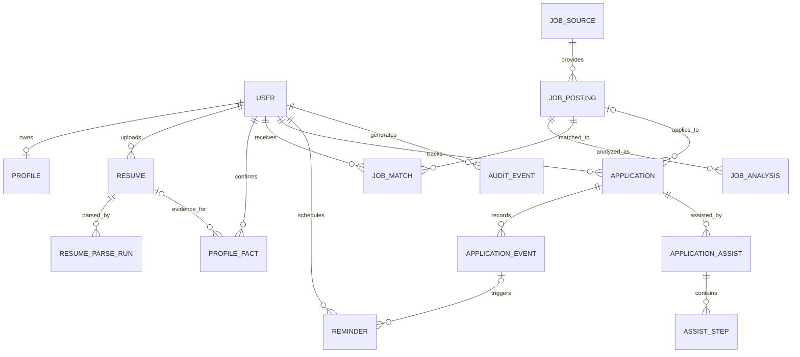

# OfferPilot 数据库设计

**版本：** 0.7（S2-1 独立正式画像与候选审核）

**日期：** 2026-10-11

## 当前实现：S1 文件与身份、S2-1 正式画像及候选

初始迁移建立三张业务表；S1-1 用 `0002_identity_ownership` 增加身份与 owner，S1-2 用 `0003_resume_file_lifecycle` 增加文件状态与清理记录；S1-3 仅复用这些结构。S2-1 追加 `0004_trusted_career_profile` 的三张画像/候选表，0001～0003 文件不修改，前端不访问数据库。下文第 1～4 节保留后续目标逻辑设计；例如目标 `users.auth_subject` 与当前密码账户不同，目标 `profiles` 偏好实体也不同于当前按简历的历史容器。以本节实际表及迁移为准，不直接改旧表含义。

| 已实现表 | 核心字段 | 关系 |
|---|---|---|
| `resume_documents` | UUID `id`、nullable UUID `user_id`、`file_name`、兼容旧 `file_path`、`file_type`、可空 `raw_text`、`object_key`、`byte_size`、`sha256`、`processing_status`、`lifecycle_status`、`created_at` | owner 外键 users ON DELETE RESTRICT；一个简历最多一个画像；对象键唯一 |
| `profiles` | UUID `id`、`resume_id`、可空的 `name` / `phone` / `email`、JSON `education` / `skills` / `projects` / `internships`、`created_at` | `resume_id` 唯一且指向简历文档；一个画像可有多个事实 |
| `profile_facts` | UUID `id`、`profile_id`、`field_name`、JSON `value`、`confidence`、`source_text`、`created_at` | `profile_id` 指向画像；`confidence` 限制在 0～1 |

删除简历文档时，数据库级外键和 ORM 关系会级联删除其画像及事实；实际文件由 Storage Adapter 删除。双上传路由保留原有限制，新文件写入私有配置根目录，用服务端对象键代替绝对路径（新 `file_path` 为兼容空串），可选中文本写入 `raw_text`。先持久化上传记录，解析完成清除记录；失败执行有记录的补偿而非忽略 unlink 异常。当前没有 AI 画像字段解析流程。

**数据边界：** `raw_text`、联系方式和证据属于个人数据。S1-1 服务端父链授权、S1-2 私有下载/单份简历原件与派生删除已实现；仍是本地文件/SQLite，无字段加密、账户导出/注销、正式保留及备份删除政策；上传仍仅本机 development 合成样本。SQLite `created_at` 使用 UTC `CURRENT_TIMESTAMP`，本身不保留时区信息。PostgreSQL/JSONB、云存储及加密是目标方案，具体版本、部署与期限待验证。

### S1-2 文件元信息与清理记录

| 表/字段 | 用途与必要性 | 保留、删除与日志规则 |
|---|---|---|
| `resume_documents.object_key`, `byte_size`, `sha256` | 不透明私有文件引用、大小/完整性核验；唯一键，大小 CHECK 非负 | 仅服务端生成/使用，不返回键或路径；随文件生命周期清除，不记日志；旧行三字段 NULL 不回填 |
| `processing_status` | CHECK uploading/uploaded/parsed/failed；区分文件写入与文本解析完成 | 仅 parsed+active 可普通业务读取；当前上传为同步，uploaded 是事务内中间态，不承诺可轮询到所有瞬时状态 |
| `lifecycle_status` | CHECK active/deleting/delete_failed；控制普通读写隔离 | 删除意图提交即隐藏、清 raw_text/Profile/Fact；最终成功硬删文档；旧行默认 active/parsed，owner 不变 |
| `resume_file_operations.resume_id`, `user_id`, `reason`, `status` | 已入库上传记录、删除补偿和幂等；reason upload/delete，status uploading/deleting/delete_failed/deleted | resume_id PK **不外键简历**，需在硬删后保留删除完成记录；user_id FK RESTRICT，只供同 owner 查询/重试，无客户端归属；上传失败清理完成则删除记录 |
| `object_key`, `legacy_path` | 清理失败/文档硬删时仍能定位可信对象；legacy_path 仅旧库受限兼容 | 完成删除清空两引用；待清理期间保留，不外显、不记录日志；越界/NULL-owner 不自动处理 |
| `attempt_count`, `error_code`, `created_at`, `updated_at` | 非负次数、安全错误分类与有限恢复排查 | 仅同 owner 安全状态返回；不保存原始异常、文件名、正文、Token；最小完成记录尚无 TTL，需未来账户生命周期/隐私政策决定并迁移 |

文件系统 `.claim` 写入已入库简历 UUID hex，证明随机键由本次操作创建；不是认证 Token，不向客户端暴露。数据库 journal 在 `.claim/.part/PDF` 前提交，持久化中断可追踪。写锁/owner/CAS 防并发恢复与迟到结果复活；最后硬删再次利用 FK 清掉迟到子行。对象碰撞或证明损坏安全失败、保留可恢复记录，无法证明者需要可信运维停写核对而非自动擦除。

0003 SQLite 原生加列/check/index，不重建父表；隔离测试覆盖空库和含 0002 owner/正文/画像/事实的数据，全部保持原值及关系。存在任一清理记录、新元信息或非默认状态时拒绝 downgrade，不能删除恢复依据。记录逻辑清空、表硬删、文件 unlink 不代表备份/磁盘/SQLite 空闲页安全擦除；恢复删除重放属后续上线工作。

### S1-1 身份表、用途及保留边界

| 表/字段 | 用途与必要性 | 保留、删除与日志规则 |
|---|---|---|
| `users.id`, `email_normalized`, `password_hash`, `is_active`, `created_at` | UUID 归属；规范化邮箱用于登录/邀请绑定、唯一；Argon2id 哈希用于验证；状态用于停用 | 本机账户存续期间保留；未实现注销/密码恢复，后续账户生命周期批次补删除；不返回哈希，不记邮箱/密码/哈希日志；邮箱不代表已验证 |
| `registration_invitations.id`, `token_hash`, `email_normalized`, `expires_at`, `consumed_at`, `created_at` | 高熵一次邀请摘要、绑定收件邮箱、到期与原子消费 | 默认有效 48 小时，过期/消费记录当前保留，清理期限待生命周期批次；明文不落库，CLI 只显示一次；不记日志 |
| `auth_sessions.id`, `user_id`, `token_hash`, `created_at`, `expires_at`, `revoked_at` | opaque 会话摘要、owner、固定有效期/撤销；外键删除用户时 CASCADE | 默认 12 小时；到期/撤销立即不可用，记录暂无物理清理；生命周期批次落实；Cookie/token/摘要均不记日志 |
| `auth_throttles.key_hash`, `window_started_at`, `attempt_count` | 账号或实际连接 IP 的 SHA-256 桶，跨进程限定尝试次数 | 后续认证请求时清除一天前桶，静默系统不主动清理；非匿名化，期限与流量容量上线前验证；不记原始 IP/邮箱/摘要 |
| `resume_documents.user_id` | owner 索引、外键；新上传取服务端当前用户，旧行 NULL | S1-2 单份简历删除覆盖原件与画像/事实；无自动认领/转移接口；不记个人正文/路径 |

画像/事实不增加重复 owner 列，经 `Profile.resume_id → ResumeDocument.user_id` 和 `ProfileFact.profile_id` 外键父链授权。API 每次服务查询带当前 owner；空或未解析的 owner 在服务层拒绝。NULL 历史记录不出现在任何用户列表，按 ID 访问与跨用户/不存在同样 404，注册不会认领旧记录。

### 迁移与验证边界

SQLite 使用原生 nullable `ALTER TABLE ... ADD COLUMN ... REFERENCES users`，避免重建父表触发已有画像/事实级联丢失；其他数据库使用标准 add/FK 路径，但本批仅实测 SQLite。迁移不回填旧记录，不修改 raw_text、画像或事实。用户删除被已有简历 RESTRICT，账户删除应先完成明确生命周期清理，不把资源变成无人所有。

测试覆盖临时空库、含旧三表数据的 0001 快照、唯一约束、外键/级联、元数据一致与安全降级。SQLite 内联新增 FK 的 SQLAlchemy 反射不显示 ON DELETE，测试直接核实 PRAGMA，再补反射比较；未来 autogenerate 须人工审查，不能把反射差异当作需重建表。只有身份四表均无数据才允许 downgrade；存在任何身份/限流/邀请记录时拒绝降级，以避免丢失认证/所有权，应向前修复或恢复已验证备份。没有在既有实际数据库执行本轮迁移。

### S2-1 新持久化结构（0004，历史三表不改含义）

正式画像独立于简历；不存在两个互相竞争的正式画像。0004 只增加新表，不重建旧父表，不自动认领 NULL-owner 简历、不将历史 `profiles/profile_facts` 升级为确认事实。旧按简历容器继续由 S1 生命周期清理；旧读取 API 返回历史派生数据，后续匹配只能使用新正式画像。

| 新实体 | 用途及约束 | 保留、删除和日志规则 |
|---|---|---|
| `career_profiles` | `user_id` 唯一、revision 非负、Schema/更新时间；用户当前画像版本权威 | 随用户资料保存，空用户 GET 可返回 revision 0 而不制造经历；无正式账户注销实现，不擅自新增 TTL；不记字段值日志 |
| `career_profile_entries` | 四类正式经历，UUID 稳定条目、严格结构值与逐字段来源；教育 school/degree/major/start/end/end kind，技能 name/level，项目 name/role/description/start/end/current，经历 organization/role/type/description/start/end/current | 只收匹配基础所需经历，不新增姓名/电话等收集；用户全量保存时删除缺席条目。已确认原值、修订及手工来源区别显示；删除简历清所有引用/文件名/证据，但保留用户当前值并标记来源已删除；值和证据不进日志 |
| `profile_candidates` | 同用户同简历的版本化候选与 evidence；pending/confirmed/modified/rejected，支持性为 supported/unsupported/needs_review；引用正式 entry 仅用于审核关联 | 初始全部 pending，无自动确认；确认只允许 supported，修订是用户提供内容。随来源简历删除；未设正式保留期限，不用于分析日志/训练样本 |
| `profile_candidates` 内的批次字段 | `resume_id/batch_key/item_index` 唯一，batch_digest 比对规范化内容、Schema 与抽取版本；每批 1～100 条、每用户最多 500 个候选 | 无独立批次表；相同键同内容复投不改变 revision，不同内容/版本为 409；随来源删除，不保存 Key、完整 prompt 或额外简历副本 |

年月字段为 `YYYY-MM`，不补不存在的日期；结束月份缺失与 is_current 未知可同时为 NULL，预计/实际毕业需用户明确给出。时间先后、进行中与结束时间冲突、空条目、重复 ID、非法类别均在显式 Schema/服务中拒绝；服务端派生 user_id，UUID 本身不代替授权。

保存/审核采用同一画像 CAS revision，成功事务才增加版本。来源删除也推进 revision，使旧快照无法恢复被删除证据。候选入库先锁定/校验简历 active/parsed，再更新画像，遵循简历生命周期一致锁序；数据库唯一/外键约束补充服务授权而不替代授权。

0004 向前升级与空库、旧 0003 合成快照验证见 S2-1 验收记录。存在新画像/候选数据时拒绝有损 downgrade，需向前修复或备份恢复；PostgreSQL 行锁及迁移行为仍待独立环境验证。资料删除不代表 SQLite 空闲页、备份或磁盘安全擦除，完整账户导出/删除与备份保留仍为上线前条件。

## 1. 设计原则

- PostgreSQL 保存业务事实和工作流状态；简历原件存私有对象存储，数据库保留对象键。
- 所有用户数据表带 `user_id` 或通过受约束的父关系归属用户；查询必须校验当前身份，不能信任客户端传入的 `user_id`。
- 使用 UUID 主键、UTC `timestamptz`、外键和必要的唯一约束；高频列表索引以 `(user_id, created_at)` 等访问模式设计。
- 解析、匹配、建议均是有版本的结果快照；用户修改和 AI 候选结果分开存，避免覆盖已确认事实。
- 简历、邮箱、电话、答案等敏感字段最小化收集；加密/访问控制和删除政策作为字段设计的一部分。
- JSONB 用于版本化的模型输出或低频扩展属性；稳定查询字段应保持关系列，不把全部业务实体塞进 JSON。

## 2. ER 关系

## 3. 核心实体

字段为逻辑设计，具体列类型、命名与加密实现由迁移定义。

### 3.1 `users`

| 字段 | 含义 |
|---|---|
| `id` | UUID 主键 |
| `auth_subject` | 身份提供方中的不可变用户标识，唯一 |
| `email` | 可选，若业务需要则加密或以受控方式存储 |
| `created_at`, `updated_at`, `deleted_at` | 生命周期时间；删除流程状态 |

索引/约束：`UNIQUE(auth_subject)`；如按邮箱查找，使用规范化且受保护的索引策略。

### 3.2 `profiles`

一用户一条当前画像偏好，不承载简历原件。

字段：`id`, `user_id UNIQUE`, `target_roles`, `preferred_locations`, `work_types`, `graduation_year`, `salary_preference`（可选）, `preferences JSONB`, `created_at`, `updated_at`。用户可修改偏好；偏好与履历事实分开。

### 3.3 `resumes`

字段：`id`, `user_id`, `object_key`, `original_filename`（安全清洗）, `mime_type`, `byte_size`, `sha256`, `status`, `uploaded_at`, `deleted_at`, `retention_until`。对象键不可由客户端指定；下载用短时签名 URL。

索引：`(user_id, uploaded_at DESC)`；限制单文件大小、MIME allowlist；文件哈希仅在用户范围内用于重复检测。

### 3.4 `resume_parse_runs`

每次抽取/解析运行一条，方便重跑和追溯。

字段：`id`, `resume_id`, `user_id`, `status`, `parser_version`, `model_provider`, `model_name`, `schema_version`, `started_at`, `finished_at`, `error_code`, `metrics JSONB`（仅脱敏信息）。不将完整提示词、简历正文放到普通日志。

### 3.5 `profile_facts`

画像字段的候选、确认值和来源记录；教育、技能、项目、经历可统一按字段路径表示，后续稳定后再按查询需求拆分子表。

字段：`id`, `user_id`, `field_key`, `value JSONB`, `normalized_value`（可选）, `status`（`candidate` / `confirmed` / `rejected` / `superseded`）, `source_type`（resume/user/manual/import）, `resume_id NULL`, `evidence_text`, `evidence_location JSONB`, `confidence`, `confirmed_by_user_at`, `supersedes_fact_id NULL`, `created_at`。

约束：`confidence` 在 `[0,1]`；已确认字段需记录确认时间；`evidence_text` 仅保存完成解释所需的最短片段。对当前有效字段建立部分索引，不能通过非唯一约束误覆盖历史记录。

### 3.6 `job_sources` 与 `job_postings`

`job_sources`：`id`, `name`, `source_type`, `base_domain`, `terms_url`, `access_policy`, `enabled`, `rate_limit_config JSONB`, `created_at`。只由管理员维护允许的来源策略。

`job_postings`：`id`, `source_id NULL`, `external_id NULL`, `canonical_url`, `company_name`, `title`, `location`, `employment_type`, `description_snapshot`, `content_hash`, `posted_at NULL`, `deadline_at NULL`, `first_seen_at`, `last_seen_at`, `status`, `normalized_fields JSONB`, `created_at`, `updated_at`。

约束/索引：来源 ID 存在时可对 `(source_id, external_id)` 建部分唯一索引；内容指纹用于去重但不替代岗位身份。URL 必须经 SSRF/域名策略验证。敏感页面/用户私有内容不能意外变成共享岗位快照。

### 3.7 `job_analyses`

字段：`id`, `job_posting_id`, `analysis_version`, `schema_version`, `required_qualifications JSONB`, `preferred_qualifications JSONB`, `skills JSONB`, `responsibilities JSONB`, `unknowns JSONB`, `evidence_map JSONB`, `model_metadata JSONB`, `created_at`。

同一岗位可以保存多个版本；旧分析作为审计/对比快照，不静默覆盖。证据需引用岗位快照中的原文区段。

### 3.8 `job_matches`

用户与岗位的匹配快照。

字段：`id`, `user_id`, `job_posting_id`, `analysis_id`, `profile_revision`（或事实集合版本标识）, `rule_version`, `dimension_scores JSONB`, `decision_labels JSONB`, `strengths JSONB`, `gaps JSONB`, `unknowns JSONB`, `recommendation`, `explanation`, `feedback NULL`, `created_at`。

分数需与维度、规则版本一起解释；不得只保留不可复算的总分。用户反馈与原结果关联并允许后续重算。

### 3.9 `applications`

字段：`id`, `user_id`, `job_posting_id NULL`, `custom_job_snapshot JSONB NULL`, `status`, `applied_at NULL`, `next_action_at NULL`, `notes`, `created_at`, `updated_at`, `archived_at NULL`。

状态：`preparing`, `submitted`, `assessment`, `interview`, `offer`, `rejected`, `withdrawn`, `closed`。建议保留 `job_posting_id` 可空，以支持手动申请记录。

索引：`(user_id, status, updated_at DESC)`、`(user_id, next_action_at)`。

### 3.10 `application_events` 与 `reminders`

`application_events`：`id`, `application_id`, `user_id`, `event_type`, `title`, `starts_at NULL`, `deadline_at NULL`, `timezone`, `details`, `source`, `created_at`, `updated_at`, `completed_at NULL`。事件类型含截止日、笔试、面试、自定义下一步、状态变更。

`reminders`：`id`, `user_id`, `event_id NULL`, `application_id NULL`, `channel`, `scheduled_at`, `status`, `idempotency_key UNIQUE`, `attempt_count`, `sent_at NULL`, `last_error_code NULL`, `created_at`。派发任务重复执行不得重复通知。

### 3.11 `application_assists` 与 `assist_steps`

`application_assists`：`id`, `user_id`, `application_id`, `target_domain`, `status`, `started_at`, `expires_at`, `ended_at`, `policy_version`, `browser_profile_ref`（短时引用，不是持久凭据）, `stop_reason`。

`assist_steps`：`id`, `assist_id`, `sequence_no`, `page_fingerprint`, `action_type`, `field_key NULL`, `profile_fact_id NULL`, `result`, `user_reviewed_at NULL`, `created_at`。不得存密码、Cookie、完整 DOM 快照或敏感字段明文；排障时采用用户明确同意的短时脱敏采样。

### 3.12 `audit_events`

记录登录、数据导出/删除、画像确认、Browser Agent 启停/暂停、关键设置变化等安全相关事件。

字段：`id`, `user_id NULL`, `actor_type`, `action`, `resource_type`, `resource_id`, `request_id`, `metadata JSONB`（字段 allowlist + 脱敏）, `created_at`。审计访问本身受限，按保留策略轮换。

## 4. 数据生命周期与安全

- 上传对象使用私有存储和随机对象键；仅经鉴权 API 发放短时下载链接。
- 原始简历、解析文本、候选事实、AI 派生数据均列入用户导出/删除清单。
- 软删除用于可恢复的短暂删除窗口；最终清除需覆盖对象存储、数据库副本/索引及适用的供应商侧数据，并有删除任务状态。
- 删除账户时先阻止新任务，撤销会话/短期 Browser Runner，再清理文件、事实、岗位个人关联、申请、提醒和派生数据；不可避免的备份保留需按备份周期过期。
- 对敏感值采用字段级加密或可靠托管数据库加密；应用层密钥存 Secret Manager，支持轮换。
- PostgreSQL Row Level Security 可作为纵深防御评估项，但应用服务端授权仍必须执行。
- 数据保留天数、供应商处理条款、数据区域和用户同意文案在上线前确定，不能仅靠数据库默认值代替产品政策。
