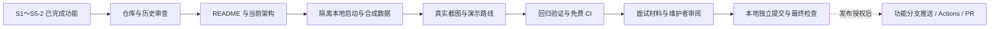

# OfferPilot 作品集路线图

更新：2026-10-18。以 GitHub 阅读、开发者本地复现和技术面试为交付目标，不安排公网运营。完整当前计划见 [PLAN](PLAN.md)，旧路线图原文见 [历史存档](roadmap-history.md)。

| 阶段 | 目标 | 交付依据 |
|---|---|---|
| 已完成 S1～S5-2 | 保留身份、文件、画像、抽取、职位、匹配、投递、工作台、PG、导出/注销 | [文档索引](INDEX.md)中的验收报告 |
| 作品集本轮 | 规范化、README、启动脚本、合成演示、测试入口/CI、讲解材料 | [本轮验收](PORTFOLIO-acceptance.md) |
| 最终本地整理 | S5-2 / 作品集 / 发布前修复分别提交，保留历史 | [发布检查表](GITHUB-RELEASE-CHECKLIST.md) |
| 发布授权后 | 确认许可与身份、普通分支推送、真实 Actions、PR 合入 main | 维护者明确决定，远程操作当前未执行 |
| 后续维护 | 按复现与面试反馈做小幅修复，扩大免费反例覆盖 | 不承诺新产品功能或付费评测 |

当前取消公网云部署、域名备案、大规模容量、复杂生产监控、多节点高可用、商业化隐私政策建设和线上试点。不降低现有数据隔离、安全测试、必要来源许可及 PyMuPDF 许可标准。Browser Agent、抓取、DOCX/OCR、通知和简历建议没有实施，不属于本轮交付。
