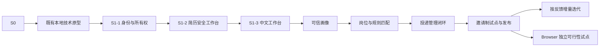

# OfferPilot 开发路线图

**版本：** 1.3（S5-1 PostgreSQL 本地集成）
**日期：** 2026-10-17

> **当前 S5-1（2026-10-16～17）：** 仅 PostgreSQL 本地适配、旧迁移/合成历史升级、事务并发、真实 HTTP/Chromium、规模查询和隔离恢复验收，详见 [S5-1 验收](S5-1-acceptance.md)。S4-2 有效内容先保存为本地检查点 `0526b7b`，在 `codex/s5-1-postgresql` 工作；不修改真实开发/生产库，不调用付费模型，不推送或部署。完成后停止，账户导出/注销 S5-2 与生产恢复策略 S5-3 均未开始。下文旧批次停止点保留为历史。

> **当前 S4-2：** 基于已验收 S4-1 提交 `237272a`，在 `codex/s4-2-workbench` 完成真实待办聚合、申请概览、待处理岗位、近期活动、非阻塞引导及完整 MVP 旅程验收；具体实测见 [S4-2 验收](S4-2-acceptance.md)。没有新增持久化结构、模型调用、抓取、自动申请或通知派发。完成后停止，不自动进入 S5；PostgreSQL、生产容量、导出/注销、安全隐私、真实用户试点与备份恢复监控均仍为发布条件。下文旧批次停止点为历史。

> **本轮执行 S3-2：** 复用已验收的私有职位/JD 审核和正式画像，实现确定性四态规则、证据化中文解释、持久历史与 revision 失效、最小独立偏好和真实本地验收。实际交付以 [S3-2 验收](S3-2-acceptance.md) 为准。历史 S2/S3-1 范围保留为当时记录；本轮不调用模型、不抓取、不部署或推送，完成后立即停止，不进入 S4/Browser。

> **2026-10-14 后续单样本真实验收：** 已在用户受限授权下完成 `normal_chinese.synthetic.pdf` 唯一一次真实 DeepSeek 请求；5项候选全部 pending，正式画像四组为空，非空字段19/19、定位21/21、归属19/19，usage为1107/781 tokens。详见 [单样本质量报告](S2-2B-single-real-evaluation-2026-10-14.md)。下文准备阶段的“真实调用0次”为历史基线；否定/计划、多经历及其余四份未验收，生产和供应商阻塞不变，不进入S3。

## 1. 交付策略

先完成可信的画像与岗位决策闭环，再开放浏览器辅助。首批为中国大陆计算机/软件方向的邀请制用户，模型采用会话 BYOK。每个里程碑都交付真实可验证的能力；首发闭环为文本 PDF → 确认画像 → 粘贴 JD/手动录入 → 规则匹配 → 保存职位 → 手动管理投递状态和下一步。DOCX、OCR、岗位抓取、简历重写、主动提醒和 Browser Agent 不作为首发发布门槛。

总体分析见 [PLAN.md](PLAN.md)，产品边界见 [PRD.md](PRD.md)。下列技术、容量和质量方案若尚无实测证据，均为建议或待决策，不代表已实现。大陆部署、PyMuPDF AGPL 路线仍需验证具体合规与许可适用；云厂商、数据库版本、队列方案、费用、数据保留期限及试点质量阈值不能由计划默认为已批准。

**历史 S2-2B 批次执行边界：** 用户授权S2-2B真实集成代码、会话BYOK、独立授权/预算和中文页面，并禁止Codex自行收费。允许范围免费验收完成，真实调用0次、真实模型质量待验收；生产关闭。见 [S2-2B验收](S2-2B-acceptance.md)。完成后停止，不进入S3/Browser，不部署或迁移实际数据库。

**本轮追加准备：** 核对当前官方接口/协议并最小修复 Provider 和 Prompt，固定五份合成评测白名单，免费验证 SDK 协议、故障和权限门槛。结果见 [正式模型验收准备](S2-2B-readiness-review.md)。下一步仅可在负责人后续明确提供授权记录、调用上限和预算后，先做一份本机合成真实评测；是否继续由负责人重新决定。第三方 BYOK 与真实个人数据仍受供应商许可/训练保留等发布阻塞限制；不自动推进 S2-3/S3。

## 2. 里程碑

### S0：产品与工程准备（原 M0）

**交付：** PRD、总计划、架构、数据库、开发规则；确认邀请制、大陆方向、首批 CS 用户、会话 BYOK；补充身份方案、模型供应商数据策略、部署方案和试点招募方式。首发来源为用户粘贴/手动输入，暂不选择抓取连接器。

**验收：** P0 流程和不做事项经团队评审；来源许可和个人数据处理策略有明确责任人；确定试点指标及数据删除/导出要求。

### Phase 0 ～ Phase 1-3：已存在的本地技术原型

**已有能力：** 基础目录、Python 3.11 后端包、FastAPI 与健康检查、Pydantic Settings、SQLAlchemy + SQLite、依赖锁文件；简历/画像/事实三表和初始迁移；开发环境文本 PDF 上传/文本提取；四字段内存抽取核心、DeepSeek Provider、离线评测脚本和 Mock 测试。完整审查证据及当时验证结果见总计划。

**范围边界（S1-1 前基线）：** 原型中的 PDF 上传只在 development 开放，抽取核心未接入 API 或持久化，尚无身份隔离、前端或求职闭环。S1-1 后端身份与归属已验收如下；原型仍不能向真实用户宣称已可用。

**现有验证入口：** `/health`、上传/模型/抽取单元测试及离线评测脚本。自动检查使用合成样本/Fake Provider，不发起付费模型调用；真实评测需单独授权。

### S1：账户与简历安全工作台（原 M1，按独立验收批次）

#### S1-1：身份与数据所有权（已验收）

**目标与模块：** 在现有 FastAPI/SQLAlchemy 骨架中建立邀请制身份、会话和服务端用户上下文，并为 `profile`、`resume_ingestion` 的持久化资源落实归属与对象级授权。

**小批次：** ① 身份/API 契约与会话策略；② 用户归属的向前迁移及历史无归属数据隔离；③ 登录/退出/会话失效与既有上传入口授权；④ 两用户隔离、未登录访问、伪造资源标识和秘密脱敏验证。实现不得接受客户端 `user_id` 作为归属依据。

**前置依赖与交付：** 基于现有锁文件和三表模型；交付可用后端身份路径、授权后的上传和可重复安全测试。保留本地 SQLite 验证环境，不为这一批同时引入前端、PostgreSQL、Redis、Worker、对象存储或 AI。

**验收与 DoD：** 受邀用户可以获得/撤销会话；未登录访问受保护入口被拒绝；新上传记录只归属当前服务端用户，画像/事实不能跨用户关联；客户端伪造归属无效；旧无归属记录不能被首个注册用户继承；测试使用临时数据库，不执行开发数据库迁移；错误及日志不泄露凭据。必须报告实际测试结果，不能据此宣称已完成私有文件下载、导出/删除或公网发布。

**风险与难度：** 中高；重点是会话、对象级授权、历史数据处理与 SQLite 外键行为。邀请制并不替代认证/授权，也不意味着公网合规问题已经解决。

**实际完成（2026-10-11）：** 新身份模块、四张身份表、nullable resume owner、新迁移、邀请 CLI、认证/CSRF API、授权后的双上传入口与简历/画像/事实访问、元数据改名均已实现。隔离回归 **58/58 通过**：21 认证、6 迁移、11 所有权、5 既有上传、14 既有抽取、1 既有模型测试。覆盖两用户、匿名、伪造 ID、会话注销/过期/旋转、NULL 历史数据、并发邀请与限流、秘密保护；不以 Fake 身份代替业务逻辑。没有迁移实际数据库、调用付费 API、推送或部署。S1-2/S2 未实施，具体文件/API/边界见 README 和 PLAN。

#### S1-2：私有简历文件生命周期（已验收）

**目标与模块：** 在 S1-1 基础上只交付后端用户简历列表/详情、私有原件下载、文件/正文/候选数据删除、清理状态与有界恢复；仍只支持文本 PDF，复用 resume_ingestion/Service/Storage/SQLAlchemy。

**小批次：** ① 本地 Storage Adapter 和服务端对象元信息；② 向前迁移与上传前持久记录/补偿；③ 本人原件下载及安全附件名；④ 删除意图/物理删除/最终完成与恢复 CLI；⑤ 双用户、NULL-owner、实际内容/清理、并发/中断/事务故障测试和真实 localhost HTTP。

**前置依赖与交付：** S1-1 真实身份及归属已验收；交付可运行后端、0003、私有本地 Adapter、操作说明和自动化/HTTP 测试。不引入云 SDK、Celery/Redis，不开放 AI。

**验收与 DoD：** A 下载得到上传原始字节；B/匿名/NULL-owner 无法访问；删除清实际 PDF/part/claim、raw_text、Profile/Fact，其他简历保留；失败 503 可查询恢复，完成才 204，重复和迟到不复活；新迁移保留旧数据；原 58 项继续通过；HTTP 服务、句柄、DB 和临时目录确实退出清理。实际结果见 PLAN 实施记录。

**风险与难度：** 中高；文件/数据库不原子、创建证明冲突、Windows 锁、SQLite IO 写锁。恢复为显式有限批次，证明损坏需人工核对；保留/备份限制与生产容量仍待验证。

#### S1-3：中文 Web 工作台（已验收）

**范围：** 用户明确选择本批只开发 Web，不把原计划中的账户导出/注销混入 S1-3。Next.js/TypeScript、Tailwind、Radix、Lucide、OpenAPI 生成客户端接入真实邀请登录和 PDF 文件 API；工作台、列表、详情与账户菜单均有实际操作。

**验收：** 注册→登录→上传→刷新/重登录→改名→字节一致下载→实际删除→退出；双账户/匿名/CSRF 边界；409/429/503 和服务关闭；1440/768/390 页面、键盘弹窗及截图。具体通过/失败/未执行以 PLAN 和 [S1-3 验收](S1-3-acceptance.md) 为准，不将文本解析或文件保存包装成 AI 画像。

**账户生命周期仍属 S1 后续：** 本人导出/注销、最小记录保留与备份删除重放须上线前独立批准及验收。生产容量、解析隔离、私有目录 ACL 和 HTTPS 仍属后续，不因页面接通而自动完成。

### S2：可信画像确认（原 M2）

#### S2-1：用户画像与事实确认基础（已验收）

**交付：** 每用户唯一正式画像，教育/技能/项目/实习工作结构、未知可保存、逐字段来源、候选 pending/confirmed/modified/rejected、原值确认与用户修订区别、revision CAS、简历删除证据清理、中文资料页及隔离测试。新增0004保留0001～0003和历史派生数据，旧候选不自动成为正式资料。

**验收：** 真实数据库的手工录入→保存→刷新/重登录→继续编辑；已有候选审核与证据；双用户/CSRF/伪造ID、409并发、删除来源但保留手工/确认值；原125后端与S1前端不回归；1440/768/390 Chromium截图。不新增依赖、队列或模型调用。

#### S2-2A：可信简历抽取流水线（本批，仅 Mock）

**交付：** 严格结构化 V2、服务端页段/字段归属、否定/计划/冲突保守验证、合成样本 Mock Adapter、0005 持久运行/调用额度、DB 领取/租约及原子 pending 入库，复用 S2-1 review/revision。默认关闭，隔离 UI 明示测试来源。

**验收：** 合成中文 PDF → 主动创建 → Mock → Schema/证据 → 候选落库 → 用户确认/修改/拒绝 → 同一正式画像；之前正式值保持为空。包含多经历/日期/别名/否定/注入、无效输出、幂等/双用户/并发、取消/删除/旧版本迟到、进程中断/租约恢复、事务故障和前后端回归。字段级评测仅说明合成流水线行为，不代表真实模型质量。

**边界：** 无网络/付费调用、Key/BYOK、生产数据库变更、推送或部署；不新增队列依赖。完成 S2-2A 即停止。

#### S2-2B/S2-3：真实抽取及相关运行能力（S2-2B本地免费验收完成，真实调用待验收）

**S2-2B实际进展：** 官方Adapter/V2/证据与候选链复用，单进程限时Fernet BYOK、十分钟预览、显式一次授权、调用前计数/未知费用、中文选择/状态/审核与0006已实现；免费回归见验收。仍缺供应商许可/保留/训练配置、授权后的真实网络/质量验证，以及正式部署加固。本轮不自动实施S2-3或S3。

**以下保留原目标条件供后续评审，不作为本批已实现声明。**

**缺少条件：** 会话 BYOK、最小发送预览、供应商数据配置和真实调用许可；真实网络请求的隔离/费用不确定性、会话失效及故障边界；多样授权标注集与真实 DeepSeek 字段/证据/归属质量验证。V2 和持久任务已有本批 Mock 基础，但不能据此宣称真实供应商已接通或质量达标。

**交付：** 复用文本 PDF 与现有 Provider，建立版本化运行状态、候选事实持久化、证据位置、编辑/确认/拒绝和手动补充；扩充匹配所需的结构化教育、毕业时间与经历字段。会话 BYOK 不持久化，未提供有效密钥时不调用付费模型，不使用开发者密钥回退。

**依赖与小批次：** S1；运行/候选 Schema 与迁移 → 有界处理/幂等/重试 → 确认 API → 证据审核页面 → 模型失败及手动录入降级。任务运行器和队列方案在需要时验证，Celery/Redis 是原架构候选，不是本轮已经批准的新依赖。

**验收：** 支持文件类型和失败路径清楚；用户能找到每项抽取证据并修正；未经用户确认的字段不会成为已确认事实；删除任务覆盖原件和派生数据。

**DoD/风险：** 重试、刷新或重复任务不会覆盖已确认事实或重复造数据；可取消且有步数、时长、调用与重试上限。难度高，主要风险为证据错误、结构差异、BYOK 生命周期和个人数据发送配置；真实模型评测需单独授权。

### S3：岗位导入、JD 分析与规则匹配（原 M3）

**交付：** 粘贴 JD/手动录入、仅保存来源链接；用户私有岗位快照、必须/优先条件审核、规则匹配、证据化解释与反馈入口。不自动访问链接、不引入共享岗位库或招聘站连接器。

**依赖与小批次：** S2 已确认事实与画像 revision；JD Schema/证据 → 岗位导入和校正 → 硬条件/技能/偏好规则 → 匹配详情与收藏 → 未知/冲突/届次金标准案例。

**验收：** 明确区分满足/部分满足/无证据/不满足；未知条件不被伪装成负面事实；匹配解释引用画像和 JD；来源、时间和更新状态可见。

**DoD/风险：** 结果按画像、JD 与规则版本可复算；首发不显示任意 0–100 总分，不让模型改变判定；关键未知项有可执行的核实提示。难度高，重点是校招资格语义和避免假精确。

### S4：投递管理与 MVP 完整闭环（原 M4 的首发部分）

前置 S3-2 及 S4-1 均已本地验收，S4-1 基线为后端 531/531、前端 99/99、Chromium 29/29，见 [S4-1 验收](S4-1-acceptance.md)。S4-2 本轮复用其对象级授权、revision/幂等、追加时间线和 UTC/上海日期语义，交付有界行动工作台及全链真实后端验收，结果见 [S4-2 验收](S4-2-acceptance.md)。功能闭环本地验收与生产发布是不同门槛；S5 需要后续授权。

**交付：** 收藏职位、手动申请状态、时间线、备注、下一步时间和工作台行动列表。首发不依赖简历建议、后台通知派发或复杂看板。

**依赖与小批次：** S3；状态/事件契约与迁移 → 保存和重复保护 → 投递列表/详情 → 今日/逾期/近期工作台 → 从登录到保存岗位和下一步的真实 E2E。

**验收与 DoD：** 新用户完成 PDF→确认→JD→匹配→保存→更新状态，刷新/重登录后保留结果；状态修正留记录，UTC 存储和 Asia/Shanghai 展示一致，收藏不会伪造投递，Offer 不会伪造接受。难度中，风险为录入负担、空状态和时区错误。

### S5：邀请制试点、质量改进与发布（原 M6，提前于 Browser）

**交付：** 少量 CS 学生/初级求职者试点、质量评审、错误反馈闭环、成本与延迟观测、备份恢复演练、隐私流程审查、发布/回滚手册。

**依赖与小批次：** S4 的真实闭环；确认大陆部署及模型数据配置、许可/政策适用 → 最小可维护的部署与 CI → 权限/删除/秘密/预算演练 → 备份恢复/回滚 → 招募和反馈。托管 PostgreSQL、私有对象存储、HTTPS 和容器化是建议方向，具体版本、厂商、容量、费用及期限均需验证。

**验收与 DoD：** 满足 PRD 的零越权/零未授权提交护栏，关闭高优先级缺陷；用户能自行完成闭环，质量、激活、留存与时延数值按授权试点实测校准。无 BYOK 或会话失效不付费调用，日志与监控不含个人正文和秘密，具备模型不可用/积压/删除失败排障路径。

**风险与难度：** 高；许可合规、真实格式差异、模型体验、BYOK 用户负担、费用和个人开发者运维能力。邀请制不免除数据处理义务。

### S6：按用户价值验证的增量功能（原 M4 的后续部分及 P1）

**交付候选：** 岗位内定向简历建议、可编辑复制的真实经历表达、简历版本/差异、应用内提醒、面试准备、DOCX/OCR。每次只选择一个有试点证据的功能，不把候选列表承诺为同时交付。

**依赖/验收/DoD：** S5 反馈及独立评测；建议全部引用 JD 与确认事实、绝不造数字或经历；提醒独立验证幂等/时区/暂停；格式扩展独立验证失败路径。风险与难度按功能评估，中至高。

### S7：受控 Browser Agent 独立可行性试点（原 M5）

**交付：** 独立隔离 Browser Runner、一个允许测试的招聘站点适配器、字段映射预览、逐页确认/暂停/停止、会话过期和审计记录。

**依赖与小批次：** S5 核心价值已经验证、站点许可及适用政策已审核；先测试表单上的窄权限工具 → 来源/字段预览 → 声明/敏感字段/页面变化暂停 → 隔离/终止清理 → 单站点停用开关。无明确允许的站点时不进入真实站点适配。

**验收：** 凭据由用户自行输入，不持久化；站点/页面变化时失败关闭；未知字段不自动填写；页面声明和最终提交都由用户处理；没有任何 Agent 提交工具；可终止并清理会话。

**DoD/风险：** 模型和 Agent 在工具权限层不能提交、签署声明或接受 Offer；异常时明确停止，恢复前重新校验页面和已有填充值。难度很高，站点变化及授权边界可能使该功能不值得维护，可独立取消而不影响 MVP。

## 3. 工作流依赖

S7 不作为 S5 的发布门槛。S1–S4 形成可用求职闭环，再以 S5 验证真实用户价值；通知、简历建议和浏览器辅助各自独立发布。原架构与数据库文件中的高级设计保留为目标方案，不表示本轮全部实施。

## 4. 需要尽早验证的风险

| 风险 | 验证方式 | 决策点 |
|---|---|---|
| 简历格式差异导致字段误抽 | 用脱敏并获授权的多样样本测字段精确率、证据定位和人工修正成本 | 首发只支持文本 PDF；DOCX/OCR 按反馈决定 |
| 匹配分数造成虚假确定感 | 与学生和职业顾问评审解释；观察不同专业/年级的反馈 | 首发不显示总分；后续是否需要透明维度分数 |
| 岗位来源许可与数据新鲜度 | 首发显示用户输入来源/时间；后续连接器逐个审核条款与更新策略 | 首发不抓取；后续连接器是否值得引入 |
| Browser Agent 页面易变且含恶意内容 | 使用隔离测试站点和少量允许站点验证字段检测、暂停和清理 | 每站点支持范围及停用条件 |
| 简历及网申信息泄露 | 数据流盘点、供应商处理条款审查、访问/删除演练 | 可用模型、部署区域、保留配置 |
| AI 成本和延迟不可控 | 记录每条任务 token/耗时/重试和失败类别，设置预算与缓存策略 | 会话 BYOK 已确认；具体额度/成本/时延阈值待验证 |
| BYOK 影响新用户完成率 | 观察密钥提供、会话失效和手动降级的阻塞情况，不收集密钥到反馈 | 用户能否完成闭环；是否需调整未来付费模式 |
| PyMuPDF 许可与大陆部署适用 | AGPL 方向保留，验证源码提供义务、依赖边界、供应商数据条款与部署要求 | 具体许可/备案/隐私方案，不能凭邀请制推断已合规 |

## 5. 团队交付节奏建议

- 每个里程碑先写可验证的用户场景和接口/数据契约，再实现垂直切片。
- 每周演示真实流程，优先观察用户是否理解证据和“未知”状态。
- 对 LLM 结果保留版本化离线评测样本；线上只采集必要的脱敏反馈。
- Browser Agent 独立发布开关和站点白名单；任一站点适配异常可单独停用。
- 首发上线前完成数据导出/删除、任务积压、模型不可用、会话 BYOK 失效和备份恢复演练；后续连接器与 Browser Agent 发布前增加来源失效和浏览器中断演练。
